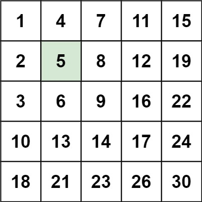

# 240. 搜索二维矩阵 II

编写一个高效的算法来搜索 m x n 矩阵 matrix 中的一个目标值 target 。该矩阵具有以下特性：

每行的元素从左到右升序排列。
每列的元素从上到下升序排列。



## 难点

1. 二分模板的使用和理解

2. 明确范围 逐行二分

## 思路

1. 因为 给的数值 是有序的，因此我们可以直接想到 ==二分==

2. 但是需要注意的是，第一列 不一定 第二列，因此需要考虑 ==逐行进行二分==

## Code

```go
func find(matrix []int, target int) int {
    l, r := 0, len(matrix) - 1
    for l < r {
        mid := (l + r + 1) >> 1
        if matrix[mid] > target {
            r = mid - 1
        }else {
            l = mid  // 答案在 <= 的这边
        }
    }
    return l
}
func searchMatrix(matrix [][]int, target int) bool {
    for i := 0 ; i < len(matrix) ; i ++ {
        col := find(matrix[i], target)
        if col >= 0 && matrix[i][col] == target {
            return true
        }
    }
    return false
}
```
