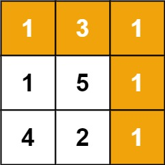

# 线性 Dp

以 ==递推== 的形式 求解对应的问题

## 不同路径

一个机器人位于一个 `m x n `网格的左上角 （起始点在下图中标记为 “Start” ）。

机器人每次只能向下或者向右移动一步。机器人试图达到网格的右下角（在下图中标记为 “Finish” ）。

问总共有多少条不同的路径？

[62.不同路径题目链接](https://leetcode.cn/problems/unique-paths/description/)


### 思路

对于 向右走 和 向下走的 状态 , 我们可以简单的想到一个方程

`dp[i][j] = dp[i-1][j] + dp[i][j-1]` 即 ==当前的值 等于上面的值+左边的值==

因此这题的一个简单版本就出来了，我们只需要设置 `dp[0][0] = 1` 即可

### 优化思路

由于我们考虑当前的 `dp[i][j]` 我们发现 ==我们永远只用了上一层的状态 即 dp[i-1]==

因此我们考虑 `dp[j]`, 当我们枚举到 `j` 的时候, `dp[j] = dp[j-1] + dp[j]`

因为 `dp[j-1]` 已经被更新过了相当于是 `dp[i][j-1]` 而 `dp[j]` 还没有更新相当于是 `dp[i-1][j-1]`

### Code

```go
func uniquePaths(m int, n int) int {
    dp := make([]int, n)
    dp[0] = 1
    for range m {
        for  j  := 1 ; j < n; j ++ {
            dp[j] = dp[j-1] + dp[j]
        }
    }
    return dp[n-1]
}
```

## 最小路径和

给定一个包含非负整数的 `m x n` 网格 `grid` ，请找出一条从左上角到右下角的路径，使得路径上的数字总和为最小。

说明：每次只能向下或者向右移动一步。

[64.最小路径和](https://leetcode.cn/problems/minimum-path-sum/description/)

{.small}

### 思路

同样的，我们无非是把状态方程 从==原来的单纯累加变成了 计算权重==

`dp[i][j] = min(dp[i-1][j], dp[i][j-1]) + a[i][j]`

这里 ==优化到一维== 需要注意 初始化

1. 初始化 `dp[0] = a[0][0]`

2. 从 `[0,0]` 开始转移, 先初始化第一行 `dp[i] = dp[i-1] + a[0][i]`

3. 然后枚举计算的时候 ，分别初始第一列 `dp[0] += a[i][0]`

### Code

```go
func minPathSum(grid [][]int) int {
    // dp[i][j] = min(dp[i-1][j], dp[i][j - 1]) + grid[i][j]
    m := len(grid[0])

    dp := make([]int , m)
    dp[0] = grid[0][0]

    for j := 1; j < m; j++ {
        dp[j] = dp[j-1] + grid[0][j]
    }

    for i := 1 ; i < len(grid) ; i ++ {
        dp[0] += grid[i][0]
        for j := 1 ; j < len(grid[i]) ; j ++ {
            dp[j] = min(dp[j], dp[j - 1]) + grid[i][j]
        }
    }
    return dp[m - 1]
}
```

## 爬楼梯

假设你正在爬楼梯。需要 `n` 阶你才能到达楼顶。

每次你可以爬 `1` 或 `2` 个台阶。你有多少种不同的方法可以爬到楼顶呢？

[70.爬楼梯题目链接](https://leetcode.cn/problems/climbing-stairs/description/)

### 思路

同样我们根据上面几个题的惯性思考，也能很简单的想到

`dp[n] = dp[n-1] + dp[n-2]`

我们初始化 `dp[0],dp[1] = 1,1`即可

### Code

```go
func climbStairs(n int) int {
    if n <= 1 {
        return 1
    }
    dp := make([]int, n + 1)
    dp[0], dp[1] = 1,1
    for i := 2  ; i <= n ; i ++ {
        dp[i] = dp[i-1] + dp[i-2]
    }
    return dp[n]
}
```
