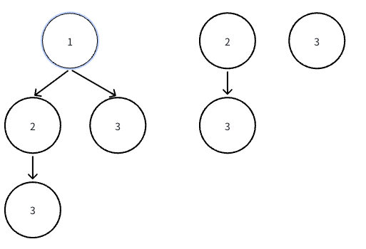

# 子集

## LeetCode 78.子集

[题目链接](https://leetcode.cn/problems/subsets/?envType=study-plan-v2&envId=top-100-liked)

给定一个数组 `nums`

给你一个整数数组 `nums` ，数组中的元素 互不相同 。返回该数组所有可能的子集（幂集）。

解集 不能 包含重复的子集。你可以按 任意顺序 返回解集。

示例 1：

> 输入：`nums = [1,2,3]`
> 输出：`[[],[1],[2],[1,2],[3],[1,3],[2,3],[1,2,3]]`

### 思路

1. 我们在求全排列的时候 通过 ==st[]== 数组表示取过哪个数

2. 同时每一层我们都从 ==`for i := 0 ; i < n ; i ++ `== 进行判断取数

3. 由此再次基础上，我们考虑 ==已经用过的数，我们不能在用==, 因此

   - 我们将 `i = index` 开始 并且 `dfs(i)` 即保证我们使用过的数 将不会再被使用
   - 当我们在 ==回溯== 的时候直接进行统计答案



### Code

```go
var (
    res [][]int
    st []bool
)

func dfs(index int, nums[]int ){
    for i := index ; i < len(nums) ; i ++ {
        if !st[i] {
            st[i] = true
            dfs(i + 1, nums)
            st[i] = false
        }
    }
    temp := make([]int,0)
    for i := 0 ; i < len(nums) ; i ++ {
        if st[i] {
            temp = append(temp, nums[i])
        }
    }
    res = append(res, temp)
}
func subsets(nums []int) [][]int {
    st = make([]bool,len(nums))
    res = make([][]int, 0)
    dfs(0 , nums)
    return res
}
```
