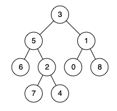

# 定义

`对于有根树 T 的两个节点 p、q，最近公共祖先表示为一个节点 x，满足 x 是 p、q 的祖先且 x 的深度尽可能大（一个节点也可以是它自己的祖先）。`

对于 询问 `5` 和 `1` 的 LCA 就是 `3`



## 求解方法

1. 我们先进行递归

2. 考虑当前节点 ，如果当前节点是 `p` 或者 `q` 以及叶子节点 那么我们就返回

   - `p` 和 `q` 都不需要额外继续往下找

3. 继续考虑当前节点

   - 如果当前节点 的 左右子树 都有返回， 即 在左右子树中找到了 `p` 和 `q` 那么说明当前节点就是 `LCA`
   - 否则只返回了左子树 那么就在左子树中
   - 否则就在右子树中

## Code

```go
func lowestCommonAncestor(root, p, q *TreeNode) *TreeNode {
  if root == nil || root == p || root == q {
        return root
  }
  left :=  lowestCommonAncestor(root.Left,p,q)
  right := lowestCommonAncestor(root.Right,p,q)
  if left != nil && right != nil {
    return root
  }

  if left != nil {
    return left
  }
  return right
}
```
