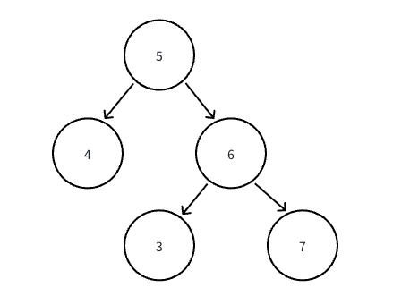

# 含义

树的中序遍历 : ==**左根右**==

1. 对于下图 预计输出 `[4,5,3,6,7]`

2. 对于中序遍历 优先返回 ==左节点，其实是根节点，然后是右节点==



## 算法思路

1. 我们在递归的递归的时候，优先递归左节点

2. 左节点走完之后，那么将当前节点放入到我们的队列中

3. 然后尝试走右节点，==右节点会在下次继续遍历的时候走完==

## Code

```go
func dfs(u *TreeNode, res []int) []int {
    if u == nil {
        return res
    }
    res = dfs(u.Left, res)
    res = append(res, u.Val)
    res = dfs(u.Right, res)
    return res
}

func inorderTraversal(root *TreeNode) []int {
    return dfs(root, make([]int,0,10))
}
```

# 题目

## 98. 验证二叉搜索树

给你一个二叉树的根节点 root ，判断其是否是一个有效的二叉搜索树。

有效 二叉搜索树定义如下：

1. 节点的左子树只包含 严格小于 当前节点的数。
2. 节点的右子树只包含 严格大于 当前节点的数。
3. 所有左子树和右子树自身必须也是二叉搜索树。

### 思路

1. 获取这棵树的 ==**中序遍历**== 结果

2. 根据 中序遍历 的结果 判断一遍数组是 有序 不重复 那么就是二叉搜索树

### 错误的 Code

我这个 Code 的思路会出现

1. Left 跑完之后还会计入一次 Left

2. 并且 Left 如是叶子节点会爱会被记录一次

3. 没有记录根节点

```go
var list []int
 func dfs(node *TreeNode) {
     if node.Left  == nil   && node.Right == nil {
         list = append(list, node.Val)
         return
     }
     if node.Left != nil {
         dfs(node.Left)
         list = append(list,node.Left.Val)
     }

     if node.Right != nil {
         dfs(node.Right)
         list = append(list,node.Right.Val)
     }
 }
 func isValidBST(root *TreeNode) bool {
     list := make([]int,0)
     dfs(root)
     if len(list) == 1  {
         return true
     }
     for i := 1 ; i < len(list) ; i ++ {
         if list[i - 1] > list[i] {
             return false
         }
     }
     return true
 }
```

## 230. 二叉搜索树中第 K 小的元素

给定一个二叉搜索树的根节点 `root` ，和一个整数 `k` ，请你设计一个算法查找其中第 `k` 小的元素（k 从 1 开始计数）。

### 思路

1. 由于给定的是二叉搜索树，因此是满足 左根右的设定，即我们如果按照中序遍历来进行处理的话 会得到一个顺序数组

2. 因此我们只需要在遍历中序遍历的时候 同步记录是第几个即可

3. 当我们==左子树==枚举完之后，则代表当前这个节点是 第K个节点

### Code

```go
var ans int
func kthSmallest(root *TreeNode, k int) int {
    var dfs func(*TreeNode)
    dfs = func(node *TreeNode) {
        if node == nil  || k < 0 {
            return
        }

        dfs(node.Left)
        k --
        if k == 0 {
            ans = node.Val
        }
        dfs(node.Right)
    }
    dfs(root)
    return ans
}
```
