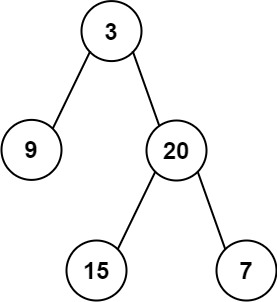
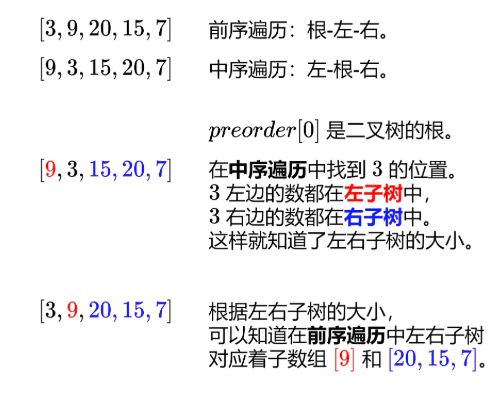

# 从前序中序构造二叉树

给定两个整数数组 preorder 和 inorder ，其中 preorder 是二叉树的先序遍历， inorder 是同一棵树的中序遍历，请构造二叉树并返回其根节点。



> 输入: preorder = [3,9,20,15,7], inorder = [9,3,15,20,7]
> 输出: [3,9,20,null,null,15,7]

## 思路

1. 我们知道构建一棵树 需要找到 ==根节点== 和 ==左右子树==

2. 通过先序遍历，我们可以找到根节点，即 ==根节点 = preorder[0]==

3. 根据根节点，寻找 中序遍历 中的位置，我们可以将树 分为左右两个子树

因此我们可以知道

`left = buildTree(preorder[1:1+left] , inorder[:left])` 含义就是 左子树 的数量，在前遍历中 和 在中序遍历中

`right = buildTree(preorder[1+left:], inorder[left+1:])` 含义就是 右子树 的数量，在前遍历中 和 在中序遍历中

后续我们就可以通过递归拆解子问题处理



## Code

```go
func buildTree(preorder []int, inorder []int) *TreeNode {
    n := len(preorder)
    if n == 0 {
        return nil
    }
    leftSize := slices.Index(inorder, preorder[0])
    left := buildTree(preorder[1:1+leftSize], inorder[:leftSize])
    right := buildTree(preorder[1+leftSize:], inorder[1+leftSize:])
    return &TreeNode{preorder[0], left, right}
}
```
