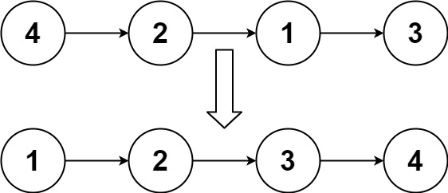

# 148. 链表排序

给你链表的头结点 `head` ，请将其按 **升序** 排列并返回 排序后的链表 。



## 思路

首先是 ==冒泡排序== 的思路

1. 冒泡排序的 关键在于 ==两两比较== ， 对于链表 我们可以 ==前一个和后一个== 进行比较

2. 交换的时候

- 交换前：pre → cur → next → rest

- 交换后：pre → next → cur → rest

这个方法是 `n^2` 的

我们可以考虑使用 ==归并排序== 的思路, 即 分治 的思想

1. 首先将 链表 二分成 两部分, 递归处理拆分 [876.链表的中间节点](https://leetcode.cn/problems/middle-of-the-linked-list/description/)

   - 拆分思路: 快慢指针，快指针比慢指针多走一倍 。 不过需要记录 `pre` 节点用于断开链接

2. 当我们递归到底部的时候，给链表进行 合并 [21.合并两个有序链表](https://leetcode.cn/problems/merge-two-sorted-lists/submissions/755677539/?envType=study-plan-v2&envId=top-100-liked)

   - 合并思路 : 双指针，每次合并的时候判断 将小的那一方放入链表中

3. 最终完成排序

## Code

```go

func mid(head *ListNode) *ListNode {
    pre, slow, fast := head, head, head
    for fast != nil && fast.Next != nil {
        pre = slow
        slow = slow.Next
        fast = fast.Next.Next
    }
    pre.Next = nil
    return slow
}

func merge(list1, list2 *ListNode) *ListNode {
    dummy := ListNode{}
    cur := &dummy
    for list1 != nil && list2 != nil {
        if list1.Val < list2.Val {
            cur.Next = list1
            list1 = list1.Next
        }else {
            cur.Next = list2
            list2 = list2.Next
        }
        cur = cur.Next
    }
    if list1 != nil {
        cur.Next = list1
    }else {
        cur.Next = list2
    }
    return dummy.Next
}

func sortList(head *ListNode) *ListNode {
    if head  == nil ||  head.Next == nil {
        return head
    }

    mh := mid(head)
    head = sortList(head)
    mh = sortList(mh)

    return merge(head, mh)
}
```
