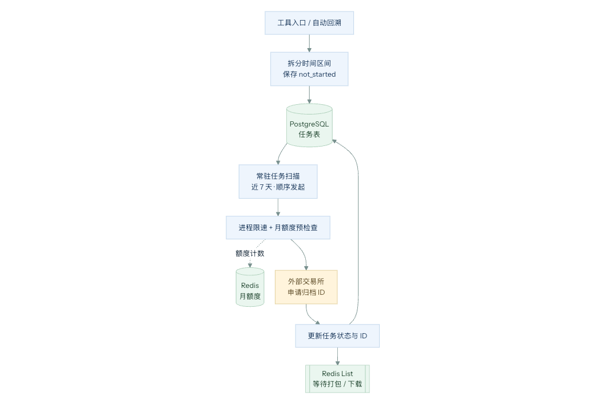
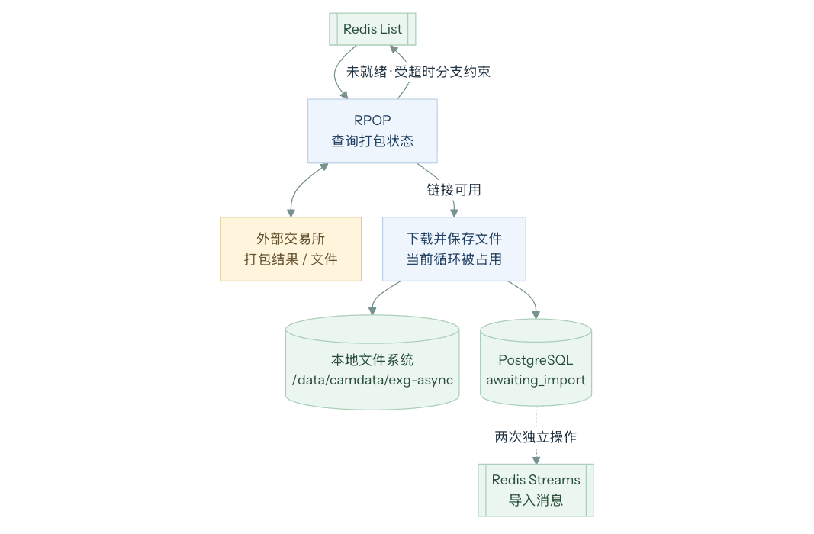
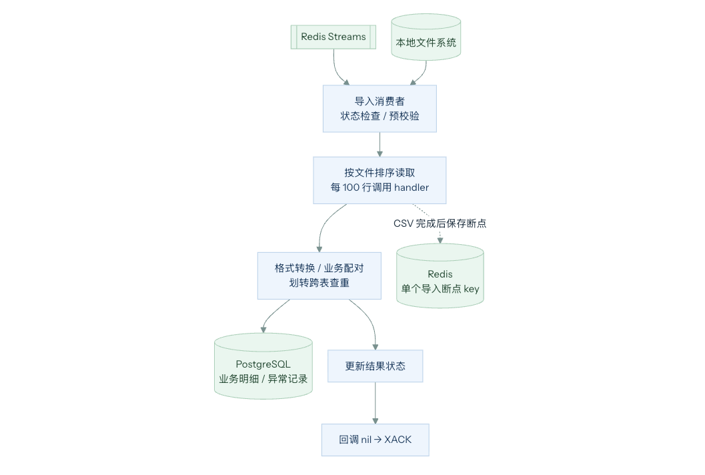

# 技术架构

根据业务需求中的根据 **交易所的异步流程**, 我们将开发设计成 3 块

1. **发起下载请求模块**: 关注下载任务入库、推送下载任务进任务队列、下载任务发起限流
2. **请求打包状态轮询模块**: 关注任务轮询、状态机推进、数据 ZIP 下载和存入本地
3. **数据处理入库模块**: 关注数据分批入库、幂等性保证 (数据中 可能出现 二合一的现象)、处理任务进度存储

## 发起下载请求



### 限流控制

对手方接口处有两处限流

1. **IP 限流**: 每分钟最多只能请求一次
2. **月额度限流**: 每个月一个账户最多只能发起 10 次下载请求, 并且请求和前端共用

对于 **IP 限流**

1. 考虑我们部署的方式 ==私有化部署==, 因此我们只考虑使用 进程级的 rate limiter

对于 **月额度限流**

1. 我们通过 Redis 记录对应的用户请求次数, 设置对应的 过期时间, 每次请求的时候优先判断 Redis 中是否有可用额度

引出问题:

1. 如果是多实例部署怎么办 ？

### 任务入库

因为我们发起任务的==权重很重==, 因此我们需要 优先保证 任务入库, 避免任务轮询时候丢失数据

1. 因此我们发起请求后 就会立马存入到数据库中 . 如果在途中出现了问题 那么会发对应的告警, 这时候 需要==人为干预==

2. 数据库中直接存放任务 MQ 信息

### 任务推送到任务队列

1. 我们数据入库之后 会立马发送到 任务队列中进行处理
2. 如果这里出现了问题, 会在下一次==进程重启== 的时候, 扫描一次数据库获取最近的还未开始的任务进行补发

引出问题:

1. 为什么要在进程重启的时候 ？ 如果想要快速补发任务怎么办 ？

## 请求打包轮询模块



### 任务轮询 & 下载 & 存入本地

1. 我们会顺序的根据每个任务 进行请求交易所 访问 URL 内容
2. 如果交易所准备好了 下载链接，我们会异步的进行下载，如果下载失败会重新丢回队列
3. 下载成功后 我们会把数据 放入本地机器的 tmp/ 目录下，有效期存放 30 天

### 状态推进

任务状态记录在 PostgreSQL 中。以 Binance 预建任务路径为例，使用代码中的真实状态名描述正常主线：

```text
not_started → packaging_data → downloading → awaiting_import → importing → succeed
```

1. **`not_started`（未开始）**：任务已保存，等待后台扫描并向交易所申请归档。
2. **`packaging_data`（打包中）**：已获取归档任务 ID，等待交易所准备文件。
3. **`downloading`（下载中）**：已获取下载链接，正在下载并保存文件。
4. **`awaiting_import`（待导入）**：文件已准备好，等待导入处理。
5. **`importing`（导入中）**：正在读取文件、转换业务记录并写入数据库。
6. **`succeed`（成功）**：当前任务处理完成；该状态本身不代表已经通过业务数据完整性核验。

这是一条便于讲述的正常路径，不是全部合法迁移。v2 直接请求入口可以从 `packaging_data` 开始；正常无数据时也可以直接结束，无须经过文件导入。

#### 异常、取消与部分成功状态

| 状态                        | 当前含义与恢复边界                                                                                 |
| --------------------------- | -------------------------------------------------------------------------------------------------- |
| `packaging_data_with_error` | Binance 查询打包信息报错后重新入队，仍属于处理中；后续入队受超时分支约束。                         |
| `packaging_failed`          | 发起或登记任务等环节失败；普通 `not_started` 扫描不会再选中该状态。                                |
| `download_failed`           | 下载失败，不同入口的恢复策略不同。上层回溯仍可能将其视为处理中，但这不能证明底层一定持续自动重试。 |
| `import_failed`             | 导入失败。多数业务错误记录失败状态后返回 `nil`，消息会被确认；需要明确后续恢复或人工重新导入方式。 |
| `partial_succeed`           | 部分成功，例如手工账单因已有记录而跳过；该状态不是所有质量问题的统一汇总。                         |
| `cancel_import`             | 用户取消待导入任务；当前导入回调的 `defer` 存在将取消状态覆盖为成功的缺陷。                        |
| `failed`                    | 通用失败状态，不能与各阶段失败状态混用；超过 30 天停止入队时，并非所有分支都会写入该状态。         |

## 数据入库阶段



### 分批入库 & 处理任务进度存储

1. 用户的数据可能有很多,一个 ZIP 里面有很多文件, 一个文件有很多行数据

2. 我们按照 文件进行顺序读取, 使用 Redis 记录每个文件是否完成, 保证重启时不会额外处理已经处理过的内容

### 幂等性保证

1. 大部分数据 例如成交数据、流水 数据我们都可以根据交易所返回的 数据唯一 id 设置对应的 业务唯一键，通过 Insert On Conflict Do nothing 来进行过滤

2. 少部分交易所那边也没有对应的唯一 id ，例如 划转记录，我们会批量的去查询 对应的划转表 查询同一时间，是否存在 from、to 双方都相同 并且金额 币种相同的情况 ， 如果存在则认为是重复的 不入库

3. 如果不存在 那么会考虑入库到 手工表里面，让人工去处理


