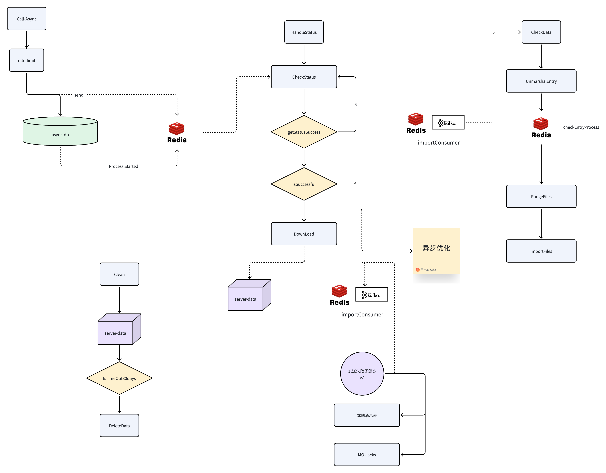

# 技术架构

根据业务需求中的根据 **交易所的异步流程**, 我们将开发设计成 3 块

1. **发起下载请求模块**: 关注下载任务入库、推送下载任务进任务队列、下载任务发起限流
2. **请求打包状态轮询模块**: 关注任务轮询、状态机推进、数据 ZIP 下载和存入本地
3. **数据处理入库模块**: 关注数据分批入库、幂等性保证 (数据中 可能出现 二合一的现象)、处理任务进度存储

## 发起下载请求

### 限流控制

对手方接口处有两处限流

1. **IP 限流**: 每分钟最多只能请求一次
2. **月额度限流**: 每个月一个账户最多只能发起 10 次下载请求, 并且请求和前端共用

对于 **IP 限流**

1. 考虑我们部署的方式 ==私有化部署==, 因此我们只考虑使用 进程级的 rate limiter

对于 **月额度限流**

1. 我们通过 Redis 记录对应的用户请求次数, 设置对应的 过期时间, 每次请求的时候优先判断 Redis 中是否有可用额度

引出问题:

1. 如果是多实例部署怎么办 ？

### 任务入库

因为我们发起任务的==权重很重==, 因此我们需要 优先保证 任务入库, 避免任务轮询时候丢失数据

1. 因此我们发起请求后 就会立马存入到数据库中 . 如果在途中出现了问题 那么会发对应的告警, 这时候 需要==人为干预==

2. 数据库中直接存放任务 MQ 信息

### 任务推送到任务队列

1. 我们数据入库之后 会立马发送到 任务队列中进行处理
2. 如果这里出现了问题, 会在下一次==进程重启== 的时候, 扫描一次数据库获取最近的还未开始的任务进行补发

引出问题:

1. 为什么要在进程重启的时候 ？ 如果想要快速补发任务怎么办 ？

## 请求打包轮询模块

### 任务轮询 & 下载 & 存入本地

1. 我们会顺序的根据每个任务 进行请求交易所 访问 URL 内容
2. 如果交易所准备好了 下载链接，我们会异步的进行下载，如果下载失败会重新丢回队列
3. 下载成功后 我们会把数据 放入本地机器的 tmp/ 目录下，有效期存放 30 天

### 状态推进

整个状态机流转大致分为

1. 发起请求阶段，任务状态为 Starting
2. 请求轮询阶段，任务状态为 Process，可能涉及 fail 的状态, 只有超出 30天请求的时候才会 fail
3. 下载中的阶段, 会变成 download 中,可能会失败，失败了会变成 download fail 但是会继续下载
4. 下载完成后 会推进变沉给 import 的状态

## 数据入库阶段

### 分批入库 & 处理任务进度存储

1. 用户的数据可能有很多,一个 ZIP 里面有很多文件, 一个文件有很多行数据

2. 我们按照 文件进行顺序读取, 使用 Redis 记录每个文件是否完成, 保证重启时不会额外处理已经处理过的内容

### 幂等性保证

1. 大部分数据 例如成交数据、流水 数据我们都可以根据交易所返回的 数据唯一 id 设置对应的 业务唯一键，通过 Insert On Conflict Do nothing 来进行过滤

2. 少部分交易所那边也没有对应的唯一 id ，例如 划转记录，我们会批量的去查询 对应的划转表 查询同一时间，是否存在 from、to 双方都相同 并且金额 币种相同的情况 ， 如果存在则认为是重复的 不入库

3. 如果不存在 那么会考虑入库到 手工表里面，让人工去处理

