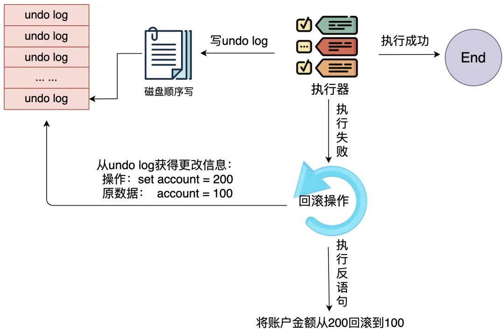

## 原子性

事务要么失败，要么成功，不能做一半。

InnoDB，在干活儿之前，先将要做的事情记录到一个叫 undo log 的日志文件中，如果失败了或者主动 rollback，就可以通过 undo log 的内容，将事务回滚。

那undo log里面具体记录了什么信息呢？

undo log属于逻辑日志，它记录的是sql执行相关的信息。当发生回滚时，InnoDB会根据undo log的内容做与之前相反的工作，使数据回到之前的状态。。。

