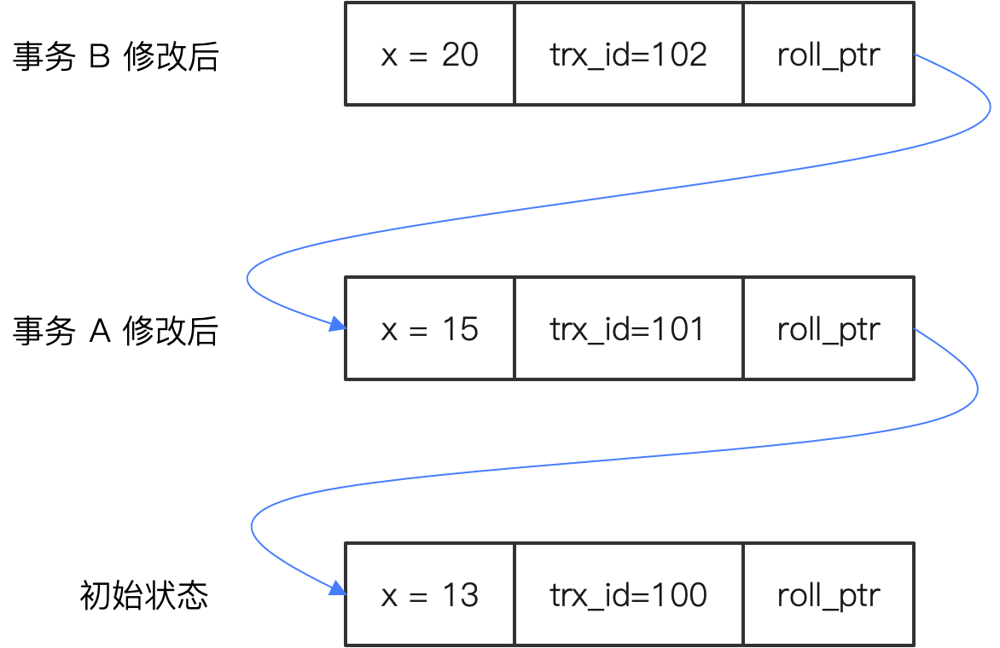

`MVCC` : `Multi-Version Concurrency Control` 全称 ==多版本并发控制==,是 MySQL 中 InnoDB 引擎使用的实现事务的底层机制，

多版本是==指每一条（具体到数据库中就是一行）都有很多版本==

- 有些是“稳定版”——也就是已经提交了的版本
- 有些是“不稳定版”，也就是你事务正在执行过程中出现的。

因此, MVCC 的关键点就是两个:

- 如何存储数据的不同版本

- 在执行事务的时候，如何确定这个事务应该使用哪个版本的数据。比如说 SELECT 的时候，应该读取的是哪个版本, 这一条其实对应的就是隔离级别。

# 如何存储数据的不同版本

我们先来看第一个存储不同版本的数据。MVCC 将数据的不同版本存储在 undo log 里面。undo log 是 MySQL 中和事务密切有关的概念，主要是用于在事务回滚的时候，能够将数据恢复到事务开始之前的状态。

在 undo log 里面使用版本链将数据不同的版本串联起来了，如下图：

{.small}

你可以注意到，上图里面 x 这一条数据有两个额外的列：==trx_id==，事务 ID，你可以认为它代表的就是版本；==roll_ptr==，回滚指针，实质上就是用它来将不同版本串联在了一起。

# 应该读取哪个版本的数据

那么当一个事务执行的时候，它在这么长的一个链条里面，就要考虑读数据应该读哪个版本了——也就是读哪个事务 ID 对应的数据。

这个过程是通过一个称为 Read View 的机制来实现的，它也就是 MySQL 中实现不同隔离级别的核心机制。

这里我们深入分析已提交读和可重复读。

- 对于已提交读来说，每次执行读数据的时候都会生成一个 Read View。

- 对于可重复读来说，在事务开始的时候生成一个 Read View，后面都用这个 Read View。
