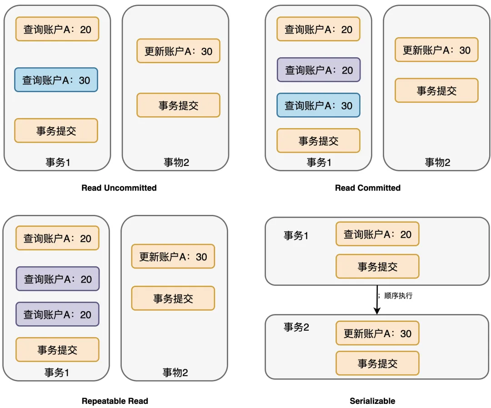

# 4类 隔离级别

四种级别 : 读未提交、读已提交、可重复读、串行化

读未提交: 顾名思义，就是可以读到还没有提交的数据；

读已提交: 会读到其它事务已经提交的数据；

可重复读: 同一事务中，读取同一条数据时，会看到同样的数据行；

串型化: 通过强制事务排序，使其不可能相互冲突。

## RR Repeatable Read

Repeatable Read 就是可重复读。它确保了在同一事务中，读取同一条数据时，会看到同样的数据行。
