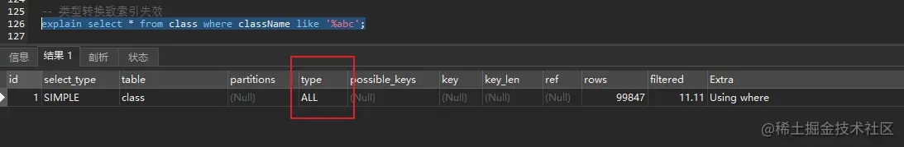
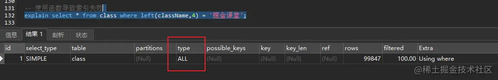
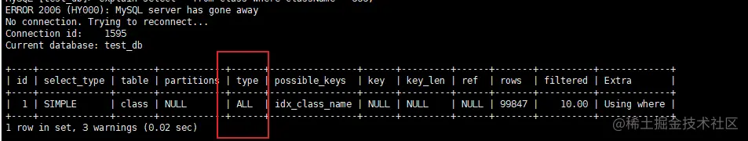

## 使用 左模糊 匹配查询

例如使用 `%abc` 进行查询

## 使用函数导致索引失效

这里的 `left` 使用 `className` 进行等值匹配

## 计算导致索引失效

1. 不应该在 索引字段 进行计算
2. 应该在参数那边计算完，在做匹配

## 类型转换

如下SQL进行了隐式类型转换将数值类型123转为字符类型123：

`explain select * from class where className = 666;`

## 联合索引最左匹配原则失效
