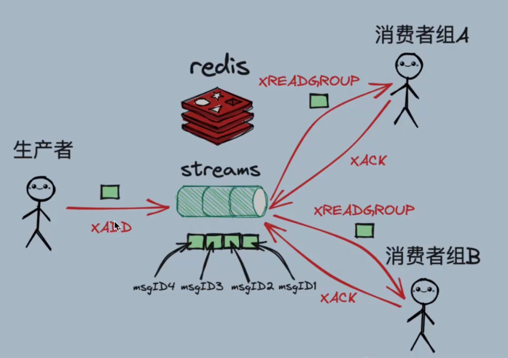

# 主要命令

`XADD`：向Stream中添加消息。如果指定的Stream不存在，则会自动创建。

`XREAD`：以阻塞/非阻塞方式获取Stream中的消息列表。

`XREADGROUP`：从消费者组中读取消息，支持阻塞读取。

`XACK`：确认消费者已经成功处理了消息。

`XGROUP`：用于管理消费者组，包括创建、设置ID、销毁消费者组等操作。

`XPENDING`：查询消费者组中的待处理消息。

## XADD 消息记录

XADD命令用于向Redis Stream（流）数据结构中添加消息。

XADD命令的语法如下：

`XADD stream_name [MAXLEN maxlen] [ID id] field1 value1 [field2 value2 ...]`

1. `stream_name`：指定要添加消息的 `Stream` 的名字

2. `MAXLEN maxlen`：可选参数，用于限制 `Stream` 的最大长度。当 `Stream` 的长度达到 `maxlen` 时，旧的消息会被自动删除。

3. `ID id`：可选参数，用于指定消息的ID。如果不指定该参数，`Redis` 会自动生成一个唯一的ID。

4. `field1 value1 [field2 value2 ...]`：消息的字段和值，消息的内容以 `key-value` 的形式存在。

### XADD 示例

假设我们有一个名为 `userinfo_stream`的Stream

并希望向其中添加一个包含 `sensor_id` 和 `temperature` 字段的消息，我们可以使用以下命令：

`XADD userinfo_stream * user_name brand age 18`

在这个例子中，*表示让Redis自动生成一个唯一的消息ID。消息包含两个字段：`username` 和 `age`，它们的值分别是 `brand` 和 `18`。

所以这边记录了一个用户信息，姓名为 `brand`， 年龄 `18岁`
