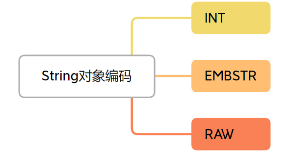
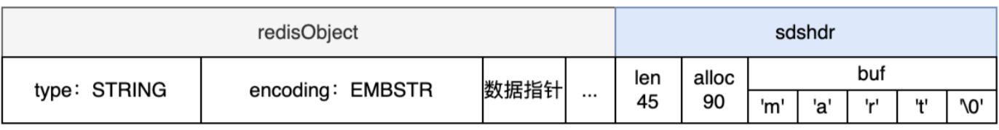
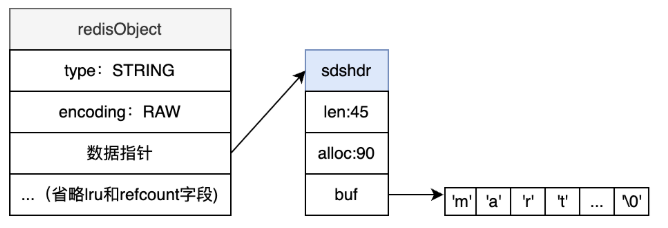

# 常用指令

```shell
SET KEY VALUE

GET KEY

MSET KEY1 VALUE1 KEY2 VALUE2

MGET KEY1 KEY2

INCR NUMBER

DECR NUMBER

# 不存在 就插入
SETNX KEY VALUE
```

# 应用场景

1. 缓存对象, 例如缓存 Info
2. 常规计数
3. 分布式锁

# 底层实现

底层实现分为 INT、EMBSTR、RAW 三种

INT: 可以用 LONG 表示的整数

EMBSTR : 字符串小于 阈值范围 就可以使用 EMBSTR 编码

RAW : 字符串大于阈值范围, 则使用 RAW 编码



EMBSTR 集合 redisObject + sds ，创建的时候一次性分配空间



RAW 根据对应的数据指针 指向对应的 SDS 结构

SDS 结构如下 :

1. 一个 len 字段 用于表示使用了多少
2. 一个 alloc 表示一共分配了多少内存
3. 以及对应的 buf 空间用于存储信息


