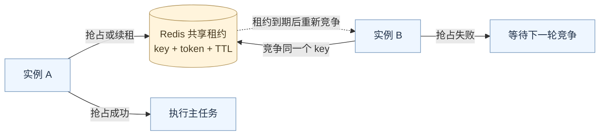

# 抢主实例

服务部署多个实例后，每个实例都会运行自己的代码。HTTP 请求可以分摊处理，但定时扫描、任务调度等工作往往只需要一个实例负责。让多个实例竞争这个职责，并在负责人失效后由其他实例接管，就是**主实例选取**。

主身份通常只控制指定任务，其他实例仍然可以处理各自的正常业务。

## 用 Redis 租约协调主身份

参与同一组选主的实例访问同一个 Redis key。这个 key 记录当前持有者，并设置有效期：

```text
key   = myapp:production:master
value = 当前实例的随机 token
TTL   = 40 秒
```

它是一把带有效期的分布式锁，也叫租约。选主就是通过竞争这把锁来确定当前负责人。



## 抢占、续租和接管

**抢占**使用 Redis 的原子命令：

```text
SET myapp:production:master token_A NX PX 40000
```

`NX` 表示 key 不存在时才允许写入，`PX 40000` 表示有效期为 40 秒。同一时刻竞争同一个 key，只有一个实例能写入成功。失败的实例等待一段时间后重试。

**续租**由主实例定期执行。例如每 10 秒续租一次，让有效期重新变成 40 秒。续租前必须确认 key 中的 token 仍然属于自己，再更新过期时间：

```lua
if redis.call("GET", KEYS[1]) == ARGV[1] then
    return redis.call("PEXPIRE", KEYS[1], ARGV[2])
end
return 0
```

Lua 保证检查和续租一起原子执行。否则在 `GET` 和续租之间，旧租约可能已经到期，新实例也可能已经抢占成功。

**接管**依赖租约到期：主实例崩溃后无法续租，Redis 自动使 key 失效，其他实例在下一轮竞争中获得主身份。因此接管有等待时间，取决于剩余租期和重试间隔。

## 为什么释放时也要检查 token

假设 A 的租约已经到期，B 抢占了同一个 key。此时 A 恢复运行，如果直接执行 `DEL key`，就会删除 B 的租约。

释放也需要 Lua 比较 token 后再删除：

```lua
if redis.call("GET", KEYS[1]) == ARGV[1] then
    return redis.call("DEL", KEYS[1])
end
return 0
```

token 应包含随机部分，并在每次启动选主循环时重新生成。它用于区分不同持有者和不同任期，避免旧实例误续租、误删新租约。

## 业务任务如何使用主身份

选主循环持续更新本地主状态，任务入口读取这个状态：

```go
if !elector.IsMaster() {
    return
}
runTask()
```

本地主状态需要线程安全。续租失败或本地租期到期时，应撤销主身份；正常停机时，先停止并等待业务任务结束，再释放租约，让其他实例接管。

一次 `IsMaster()` 检查不能保护任务的整个执行过程。已经开始的长任务需要业务侧响应身份变化并停止；可能重复执行的写入需要唯一键或幂等处理。随机 token 保护的是租约操作，如果需要下游拒绝旧主实例的写入，还需使用下游验证的递增 fencing token。

租约方案依赖 Redis 的一致性，网络分区、长时间进程暂停和故障切换都可能造成任务重叠，不能单靠选主保证任务恰好执行一次。不同环境或不同任务组选用不同 key，避免相互竞争。

相关说明：[K8s 和主实例](/post/k8s-master-election-0x01)。
