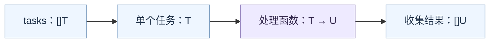
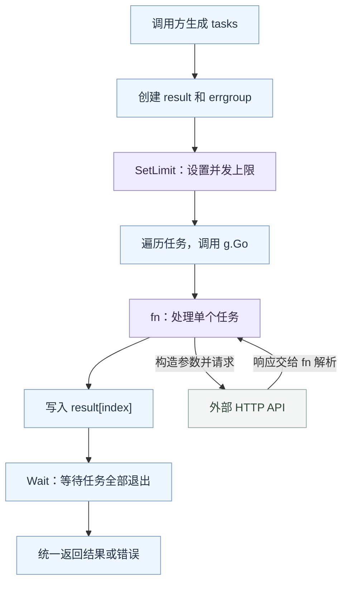
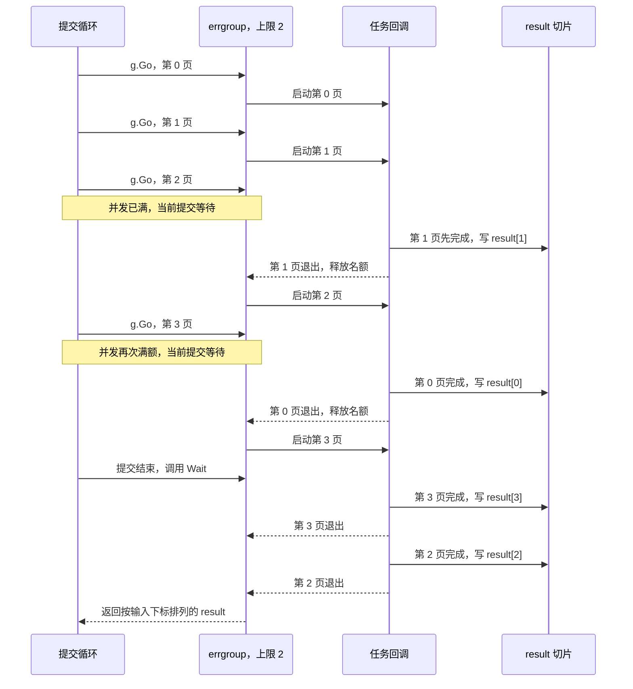
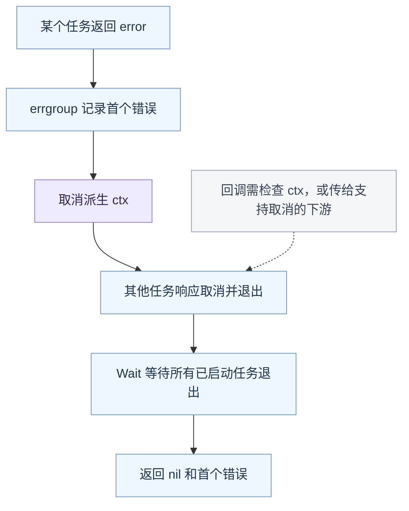

# 并发翻页框架

我希望提供一个函数：调用方传入一组分页任务、最大并发数和单页处理逻辑，函数就能并发执行这些任务，并统一返回结果或错误。

设计时可以沿着这条思路推导：先确定输入和输出，再确定单个任务怎么处理，最后解决并发控制、结果收集和错误处理。

这里先实现一个通用的**并发任务执行器**。用于翻页时，调用方还需要负责生成页码、组织请求参数和判断翻页结束。对于下一页参数依赖上一页响应的游标分页，不能直接提前生成同一条链路的全部任务。

## 1. 输入和输出不固定，因此引入泛型

不同接口的请求参数和响应内容并不相同：

| 使用场景               | 单个输入 `T` | 单个输出 `U`    | 最终结果 `[]U`    |
| ---------------------- | ------------ | --------------- | ----------------- |
| 按页码获取原始响应     | `int`        | `[]byte`        | `[][]byte`        |
| 按页码获取解析后的订单 | `int`        | `[]Order`       | `[][]Order`       |
| 按账户查询状态         | `string`     | `AccountStatus` | `[]AccountStatus` |

并发执行器不需要知道订单有哪些字段，也不需要知道账户状态如何计算。它只需要把一个输入交给处理函数，再保存对应的输出。

因此可以用两个类型参数描述这件事：

```go
[T any, U any]
```

- `T` 表示**一个任务的输入类型**。
- `U` 表示**一个任务的输出类型**。
- `any` 是类型约束，表示调用者可以选择任意类型。

`T`、`U` 是作者起的名字，换成 `Input`、`Output` 也可以。它们是类型参数；`tasks`、`numG` 则是实际传入的值。

**“类型不固定”指的是不同调用可以选择不同类型。** 例如这次选择 `T = int`，本次调用的 `tasks` 就必须是 `[]int`，处理函数也必须接收 `int`，编译器仍然会检查类型是否匹配。

先只考虑任务列表和并发数，可以写出一个签名草图：

```go
func ParallelRun[T any, U any](tasks []T, numG int) ([]U, error)
```

`tasks` 表示要处理哪些任务，`numG` 表示最多同时执行多少个任务。成功时，返回的 `[]U` 与 `tasks` 长度相同，每个输入对应一个输出。



图中的 `U` 可以是一组数据。例如一次请求返回 `[]Order`，那么 `U = []Order`，整个执行器返回的 `[]U` 就是 `[][]Order`。是否把多页结果合并成 `[]Order`，由调用方决定。

## 2. 只有任务参数还不够，还要传入处理函数

知道要处理哪些页，并不等于知道如何请求这些页。不同接口的 URL、请求参数、响应格式和解析方式都不同，因此需要调用方提供一个处理函数 `fn`：

```go
fn func(context.Context, T) (U, error)
```

这个函数负责处理**一个任务**：

1. 接收当前任务的输入 `T`。
2. 使用 `ctx` 传递取消信号，构造参数并发起请求。
3. 解析响应，返回结果 `U`；失败时返回 `error`。

把它加入前面的签名，就得到完整的接口：

```go
func ParallelRun[T any, U any](
    tasks []T,
    numG int,
    fn func(context.Context, T) (U, error),
) ([]U, error)
```

例如指定 `[int, []byte]`，从调用者的角度看，签名就相当于：

```go
func ParallelRun(
    tasks []int,
    numG int,
    fn func(context.Context, int) ([]byte, error),
) ([][]byte, error)
```

泛型让我们复用同一份调度逻辑，同时保留具体的输入输出类型。它不是实现并发的必要条件；如果把类型写死，就只能服务于某种业务，或者为不同类型重复编写函数。

## 3. 用 errgroup 统一控制并发和错误

接下来需要解决：如何并发执行任务，同时限制数量、等待完成并收集错误？

这里使用 `golang.org/x/sync/errgroup`：

```go
g, ctx := errgroup.WithContext(context.Background())
g.SetLimit(numG)
```

- `g.Go` 启动任务，并接收任务返回的错误。
- `g.SetLimit(numG)` 限制这个任务组中同时活跃的 goroutine 数量。
- `g.Wait()` 等待任务退出；如果有任务出错，返回最先记录的非空错误。
- `WithContext` 创建派生上下文：任务出错或 `Wait` 返回时，会取消这个 `ctx`。

执行过程如下：

1. 提前创建结果切片。
2. 创建任务组，设置并发上限。
3. 遍历任务，通过 `g.Go` 启动对应的 goroutine。
4. 每个 goroutine 调用 `fn(ctx, tasks[index])`，把结果写回对应位置。
5. 提交结束后，调用 `g.Wait()`，统一返回结果或错误。



图中展示的是成功路径。HTTP 请求和响应解析放在 `fn` 中；执行器负责调度和收集结果，因此外部接口可以独立替换。

**达到并发上限时，阻塞的是提交任务的 `g.Go` 调用。** 已启动的任务继续运行；其中一个退出后，释放一个名额，等待中的提交才会继续。

这份实现会为每个任务启动 goroutine，并限制同时活跃的数量，没有建立常驻 worker 池。

## 4. 并发完成顺序不同，如何保持结果顺序

假设任务是第 0、1、2、3 页，并发上限是 2。由于网络耗时不同，第 1 页可能比第 0 页先完成。

如果按照完成顺序追加结果，就无法直接通过下标找到原来的页。这里提前分配结果切片，并按输入下标写入：

```go
result := make([]U, len(tasks))

// 每个任务只写自己的位置。
result[index] = res
```

因此，无论完成顺序如何，成功返回时都有：

```text
tasks[0] 的结果 → result[0]
tasks[1] 的结果 → result[1]
tasks[2] 的结果 → result[2]
tasks[3] 的结果 → result[3]
```

下面是一种可能的时序，实际完成顺序由任务耗时和调度决定：



这里不用给结果切片加锁：各任务写的是不同的元素，没有并发 `append` 或调整切片长度，调用方也在 `Wait` 结束后才读取结果。

这个结论只适用于执行器的结果收集。如果 `fn` 内部修改同一个 map、共享计数器，或者多个任务持有的指针指向同一份可变数据，仍然需要自行同步。

循环中的 `index := i` 用于固定当前任务的下标，避免闭包在旧版 Go 中错误引用循环变量。Go 1.22 起，对于 `for i := range tasks` 这种声明方式，每轮循环变量已经独立，保留这个写法也有助于明确任务与下标的对应关系。

## 5. 一个任务出错后，其他任务如何收尾

任务返回错误时，`errgroup` 会记录最先收到的非空错误，并取消派生的 `ctx`。其他任务需要检查这个 `ctx`，或者把它传给支持取消的 HTTP、数据库调用，才能响应取消。



取消信号不会强制终止 goroutine。若 `fn` 忽略 `ctx`，任务可能继续执行；如果它一直无法退出，`Wait` 也会一直等待。

另外，当前的 `for` 循环没有检查 `ctx.Err()`。因此，出错后它仍可能继续提交后面的任务。若后续要实现“发现取消就停止提交”，需要在提交逻辑中额外处理；取消与提交之间仍可能存在并发时序。

本方案选择整批成功才返回结果：

```go
if err := g.Wait(); err != nil {
    return nil, err
}
return result, nil
```

这意味着即使部分任务已经成功，只要有任务失败，也不会把部分结果返回给调用方。它也不会撤销任务已经产生的外部写入。

## 6. 把前面的推导组合成完整实现

下面沿用当前代码的主要逻辑：以 `context.Background()` 创建任务组，保留结果顺序，并把回调中的 panic 转成错误。

```go
package parallel

import (
	"context"
	"fmt"

	"golang.org/x/sync/errgroup"
)

func ParallelRun[T any, U any](
	tasks []T,
	numG int,
	fn func(context.Context, T) (U, error),
) ([]U, error) {
	// 提前分配结果位置，每个输入对应一个输出。
	result := make([]U, len(tasks))

	g, ctx := errgroup.WithContext(context.Background())
	g.SetLimit(numG)

	for i := range tasks {
		index := i
		g.Go(func() (err error) {
			// err 是具名返回值，defer 可以把 panic 转为任务错误。
			defer func() {
				if panicErr := recover(); panicErr != nil {
					err = fmt.Errorf("panic: %v", panicErr)
				}
			}()

			res, err := fn(ctx, tasks[index])
			if err != nil {
				return err
			}

			result[index] = res
			return nil
		})
	}

	if err := g.Wait(); err != nil {
		return nil, err
	}
	return result, nil
}
```

`recover` 只能捕获当前 goroutine 中的 panic。这里为 `g.Go` 的回调设置了保护；如果 `fn` 自己又启动 goroutine，需要在那个 goroutine 中单独处理。

CAM 中的原实现还会记录 panic 对应的函数名和调用栈，上面的示例简化了这部分信息，方便理解主体流程。

## 7. 怎样把执行器用于分页请求

假设业务已经确定需要查询 3 页，每页 500 条，页下标从 0 开始。调用层可以先生成任务，再交给执行器。下面的 `fetchPage` 代表业务侧实现的单页请求函数，它应把接收到的 `ctx` 传给 HTTP 请求：

```go
pageIndexes := []int{0, 1, 2}
pageSize := 500

pages, err := ParallelRun[int, []json.RawMessage](
    pageIndexes,
    2,
    func(ctx context.Context, pageIndex int) ([]json.RawMessage, error) {
        offset := pageIndex * pageSize
        return fetchPage(ctx, offset, pageSize)
    },
)
if err != nil {
    return nil, err
}

// pages 是 [][]json.RawMessage，按输入页下标排列。
var all []json.RawMessage
for _, pageItems := range pages {
    all = append(all, pageItems...)
}
return all, nil
```

这个调用中，`T = int`，`U = []json.RawMessage`。Go 也可以根据任务列表和回调签名推断类型，因此 `[int, []json.RawMessage]` 通常可以省略。

CAM 的 `fetchAllPositions` 就使用了类似结构：生成页下标，调用 `ParallelRun` 获取各页，再交给 `mergePositionPages` 合并。实际代码固定查询最多 5 页，每页 500 条，并不是先发现总页数再生成任务。

它在合并时遇到空页或不足 500 条的页就结束，但此时预先提交的请求已经执行完毕，合并阶段的停止不会节省后续页请求。最后一页仍满页时，代码会告警，也不能据此断言已经获取全部数据。

实际调用的回调使用 `_ context.Context`，下游沿用外层的 `*cam.Context`，因此执行器派生的取消信号没有通过这个回调透传下去。这一点与上面建议透传 `ctx` 的调用示例不同。

## 8. 使用这个方案时需要明确的边界

- **并发数应传正整数。** `numG = 0` 会阻止任务启动，非空任务列表的提交会阻塞；负数表示不设并发上限。当前实现没有做参数校验。
- **并发上限不等于请求限速。** 它限制活跃任务数；如果单个任务发起多次请求，或任务很快完成，仍需根据接口配额单独控制 QPS。
- **当前函数没有接收调用方的 ctx。** 它只具备任务组内部的取消联动。若需要继承调用方的取消、超时和请求范围信息，可进一步增加 `parentCtx context.Context` 入参，并交给 `errgroup.WithContext(parentCtx)`。
- **重试、断点恢复和下一页生成需要额外设计。** 当前执行器只运行给定的 `tasks`，失败后不会自动重试，也不会保存分页进度。
- **并发翻页的前提是任务可以独立确定。** 页码、offset 或已划分的时间区间可以作为任务；依赖上一页返回 `nextCursor` 的单条游标链路，应先串行推进，或在不同账户、不同独立区间之间并发。
- **结果顺序不等于数据完整性。** 当分页期间数据变化时，offset 可能偏移，导致重复或遗漏；完整性还依赖接口的快照、稳定排序、游标或业务补偿策略。

## 代码对照

| 内容                              | 实际代码位置                                                                                      |
| --------------------------------- | ------------------------------------------------------------------------------------------------- |
| 并发执行器、结果收集和 panic 处理 | `cam/back/pkg/cf/concurrent.go` 的 `ParallelRun`                                                  |
| 取消联动和 panic 转错误的测试     | `cam/back/pkg/cf/concurrent_test.go` 的 `Test_ParallelRun`                                        |
| 页任务生成和单页请求参数          | `cam/back/exg/polymarketprop/polymarket_biz/info.go` 的 `fetchAllPositions`、`fetchPositionsPage` |
| 空页、短页停止合并和满页告警      | 同文件的 `mergePositionPages`                                                                     |
