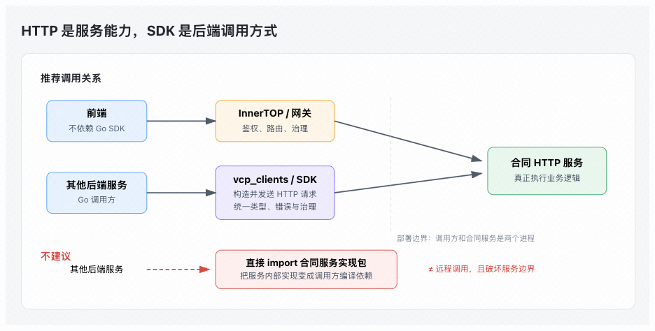

# 疑问

> 我还是不懂 SDK 的作用，我们合同系统不是已经提供了 HTTP 接口吗 。
> https://bits.bytedance.net/code/eps-platform/vcp_clients
> 为什么 还需要这个，如果其他业务组需要对接 或者使用我们接口直接让前端call HTTP接口即可，如果是后端想用的话 那么直接调用我们的项目包即可，为什么还需要单独拆出来一个 SDK

# 回答

## 为什么其他后端不能直接依赖服务端

1. 真正复用其函数，相当于把==合同逻辑复制进调用方进程，可能绕开接口鉴权、服务路由和部署边界。==

2. 调用方可能==被迫依赖数据库模型、配置、缓存、初始化逻辑和大量传递依赖==

3. 容易出现 ==**循环依赖和依赖膨胀**==

