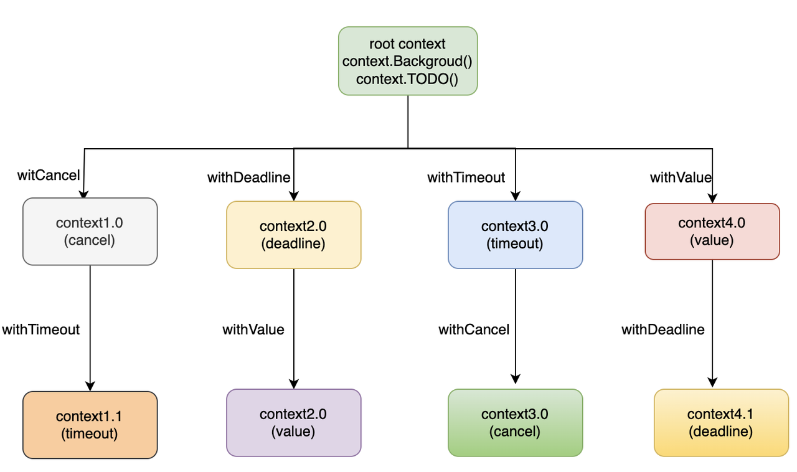
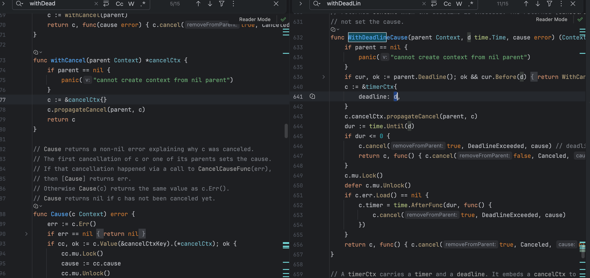

# Context 是什么

`Context` 可以认为是一个标准库的 ==接口==

```go
type Context interface {
   Deadline() (deadline time.Time, ok bool)
   Done() <-chan struct{}
   Err() error
   Value(key interface{}) interface{}
}
```

这个接口定义了四个方法

- `Deadline`： 返回 `context.Context` 截止时间

- `Done`： 返回一个 只读 `Channel`，当 `Context` ==被取消或者到达截止时间，这个 `Channel` 就会被关闭==，表示 `Context` 的链路结束，多次调用 `Done` 方法会返回同一个 `Channel`

- `Err`： 返回 `context.Context` 结束的原因，它只会在 `Done` 返回的 `Channel` 被关闭时才会返回非空的值，返回值有以下两种情况；

  - 如果 是 `context.Context` 被取消，返回 `Canceled`

  - 如果 是 `context.Context` 超时，返回 `DeadlineExceeded`

- `Value`: 从 `context.Context` 中获取键对应的值，类似于 `map` 的`get` 方法，对于同一个 `context`，多次调用 `Value` 并传入相同的 `Key` 会返回相同的结果，如果没有对应的 `key`,则返回nil，键值对是通过 `WithValue`方法写入的

## Context 的作用

context主要有两个用途，也是在项目中经常使用的

- 用于==并发控制，控制协程的优雅退出==

- ==上下文的信息传递==

总的来说，`Context` 就是用来在父子 `goroutine` 间进行值传递以及发送 `cancel` 信号的一种机制。

# Context 的 创建

## 根 Context 创建

主要有以下两种方式创建根 `context`

- `context.Background()`

- `context.TODO()`

从源代码分析 `context.Background` 和 `context.TODO` 并没有太多的区别，都是用于创建根`context，根context是一个空的context，不具备任何功能。但是一般情况下，如果当前函数没有上下文作为入参，我们都会使用 context.Background创建一个根context 作为起始的上下文向下传递。

## Context 派生

```
func WithCancel(parent Context) (ctx Context, cancel CancelFunc)
func WithDeadline(parent Context, deadline time.Time) (Context, CancelFunc)
func WithTimeout(parent Context, timeout time.Duration) (Context, CancelFunc)
func WithValue(parent Context, key, val interface{}) Context
```

基于当前创建的 `rootContext` 我们可以通过对应的 `Func` 派生出对应的 `sub-context`



### Contedxt.WithCancel

```go
func WithCancel(parent Context) (ctx Context, cancel CancelFunc)
```

`context.WithCancel` 函数是一个取消控制函数，只需要一个 `context` 作为参数，

能够从 `context.Context` 中衍生出一个新的子 `context` 和取消函数 `CancelFunc`

通过将这个子 `context` 传递到新的 `goroutine` 中来控制这些 `goroutine` 的关闭

一旦我们执行返回的取消函数 `CancelFunc`，==当前上下文以及它的 子上下文== 都会被取消，所有的 `Goroutine` 都会同步收到取消信号。

使用示例 :
f

```go
package main

import (
   "context"
   "fmt"
   "time"
)

func main() {
   ctx, cancel := context.WithCancel(context.Background())
   go Watch(ctx, "goroutine1")
   go Watch(ctx, "goroutine2")

   time.Sleep(6 * time.Second)   // 让goroutine1和goroutine2执行6s
   fmt.Println("end watching!!!")
   cancel()  // 通知goroutine1和goroutine2关闭
   time.Sleep(1 * time.Second)
}

func Watch(ctx context.Context, name string) {
   for {
      select {
      case <-ctx.Done():
         fmt.Printf("%s exit!\n", name) // 主goroutine调用cancel后，会发送一个信号到ctx.Done()这个channel，这里就会收到信息
         return
      default:
         fmt.Printf("%s watching...\n", name)
         time.Sleep(time.Second)
      }
   }
}
```

**运行结果 :**

`goroutine1` 和 `goroutine2` 交替出现 6次

```go
goroutine1 working...
goroutine2 working...
goroutine2 working...
goroutine1 working...
goroutine2 working...
goroutine1 working...
goroutine1 working...
goroutine2 working...
goroutine1 working...
goroutine2 working...
goroutine2 working...
goroutine1 working...
Process finished with the exit code 0
```

### Context.WithDeadline

```go
func WithDeadline(parent Context, d time.Time) (Context, CancelFunc)
```

从源代码上面看，`WithDeadline` 无非是使用了 `timer` 来进行处理了一个 定时 `cancel` 的内容



### Context.WithTimeout

```go
func WithTimeout(parent Context, timeout time.Duration) (Context, CancelFunc)
```

从源码设计上来看, `WithTimeout` 实际上是最 `WithDeadline` 的一个封装可以认为就是对开发友好

```go
func WithTimeout(parent Context, timeout time.Duration) (Context, CancelFunc) {
	return WithDeadline(parent, time.Now().Add(timeout))
}
```

### Context.WithValue

方法定义

```go
func WithValue(parent Context, key, val interface{}) Context
```

`context.WithValue` 函数从父context中创建一个子 `context` 用于传值，函数参数是父`context，key，val`键值对。返回一个 `context`。

项目中这个方法一般用于上下文信息的传递，比如请求唯一id，以及trace_id等，用于链路追踪以及配置透传。

使用示例：

```go
package main

import (
   "context"
   "fmt"
   "time"
)

func func1(ctx context.Context) {
   fmt.Printf("name is: %s", ctx.Value("name").(string))
}

func main() {
   ctx := context.WithValue(context.Background(), "name", "zhangsan")
   go func1(ctx)
   time.Sleep(time.Second)
}
```

输出

```go
name is: zhangsan
Process finished with the exit code 0
```

源码、封装了一个 `context` 和 `key - value` 的形式 从而记录对应的键值对内容

```go
func WithValue(parent Context, key, val any) Context {
	if parent == nil {
		panic("cannot create context from nil parent")
	}
	if key == nil {
		panic("nil key")
	}
	if !reflectlite.TypeOf(key).Comparable() {
		panic("key is not comparable")
	}
	return &valueCtx{parent, key, val}
}

// A valueCtx carries a key-value pair. It implements Value for that key and
// delegates all other calls to the embedded Context.
type valueCtx struct {
	Context
	key, val any
}
```
