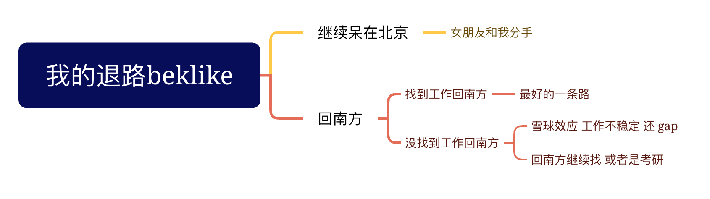

"我" : "不学了，有种 ==**拔剑四顾心茫然**== 的感觉"

"刘宇" : "不准不学习"

"我" : "学啥啊"

是啊，我该学什么呢，我不是校招生了，是社招上

上次社招面试，==不是工作经验不匹配，就是工作经验不匹配==

工作经验这玩意我我又不能改，除非我==包装==一下

除此之外呢 我还能做什么呢 ？

1. 刷题; 刷算法题, 因为面试经常考
2. 背概念，八股文; 相当于巩固基础 或者是 提高深度
3. 包装一下上一份工作经验
4. 不知道

我能做的好像只有这几点 ？ 至于学历嘛，我感觉 ==这辈子都不会再提升了==

# 此时我的退路 belike

我如果继续待在北京，我的女朋友大概率会和我分手，我们已经谈了 3 年了，好不容易关系已经进一步了

那么有一句话这么说 =="我们活到最后都是为自己而活，爱到最后都是爱自己"==

可是说实话 我待在北京也不开心，而且我并不感觉我在北京能够学到什么

那么我就要回南方

1. 我要么找工作回南方，在最近的6个月

2. 要么没找到工作回南方

   - 这里可能会滚雪球，工作跳的频繁，还有 gap
   - 回南方继续找 或者是 考研 说实话风险很大

那么看来 我也只能 ==找工作回南方了==

# 社招面试内容

根据我好几次社招的面试有以下几个情况

1. 询问上一家工作做了什么，遇到什么问题，怎么解决的

2. 询问八股文基础 （有些公司甚至会用一面单独问这个）

3. 考算法

大致就是这几个方向

因此我能做的也只有

1. 背诵八股文

2. 每天写算法并牢记

3. 整理 & 包装简历 提炼面试方案
