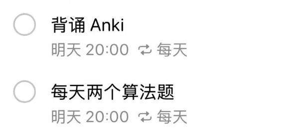

总时长大概是 6 个月 从 ==11 月份到明年 4 月份(11,12,1,2,3,4)==

# 简历包装 上一份工作

上一次面试的时候 其实已经包装过了，但是感觉不够。面试方案也有，不过感觉只有 50%

上次大概花了 60H 总结，预计需要整理出 3 个模块，假设一个模块需要 一周 10 H . 那么 预计需要 30H

# 算法

算法内容预计每天 ==**2**== 题, 最基础的要完成 ==Top100== + ==Acwing 算法基础题 106==

假设最后一个月是冲刺 那么只有 5个月时间，即 ==5 * 30 * 2 = 300 题== 。时间足够

如果可以的话 ==一天可以尝试4道题==，假设 1天2道题需要 2H，我现在已经刷了 100道了 还剩200道

那么就是 100H

# 八股文

上一次八股文，我认为我已经背了 50%了，大概花了 2周，平均一天可能4H 的样子。 也就是 4*7*2=56H

那么估计还需要 60H 左右

# 时间分配

## 时间可行性分析

现在白天时间预计完整的有 ==1个小时可支配== , 包括早上的半小时 和 中午午休后的半小时

晚上回去 18.30左右下班 ， 19.30 左右吃完饭

期间可能洗澡运动 要一个半小时 ，也就是到 21:00 （运动算作休息，上一天班很累，我认为运动必不可少）

那么 21:00 到 00:00 预计有 3 个小时到时间，可以 buffer 算作 2个人小时

总共一天有 `3个小时` 的时间

假设工作日5天，有 15H。 那么周末 2天，一天投入 5H 那么就是 10H

一周总共有 25H

从今年 2026年 11 月1日 到 2027年 4 月 30日 大概有 26个星期 也就是 ==26 * 25 = 650H==

预计总花费是要 项目 `30H` + 算法 `100H` + 八股文 `60H` = `190H` 绰绰有余

## 时间规划

1. 一天 2 道题 Cover 到明年 5 月份

2. 11月份 主要准备
   - 项目包装，预计 30H，总时长预计4个星期， 100H 减去 30H 还剩 70H
   - 其余时间复盘一下上次的面试
   - 准备 Anki 八股文

3. 12月份 主要准备
   - 项目包装剩余的内容
   - Anki 八股文补充 & 背诵

4. 1月份 尝试开始投递部分
5. 2月份 尝试开始投递部分，并且将当前这个工作的内容写入到简历中

## 惩罚 & 奖励机制

**惩罚 :**

1. 如果没有做到 那么我将会失去我的女朋友

2. 如果没有做到 我将可能面临进退两难 ，我甚至可能考研

==惩罚晚上的时候 连续 2周 只能吃鸡胸肉 鸭腿 玉米，不能点外卖==

**奖励 :**

1. 奖励自己买一些好吃的、放纵餐

2. 奖励好好休息，去公园放松

