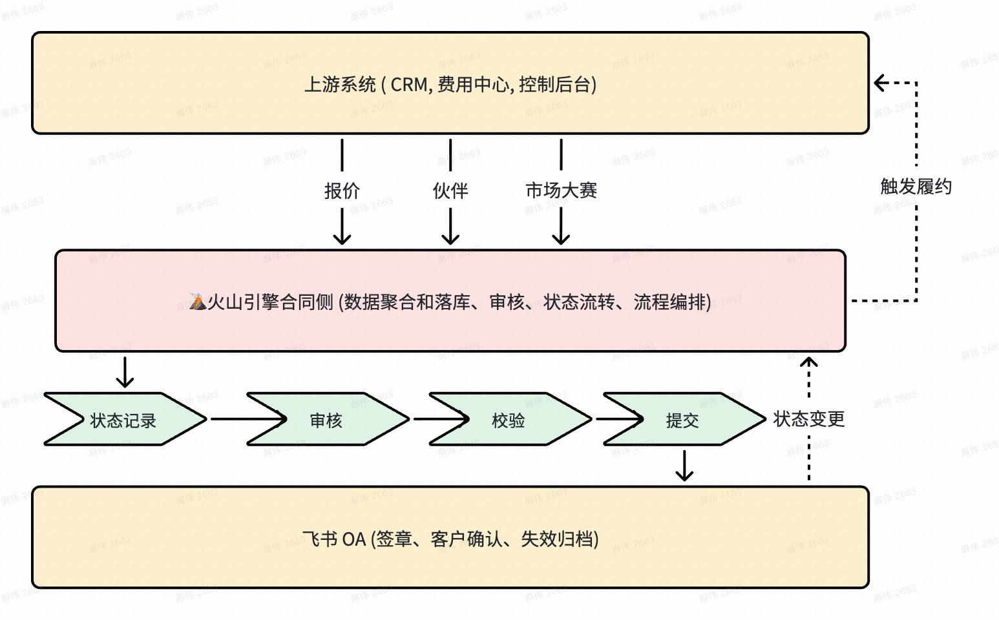

# 业务

业务上来说 ==**合同**== 无非就是 ==上游发起合同 到我们系统, 我们系统记录合同并且流转状态==

但是问题是 集团侧即==飞书合同==是 需要记录到我们的业务合同，或者说 所有的合同签署最终都应该落入到 飞书合同中

> 按合同场景提交至飞书合同或签署其他链路
> 原则上统一沉淀至集团平台合同

因此 我们这个 系统的业务 有

1. 将上游的一些数据 整合到我们系统中 然后创建对应的合同

2. 在合同侧, 我们这进行一些 税务、财务法等 合法性校验

    - 数据建模、模板填充
    - 流程编排
    - 税务、结算、风险审批

3. 校验完成之后会提交到 集团合同侧

4. 集团合同侧状态变更之后会通知给我们合同侧系统，我们系统做对应的变更 

5. 集团侧通知通知我们系统之后，我们需要通知上游 ==**触发履约**==

