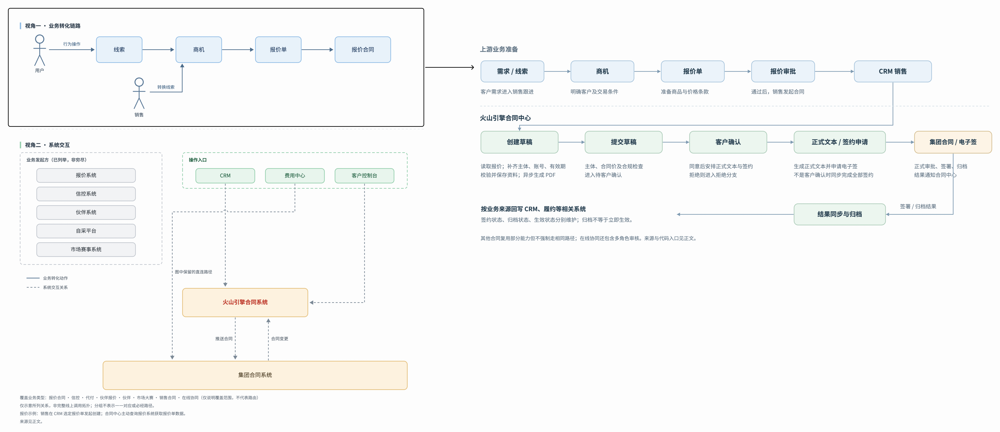
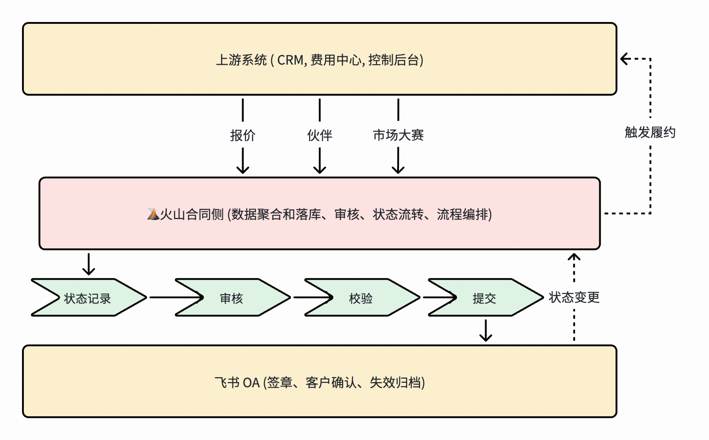

# 业务

先看一条合同任务的主线 : 

1. 用户在火山引擎页面上操作，这些操作会被 ==系统判定归纳为线索== 

2. 销售会跟进这条线索，将其转换为 ==商机== 

3. ==商机进一步转化为报价==, 在报价系统中对应一条报价单 

4. 每条报价单 可以发起对应的 ==报价合同==

另外从系统交互的角度来看 :

1. 业务发起方不只有==报价系统== : 还有 信控系统、伙伴系统、自采平台、市场赛事系统

2. 操作入口分别对应 : CRM、费用中心、客户控制台

其中 ==销售可以通过费用中心发起销售合同、**销售合同会直接提交到飞书中**== 

## 为什么要分层引入 火山合同中心

从业务的角度进行考虑 :

1. 对于一笔云业务, ==订单是否是否、应付金额如何计算、账单按什么规则合并== 由对应的 订单、账单、账户和计费等业务系统负责

2. ==集团合同系统不负责这些业务规则的计算与执行== ，而是 ==接受已组织好的合同资料和文本==

