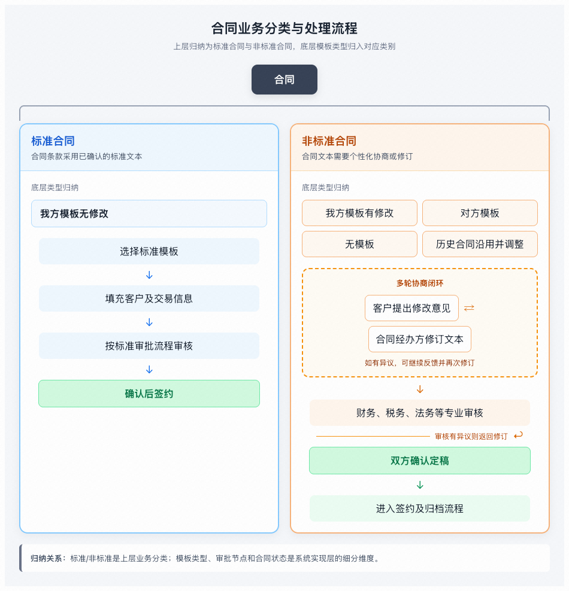
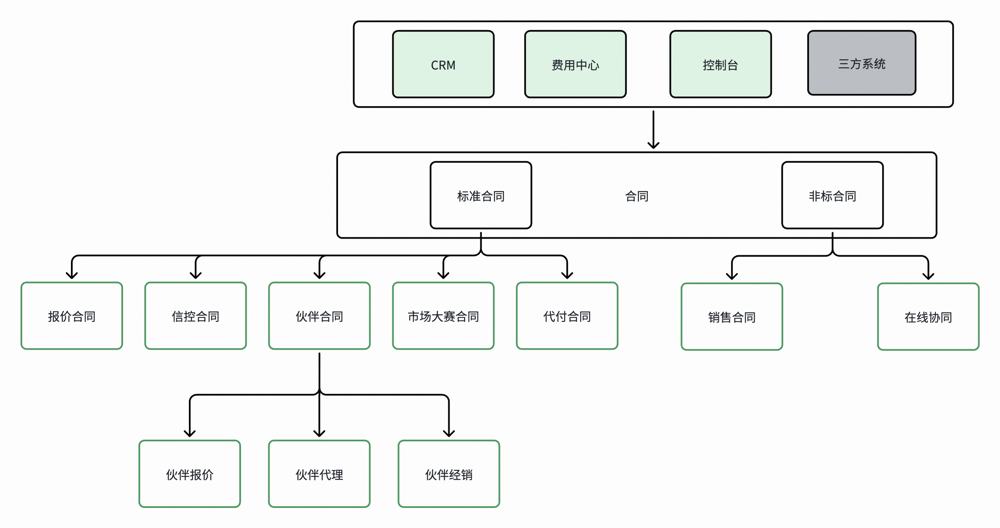
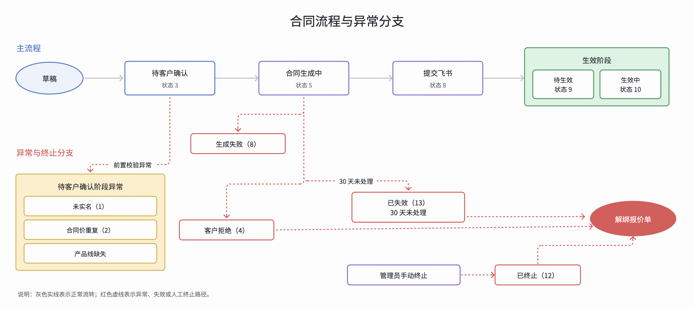
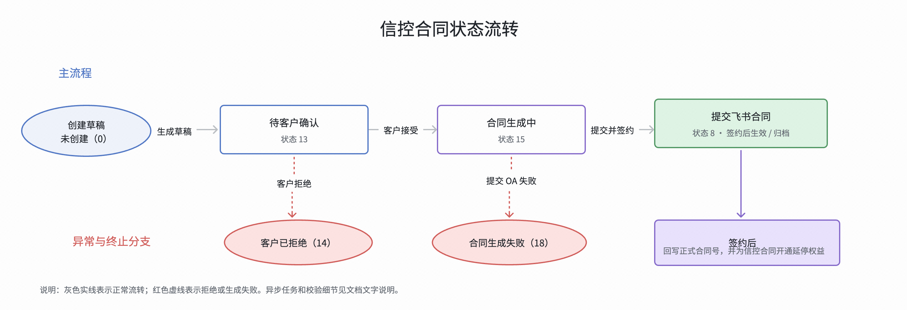
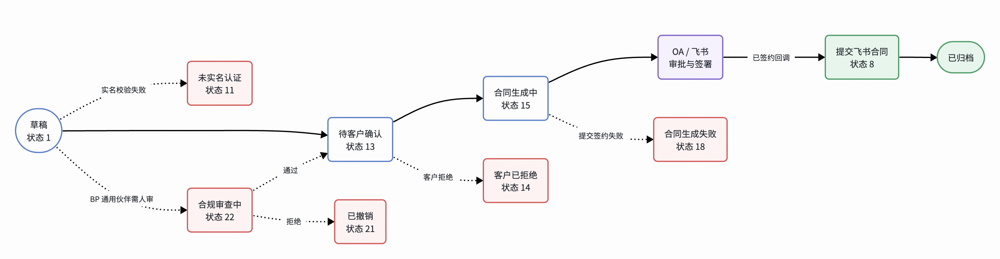
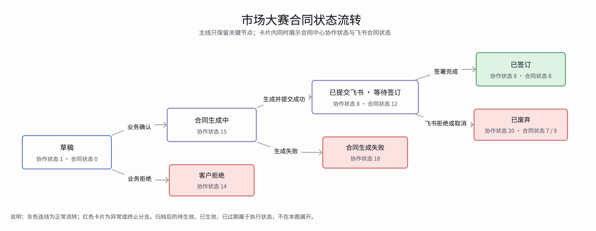
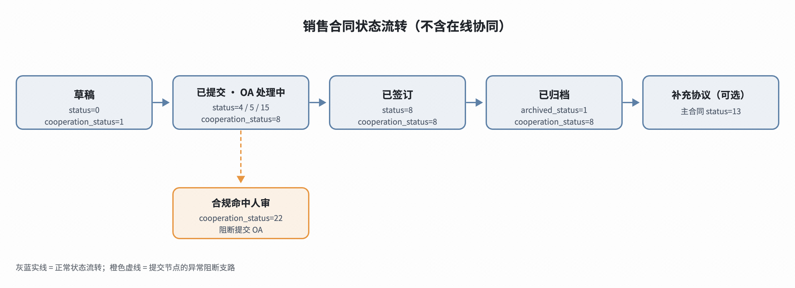
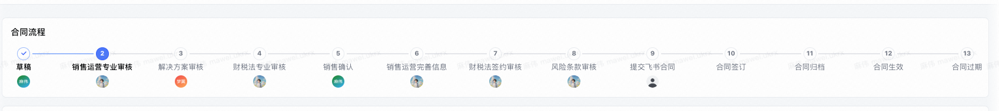
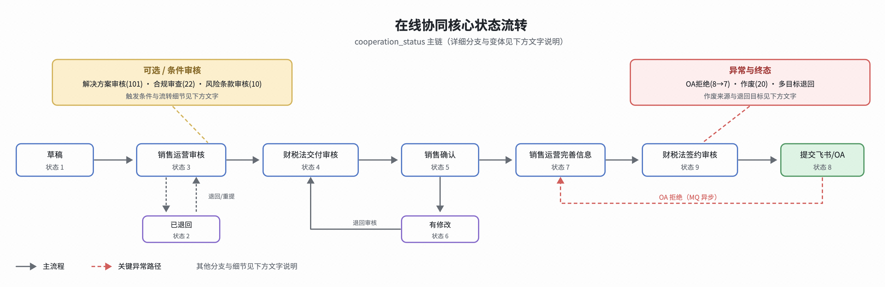

# 大类标准

合同可以分为两大类 : 标准合同 和 非标准合同

标准合同 : 我方既定的模板，不需要修改标准的正文，按照业务场景和规则执行

非标准合同 : 偏离我方既定的模板，我方/对方/无模板， 需要==评估、协商或修订==条款

# 标准合同 和 非标准合同

## 标准合同

标准合同分为 ==报价合同、信控合同、伙伴合同、市场大赛合同、代付合同==

### 报价合同

#### 业务

报价合同 由 ==**报价单驱动**==, 走标准化、免审批的流程

**主要解决的问题 :**

1. 销售申请折扣过去靠线下盖章合同

2. 归档后还要人工去配价系统改折扣

报价合同则把 ==销售申请报价 → 报价审批 → 生成价格确认单 → 客户线上接受 → 折扣自动生效== 整条链路先上化

#### 状态

整个业务流程如下 ==**草稿 → 待客户确认 → 合同生成中 → 提交飞书 → 待生效/生效中 **==

1. 生成草稿 之后会进行一些 ==前置校验异常==

   - 判断合同价是否重复
   - 判断是否实名
   - 判断产品线是否缺失

2. 客户确认之后、还没提交飞书之前

   - 客户拒绝
   - 生成失败
   - 已失效

### 信控合同

#### 业务

**主要解决的问题** :

1. 企业客户在火山云上面 ==后付费/月结==, 本质上就是 火山引擎先==垫资==给客户用云资源, 这就构成了一笔 ==**对客户的商业信用**==

整个流程大概就是 :

1. 信控系统 : 批不批额度，批多少
2. 合同系统 : 把这个授信条件变成一个可签署、可归档的电子合同
3. 合同盖章之后，合同系统 ==把合同号 传回给信控系统==, 信控系统才给客户开放额度

#### 流程

合同状态: ==**未创建（0） → 待客户确认（13） → 合同生成中（15） → 提交飞书合同(8)**==

1. 草稿生成之后，需要客户确认，同时客户 也可以在这个阶段拒绝 合同

2. 合同生成之后 会 发起正式提交文本和发起电子签，如果提交失败 则会进入失败的流程

### 伙伴合同

#### 业务

伙伴合同 包括 `通用伙伴、代理伙伴、经销伙伴、代理+经销伙伴、集成交付、解决方案、伙伴报价` 合同

**主要解决的问题** :

**例子 1:**

1. "xx 云科技" 想要成为 火山引擎的 代理、对外销售云服务器

2. 伙伴系统，选择授权类型 **伙伴**

3. 生成伙伴合同, 双方确认 → 电子签 → 授权生成

**例子 2:**

1. 经销伙伴的客户 **想要买 100台云服务器 ECS**, 伙伴在报价系统给客户报价

2. 分销系统 判定 分销协议 → 要求报价单填写

3. 生成伙伴合同

#### 状态

状态流转：==**草稿（1）→ 待客户确认（13）→ 合同生成中（15）→ OA/飞书审批与签署 → 提交飞书合同（8）→ 已归档**==

1. 创建草稿之后 会进入到 校验 和 合规审查

2. 生成草稿之后客户可以进行确认或者拒绝

3. 客户同意之后，生成对应的合同，并且提交到飞书中

### 市场大赛合同

**主要解决的问题 :**

1. 无市场费的办赛合作
   - 例如高校社团、开发者社区或合作方协助招募、组织活动、收集作品、安排评审，但火山引擎不向对方支付办赛服务费。

2. 有市场费的办赛合作
   - 例如委托活动服务商承办一场 Agent 创新大赛，需要支付市场推广费。

#### 状态

状态流转 : ==**草稿（协作状态 1、合同状态 0） → 合同生成中（协作状态 15） → 已提交飞书 / 等待签订（协作状态 8、合同状态 12） → 已签订（协作状态 8、合同状态 8）。**==

1. 创建草稿 会直接生成 合同 ==不需要客户确认==

2. 合同生成之后会提交到飞书合同中

3. 合同侧监听飞书侧的状态变动

## 非标准合同

### 销售合同

**主要解决的问题 :**

内部销售 或 后台系统==已准备好合同内容，直接发起签约==的场景，而不是在合同系统中由销售、销运、财税法多角逐步审批的场景

- 为销售交易提供可签署的合同
- 使客户、商品、结算与签约主题信息一致
- 在签约完成后，将合同状态和关键日期同步给 CRM、履约或结算等下游

#### 流程

状态流转 : ==**草稿 -> 飞书/OA 签约**==

1. 创建草稿之后 进入 飞书/OA 签约

### 在线协同

**主要解决的问题 :**

把合同资料、合同文本 和 内部多角色审核 在线化, 最终再提交到 飞书/OA 签约

#### 流程

状态流转 : ==**草稿 -> 销售运营审核 ->（可选解决方案审核）-> 财税法交付审核 -> 销售确认 -> 销售运营完善信息 -> 飞书/OA 签约**==

1. 创建草稿之后 进入 销运审核

2. 销售确认 如果有修改 重新进入 财税法审核

3. 销运完善信息 进一步进行 财税法签约审核 提交飞书

