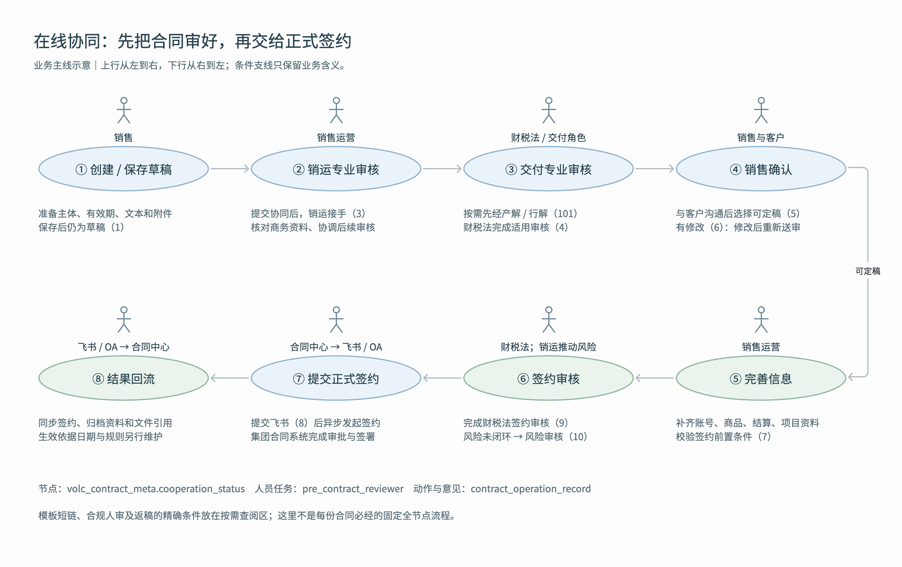
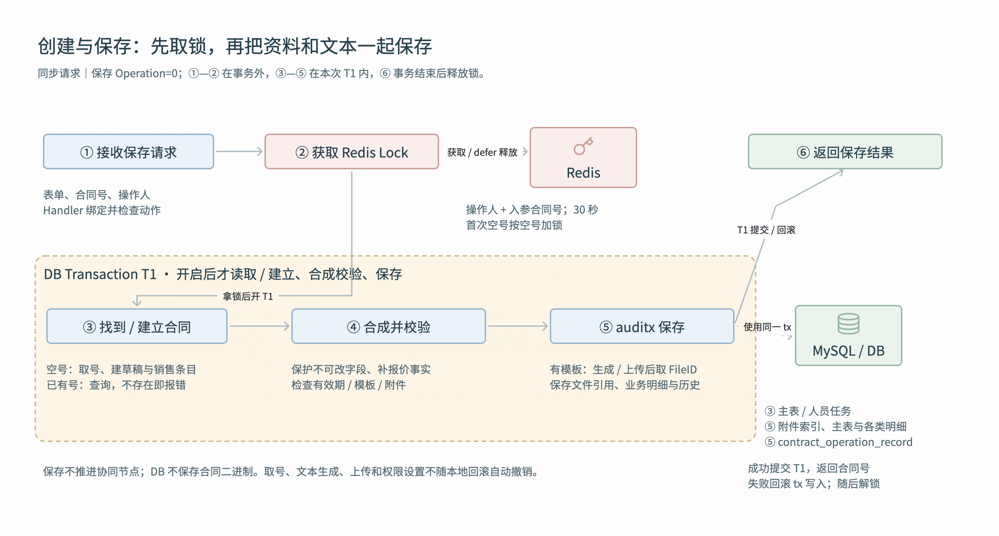
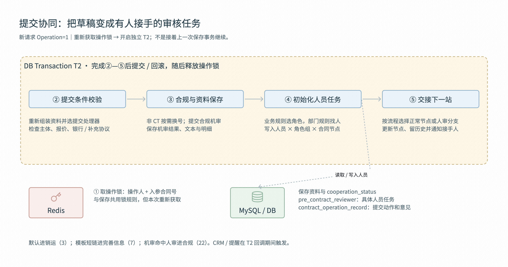
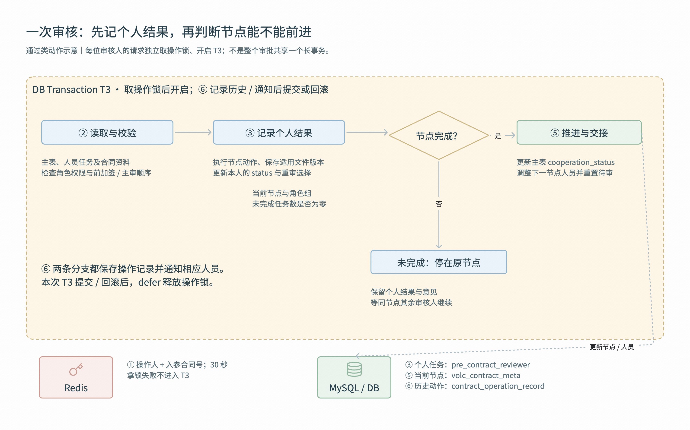

# 业务

==销售创建 / 保存草稿 → 提交协同 → 销售运营专业审核 → 按需解决方案审核 →==

==财税法交付专业审核 → 销售确认 → 销售运营完善信息 → 财税法签约审核 → 按需风险条款审核 → 提交飞书 → 签订、归档与生效。==

==① 创建 / 保存 → ② 销运接手==
保存解决的是“把资料留下来”，提交协同解决的是“让下一位开始处理”。
默认流程提交后进入销售运营专业审核。销运核对商务资料，再把合同交给后续专业角色

==③ 专业审核 → ④ 销售确认==
带解决方案的流程先让产解 / 行解审核，再进入财税法交付专业审核；普通默认流程直接到交付审核。具体需要哪些财务、税务、法务角色由规则匹配。专业审核完成后，销售与客户沟通，选择“可定稿”继续；有修改则修改后重新提交审核。这里的销售确认不是报价合同中客户控制台的接受 / 拒绝接口。

==⑤ 完善信息 → ⑥ 签约审核==
销售运营把账号、主体、商品、结算、项目和附件等签约资料补齐，经过前置校验后，一般进入财税法签约审核。交付审核关注前面的合同协商，签约审核是定稿后进入正式签约前的节点；适用人员完成后，风险条款没有闭环则先进入风险审核，由销运推动相关条款送审和闭环。

==⑦ 正式签约 → ⑧ 结果回流==
内部审核完成后，合同中心异步递交资料和文本，飞书 / OA 承接正式审批、签署与归档。结果回到合同中心，更新签约状态、归档资料和文件引用，并按适用条件通知业务系统。提交不等于签完，归档也不等于立即生效。

# 技术

## 创建与保存草稿：同步准备资料和文本

**① 接收保存请求，② 先取操作锁**

销售点击保存，请求进入 `/pre_contract` 的 `CreateOrUpdatePreContract`，保存动作是 `Operation=0`。

salescontract 按“操作人 + 入参合同号”获取 30 秒 Redis Lock；拿锁失败停止，成功后才开启 T1。
首次入参合同号为空，锁也按空号构造，所以不能把它讲成所有人员对同一合同的全局串行锁。

**③ 找到 / 建立合同，④ 合成并校验**

- ==没有合同号时，系统检查创建参数、向编号服务取号，插入草稿主记录和销售任务条目；==

- 有合同号则读取已有记录，查不到返回错误。接着将已有事实与允许修改的表单合成上下文：补默认币种、保护不可改字段，按需读取报价与项目信息，再检查有效期、模板、附件等适用条件。草稿会跳过后面的部分强校验，但不是完全不校验。

**⑤ auditx 保存，⑥ 提交事务后返回**

草稿 + 保存选择保存处理器。

- 使用模板时，先填充文本并上传到文件管理系统取得 FileID；不用模板时沿用上下文文件 ID。

- 随后保存附件索引、主表文件引用、管理 / 商品 / 交易方 / 结算 / 条款 / 扩展等结构化数据，再留下操作历史。保存不推进协同节点。

- T1 成功后提交，返回最终合同号，再 defer 解锁；错误回滚使用该 tx 的本地写入，取号、文件上传与权限操作不会自动撤销。

## 提交协同：不仅改状态，还要安排接手人

**① 重新取锁开 T2，② 检查提交条件**

- 提交与保存共用创建 / 编辑入口，但动作改为 Operation=1，是新请求、新事务。重新准备资料后

- auditx 选提交处理器，检查交易主体、适用银行信息、报价关联与补充协议等提交条件。

**③ 保存合规和资料，④ 把角色变成具体人员任务**

- 非 CT 前缀的合同号按需换号，并同步主表、管理员、历史与审核条目的号码；

- 已是 CT 则跳过。处理器匹配销运并补齐创建人资料，提交合规机审、保存结果和合同资料。

- 接着==按业务条件选审核角色==，再按部门与执行人找具体人员，写入 pre_contract_reviewer。同一个人在多个节点可以各有一条任务，不是一条记录随合同移动。

**⑤ 交接下一站，结束本次请求**

默认流程进入销运专业审核（3）；

模板短链进入完善信息（7）；

机审命中人审则先进入合规审查中（22）

引擎更新 cooperation_status、调整节点人员、留提交记录，后置处理提醒接手人。

成功提交 T2 后返回最终合同号并解锁。

## 一次审核：先记录个人完成，再推进合同节点

