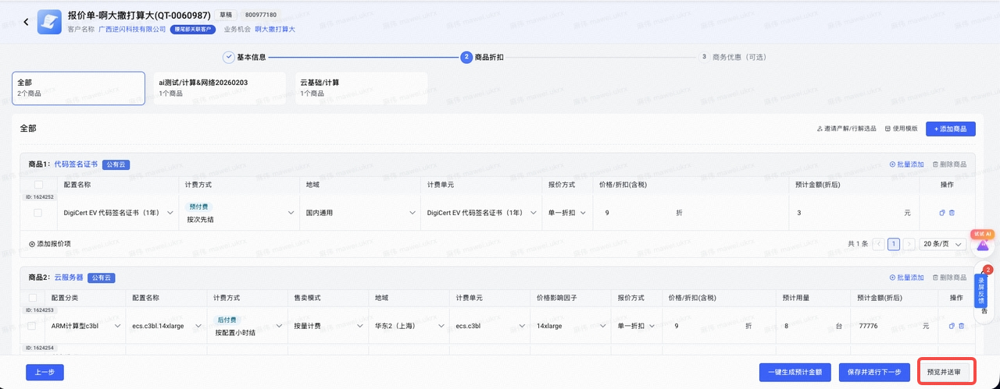
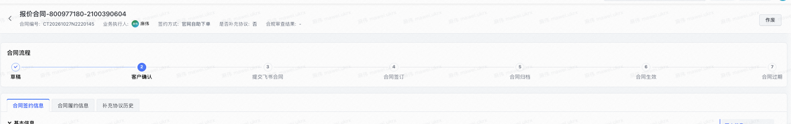
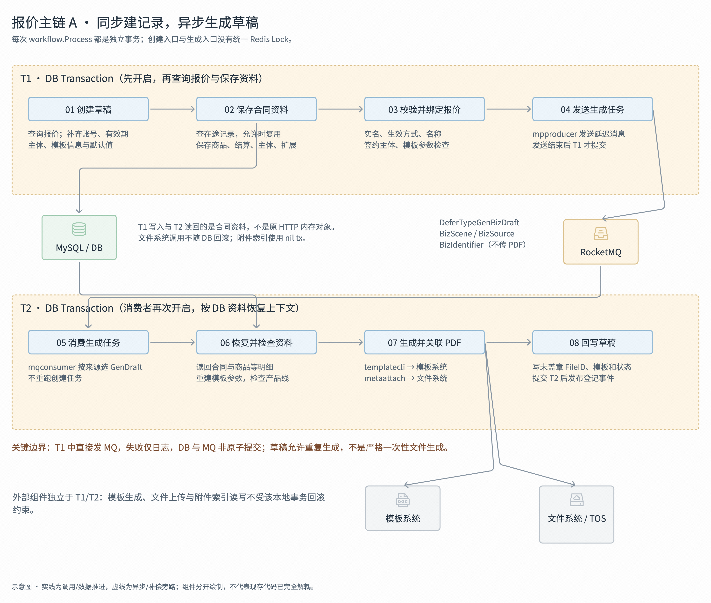
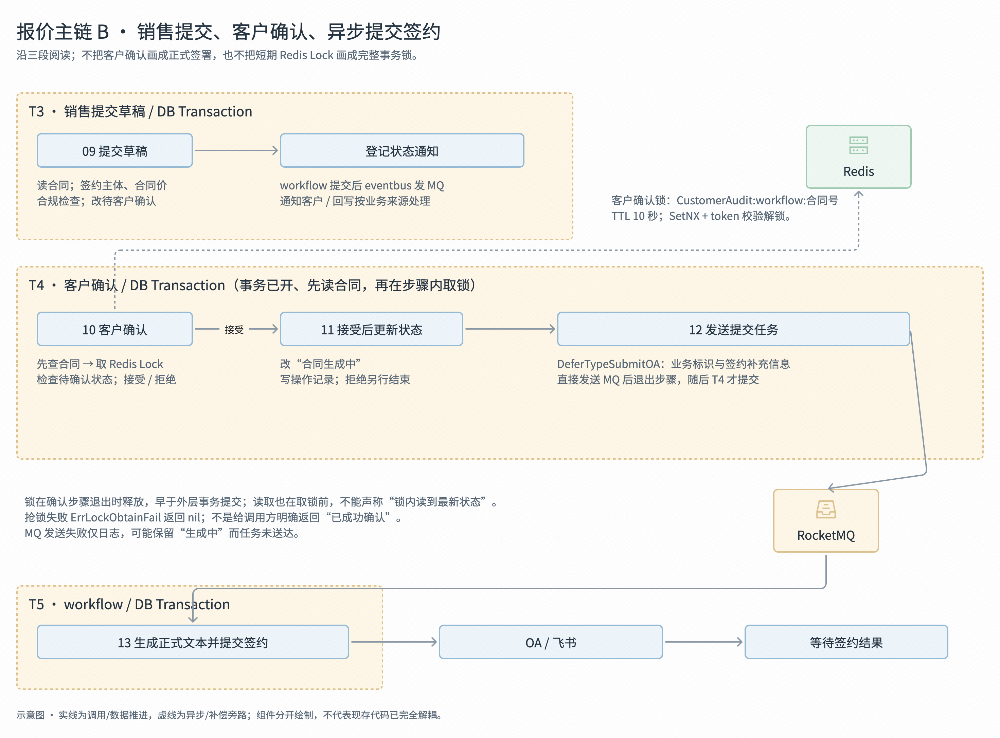

# 业务

在 ==CRM== 中创建对应的报价单，==预览并且送审==，审批完成之后选择创建合同



创建完成合同之后可以看到对应的合同流转状态，同时我们也可以在费用中心中看到对应的流程

1. 这里可以看到 前端的状态是 ==**草稿->客户确认->提交飞书->合同归档->生效**==



# 技术

## 同步建合同记录，再由 MQ 生成草稿



调用方发起 CreateBizDraft 按业务来源选择产品报价任务 TaskTypeQuoteCreateOrUpdateDraft，再调用 workflow.Process

```go
	ret = append(ret, &pipeline{
		// 创建报价草稿
		taskType: TaskTypeQuoteCreateOrUpdateDraft,
		steps: []workStep{
			newStepMetaBizCreateFormat(),         // 创建更新参数统一化
			newStepMetaBizCreateTemp(),           // 创建临时记录
			newStepMetaBizCheckVerify(),          // 实名验证
			newStepMetaBizCheckUsefulLifeType(),  // 校验生效时间类型，报价单包含线上标品，不允许选择自签订生效
			newStepMetaBizCheckContactsName(),    // 校验商机用户名称与客户实名认证名称
			newStepMetaBizCheckSignSubject(),     // 校验签约主体
			newStepMetaBizCheckTemplateReplace(), // 校验对接模板管理系统的合同，参数是否完整
			newStepMetaBizQuoteChange(),          // 绑定报价单,若存在旧报价单需解绑
			newStepMetaBizSendDraftMQ(),          // 发送延迟消息
		},
	})
```

### workflow 开启事务 T1

- `Process` 先找到已注册的 pipeline，再执行 `dal.GetDB(ctx).Transaction`，将 `tx` 放到 `EventContext`，然后依次执行步骤。
- ==T1 在读取报价、保存合同和业务校验之前就已开启。不是等写 DB 时才开事务，也不是每个步骤各开一次。==

```go
func Process(ctx context.Context, eventCtx *EventContext) (Result, errors.APIError) {
    pl := _pipelineMappings[eventCtx.TaskType]
    // ...
    err := dal.GetDB(ctx).Transaction(func(tx *gorm.DB) error {
       eventCtx.tx = tx
       for _, step := range pl.steps {
           // ...
          step.Handle(ctx, eventCtx)
          // ...
       }
        // ...
    })
    // ....
}
```

### 读取报价、保存合同 和 明细

`workflow` 通过 `quotecli` 按 `BizIdentifier` 读取报价合同参数。

报价内容以上游返回为准，再补入请求中的账号、有效期等信息，整理模板所需数据并做基础校验。

参数转换成合同元数据、必要时申请合同号后，查 volc_contract_meta：传了合同号就按合同号查，否则按业务场景和业务标识找进行中的合同。

- 没有旧记录：INSERT 新合同主记录。

- 旧记录存在且状态允许：复用原 Id、合同号等信息，UPDATE 合同，并重置为“未创建”。不允许更新时停止并回滚。

随后保存管理信息、商品、结算、交易主体和扩展字段。==**主记录与这些结构化明细在 T1 中保存；此时保存的是合同数据，不是 PDF。**==

### 校验、绑定报价，生产者发生成任务

1. 依次执行 ==实名 → 生效方式 → 客户／伙伴名称 → 关联签约主体 → 模板参数== 检查。

2. 全部通过后，按需解绑旧报价、绑定当前报价，再调用 mpproducer 发消息。

### mqconsumer 接到消息，选择生成流程

`mqconsumer.handleGenBizDraft` 解析消息，根据业务来源选择 `TaskTypeQuoteGenDraft`

新建上下文，再次调用 workflow.Process。 它接续的是“生成文件”任务，不会重跑前面的创建流程。

```go
func (h *handlerDeferMsg) handleGenBizDraft(ctx context.Context, msg *bizmodels.DeferMsg) error {

// ..
    task := &workflow.EventContext{
       TaskType:     tt,
       EventExtInfo: &detail,
    }
    _, err := workflow.Process(ctx, task)
// ...
    return nil
}
```

### workflow 开启 T2，从 DB 恢复生成参数

第二次 `Process` 再开启一个独立事务 T2

workflow 查合同主表，读回商品、管理、主体、扩展等数据，重建完整合同数据和模板填充参数，再查询有效商品对应的产品线。

### 生成 PDF，由附件模块接管文件

产品线检查通过，且合同仍为“未创建”或“草稿”时，`workflow` 调用 `templatecli.GetFillFile`，填充主模板和附录，获得 PDF 的 `FileKey`。其他状态会跳过生成。

随后调用 `metaattach.UploadAttachment`：接管模板文件，通过 `filecli` 上传到文件管理系统，在 `volc_contract_attachment` 保存或更新索引和元信息，返回供合同引用的 `FileID`。

`FileKey` 是模板生成阶段的文件标识；`FileID` 是合同最终引用的文件标识。`PDF` 放在文件系统里，附件表不存二进制；附件记录使用 `nil tx`，未绑定 T2。

### 回写草稿，提交 T2 后发布状态事件

workflow 在 T2 中更新 `volc_contract_meta` 的 `file_id_unsigned / contract_file`、模板信息和 `cooperation_status`，将产品报价合同设置为“草稿”。

生成步骤先将协同状态变更事件登记到上下文；**T2 提交成功后**，由 `Process.publishEvents` 发布。

完成结果：合同已关联未盖章 PDF，协同状态为“草稿”，可查看文件并进入后续提交。

## 销售提交、客户确认、异步发起正式签约



### 销售提交草稿，开启 T3

销售发起提交后，系统进入 TaskTypeQuoteSubmit，开启独立事务。

先从数据库定位已有合同，读取业务数据和本次操作人信息，并确认合同处于“草稿”或“合同价重复”状态。

1. **先检查签约主体，再检查合同价**

   - 系统按适用规则，核对签约账号可使用的我方主体与合同中的我方主体是否一致。

   - 随后读取有效报价条目和管理信息，先做合同价创建预校验，再检查配价账号、产品及有效期是否与已有合同价重复

2. **价格重复时，先让销售确认**

   - 如果发现重复且销售尚未确认，系统保存“合同价重复”状态、记录重复信息并返回详情，停止后续合规和提交步骤。

3. **合规未通过时，停在“合规审查中”**

   - 系统调用合规服务并保存机审结果。结果允许交易时继续；

   - 机审未通过时，保存“合规审查中”状态及操作记录，并登记相应事件。

4. **允许提交时，更新状态，提交后再通知**

   - 检查允许继续后，系统在 T3 中将合同协同状态更新为“待客户确认”，记录销售提交操作并登记状态变更事件。数据库事务提交成功后再发布事件，由后续处理器通知客户、安排超时提醒与失效任务。

### 客户确认，T4

`workflow` 先开事务，部分前置步骤处理主数据、有效期、返券；

通用确认步骤先读合同，再取 `CustomerAudit:workflow:合同号 锁`，TTL 10 秒，然后检查待确认状态。

抢锁失败 ErrLockObtainFail 返回 nil。**锁不是事务外层全局锁：读取在取锁前，defer 解锁在步骤退出时，早于外层事务提交。**

### 接受/拒绝

接受更新为合同生成中；拒绝写拒绝状态、理由等并登记状态通知，后续可能解绑报价。

接受分支的操作记录使用 nil tx。重复接受不会稳定返回第一次结果，通常进入状态不符或锁冲突分支。

### 发送提交签约任务

接受分支直接发送 `DeferTypeSubmitOA`，携带业务标识和签约补充信息，发送失败仅日志；之后 T4 才提交。若消息未送达，合同可能停在生成中，当前未发现统一扫此状态补发任务的自动闭环。

### 消费任务，T5

`mqconsumer.handleSubmitOA → workflow`；报价先合同价预校验，==再刷新主体、生成正式 PDF、上传飞书文件、关联 FileID，最后 SubmitSigning。== 模板、文件、OA/飞书调用不受本地回滚约束。
