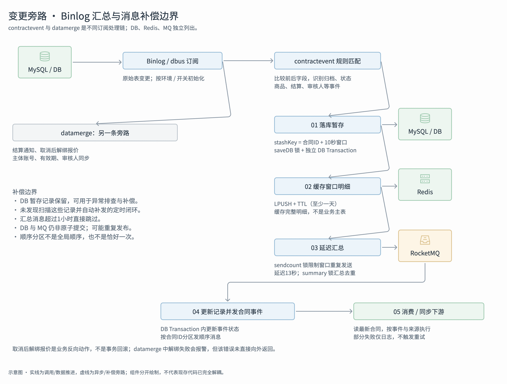

`datamerge` 看到数据库变化后直接做事

`contractevent` 先把变化整理成 “合同事件”，再让消费者做事。

## 合同变成已取消

1. 当合同的 `status` 从其他状态变为 “已取消”，且有关联报价单，==`datamerge` 调用报价系统解绑==；
2. 还会清理补充合同关联。业务含义是：**这份合同取消了，不应继续占着报价关联**

## 合同从 “未归档” 变为 “已归档”：两条都可能做事

- **datamerge**：读取合同结算条款、交易主体和账号，组织应收通知。它关注的是 “归档之后，结算侧要知道这些条款”。

- **contractevent**：规则命中后形成 `MILESTONE_ARCHIVED`，==汇总后发到合同事件 MQ==；消费者再按条件同步报价、CRM、履约等。==它关注的是 “合同已经归档，相关系统需要联动”==。**不是每份报价合同都再创建一次履约**，消费侧有 PerformFlag 等条件限制。
