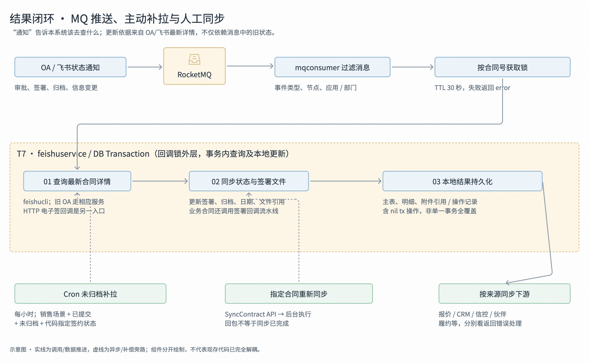

## 推送入口

==OA/飞书通过 MQ 通知节点和信息变化；==

mqconsumer 过滤关注节点及我方合同，按合同号取 30 秒 Redis Lock，失败返回 error。

## 查最新详情

`feishuservice.ContractStatusChange / ContractInfoChange / ContractArchived`

在本地事务中查合同记录并请求飞书最新详情，然后更新签约状态、主数据、日期和文件。

```go
飞书 → MQ → handlerFeishuProcessChangesNotify
              ├─ 普通节点变化 → ContractStatusChange → 更新状态
              ├─ 信息变化     → ContractInfoChange   → 拉详情并保存
              └─ 归档完成     → ContractArchived     → 签署处理、归档保存
                                                        └─ 下游回写
```

## 持久化结果

- **普通状态变化**：ContractStatusChange 查询最新详情、转换状态后，调用 ContractMetaDao.UpdateByMap，==更新签约状态、前序协商状态、当前协商状态。==

- **信息变化**：ContractInfoChange → pullContract 构建最新合同信息，更新或创建合同主记录，==再保存管理信息、交易双方信息、文件引用和操作记录。==

- 归档完成：ContractArchived

  - 销售合同先走 `salesContractSign`；

  - 业务合同先走 `bizContractSign → SyncFeishuContract + ESignCallback → workflow`；

  - 然后走 `doArchived` 保存归档相关信息。

## 同步下游

业务协同事件和归档里程碑事件分别按来源回写报价、CRM、信控、伙伴、赛事或履约等
