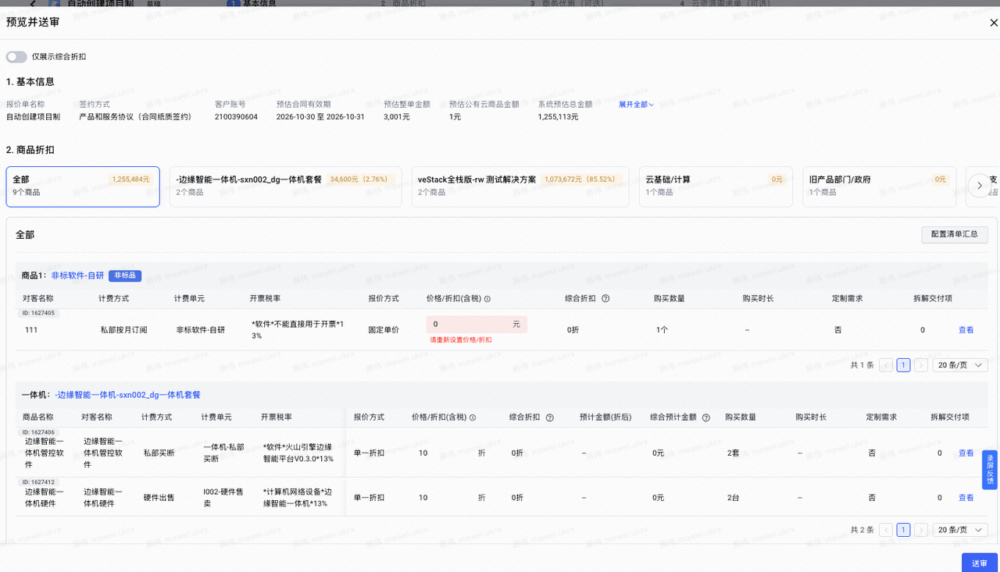
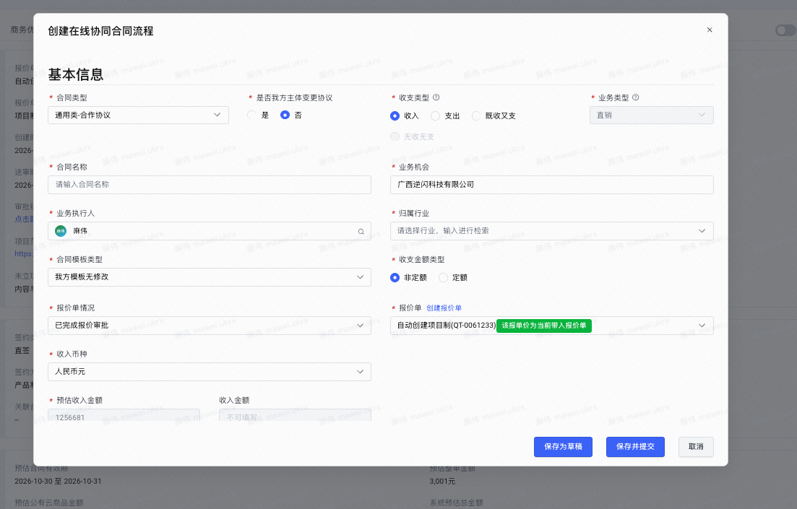
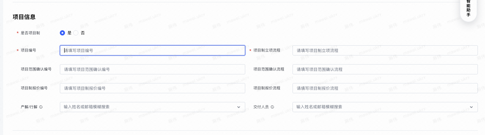

# 业务操作

项目制报价单, 商品信息中有一些==定制化的内容==

1. 例如这里的 非标软件-自研 非标品内容



项目制报价单 仅能发起 ==在线协同流程==



我们也可以在 费用中心创建 对应的 包含 项目制信息的 合同



## 业务理解

1. 项目制合同 合同就是 ==客户想要定制化需求、平台== 的合同

2. 我们系统支持通过 销售合同/在线协同 发起对应的 项目制合同

# 从代码的角度去看

## 校验合同与报价的项目制属性是否一致

业务含义：不能把项目制报价关联到标成非项目制的合同上，反过来也一样。

```go
quoteWhetherProject := _const.No
if req.BizInfo.QuoteType == _const.QuoteTypeProject {
    quoteWhetherProject = _const.Yes
}

if len(whetherProject) != 0 &&
    !strings.EqualFold(whetherProject, quoteWhetherProject) {
    return errors.ErrCommon.WithArgs(
        i18nfmt.Sprintf(ctx, "报价单[%s]项目制与合同项目制不一致", req.Identifier))
}
```

## 项目制合同增加项目资料校验

- 未关联报价、项目制、收入类／既收又支：通常要求项目编号、立项流程、项目报价编号、报价流程。
- 未关联报价、项目制、支出类／无收无支：要求项目编号、立项流程。
- 已经关联报价：这个函数直接跳过；部分报价场景也有例外。

## 履约交接：把项目制属性传给下游

业务含义：告诉履约系统这份合同是否属于项目制，具体执行方式由下游判断。

```go
IsProjectBased: basicInfo.WhetherProject == _const.Yes,
```
