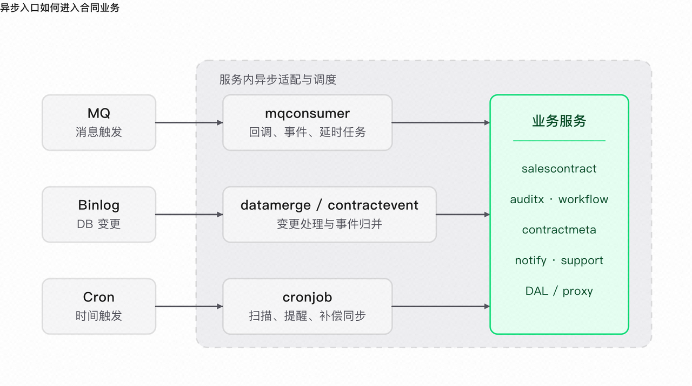

# 总览

从接口层面出发 :

1. 项目在启动的时候 会启动 ==HTTP 服务 和 Cron 服务== 

2. HTTP 服务分为 ==vcc、vcp、inner-top== 这几个接口

3. 不同接口根据不同鉴权方式允许不同的方式获取数据 

4. 业务实现层 分为 标准合同走 workflow , 销售合同和在线协同 走 ==salescontract + auditx== 审批流程

5. 异步的数据出了 Cron 还有 EventBus 和 MQ 以及 BinLog

