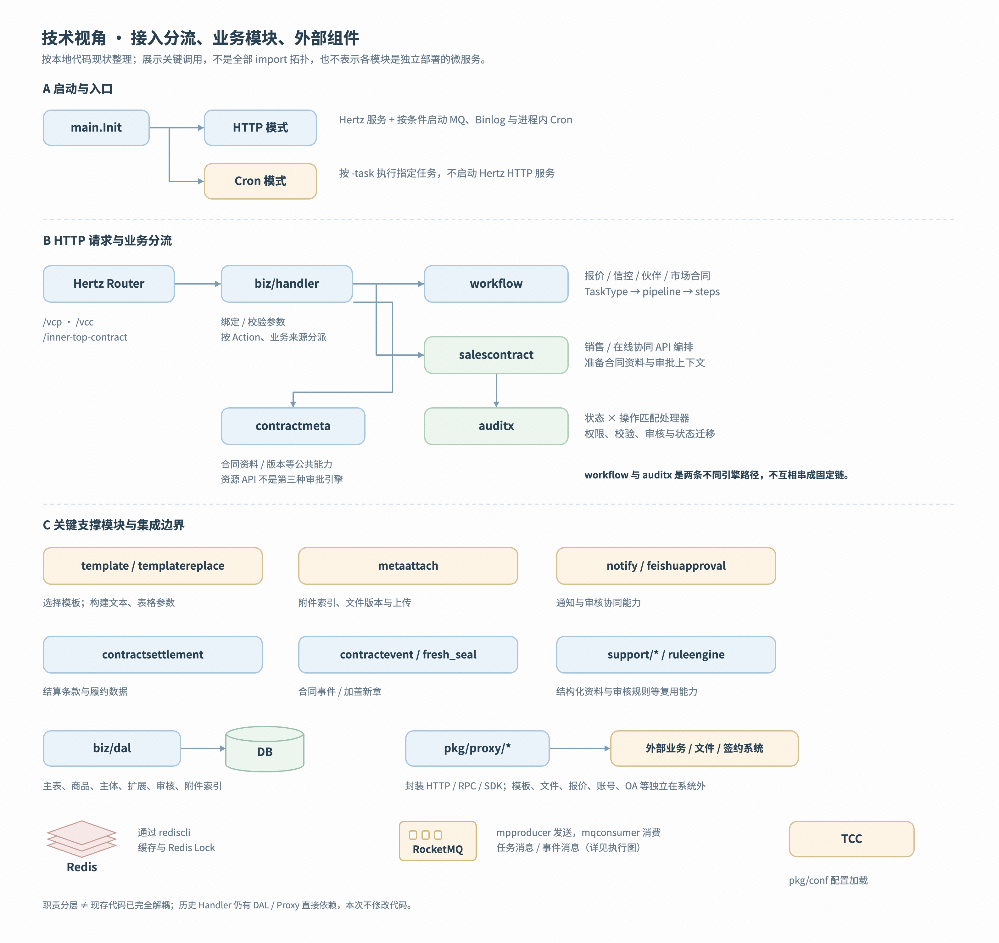

# 启动方式

1. 同一个程序支持 ==HTTP 常驻模式== 和 ==Cron 任务模式==

   - 默认 `-mode http`：启动 Hertz HTTP 服务；满足环境、配置条件时，还会启动 MQ、Binlog 消费者及 ==**进程内定时任务**==

   - `-mode cron -task 方法名`：执行指定任务后返回，**不启动 HTTP 服务**

## HTTP 接口划分

HTTP 接入按权限边界组织，业务再按动作分流 , 主路由分为 `/vcp`、`/vcc` 和 `/inner-top-contract`

biz/handler 绑定并校验请求，==按 Action、版本和业务来源选择服务==。按职责可以分为业务合同动作、销售／在线协同动作、合同资源查询与操作；

- `workflow`：承载报价、信控、伙伴、伙伴报价、市场合同等业务流水线。启动时注册任务与步骤；每次 Process 根据 TaskType 执行一条已注册 pipeline，并开启独立 DB 事务。
- `salescontract`：承接销售／在线协同 API 编排，准备合同资料、模板参数和审批上下文。创建与操作流程调用 auditx.Handle。
- `auditx`：按当前合同状态和操作选择处理器，执行权限检查、动作校验、处理、审核人更新与状态迁移。它是审批执行引擎，不等于整个在线协同业务。
- `contractmeta`：提供合同元数据、版本等公共能力；附件、商品、结算等资源还有各自服务。资源查询不必经过 workflow 或 auditx。

## 外部组件

- **`DB`**：
   - biz/dal 封装数据库访问，事务由具体 service／引擎开启并把 tx 传到读写操作，不是 DB 组件自行编排业务。

- **`Redis`**：
   - rediscli 封装缓存与锁。哪些入口取锁、锁覆盖什么范围，需要看具体调用；不能给所有业务流程统一画一个虚构的 Redis Lock。

- **`RocketMQ`**：
   - mpproducer 是生产者模块
   - mqconsumer 是消费者模块，RocketMQ 是独立消息基础设施；三者不是同一个组件。

- **`外部调用与配置`**：
   - pkg/proxy/ 封装报价、账号、模板、文件、OA／飞书等 HTTP／RPC／SDK 调用；pkg/conf 负责 TCC 配置加载。

