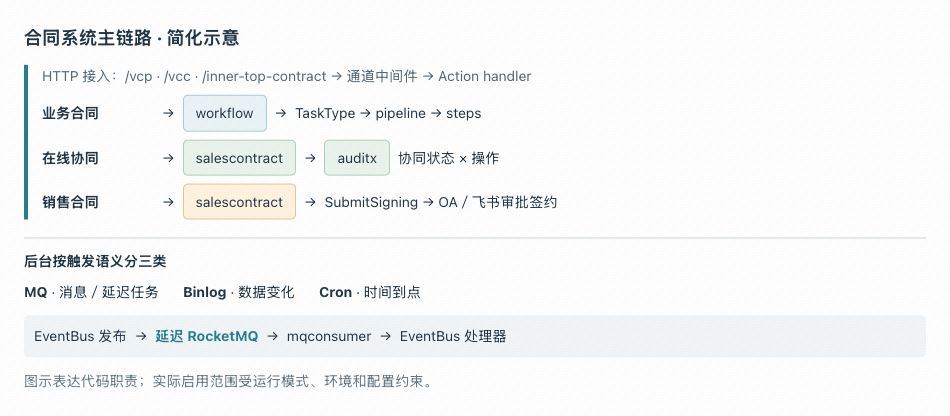

# 总览

从接口层面出发 :

1. 同一个程序支持 ==HTTP 常驻模式== 和 ==Cron 任务模式==

   - 默认 `-mode http`：启动 Hertz HTTP 服务；满足环境、配置条件时，还会启动 MQ、Binlog 消费者及==**进程内定时任务**==

   - `-mode cron -task 方法名`：执行指定任务后返回，**不启动 HTTP 服务**。

2. HTTP 服务分为 ==vcc、vcp、inner-top== 这几个接口

3. 不同接口根据不同鉴权方式允许不同的方式获取数据 

4. 业务实现层 分为 标准合同走 workflow , 销售合同和在线协同 走 ==salescontract== 审批流程 

   - 在线协同走 `auditx` 审批流

5. 异步数据 从触发方式看有 ==MQ消息驱动、Binlog数据变更驱动、Cron时间驱动== 

