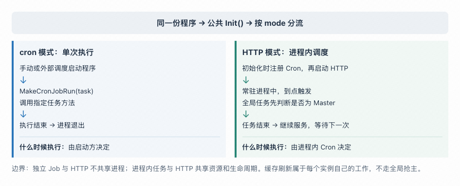
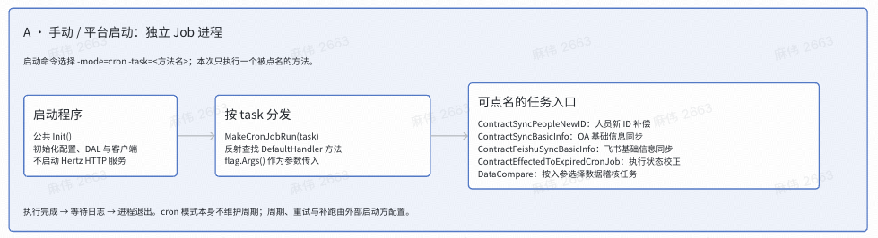
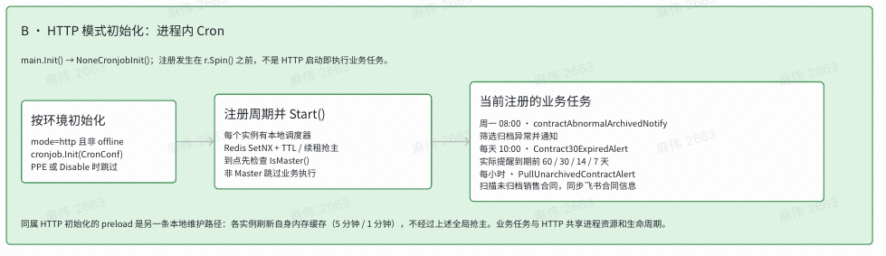
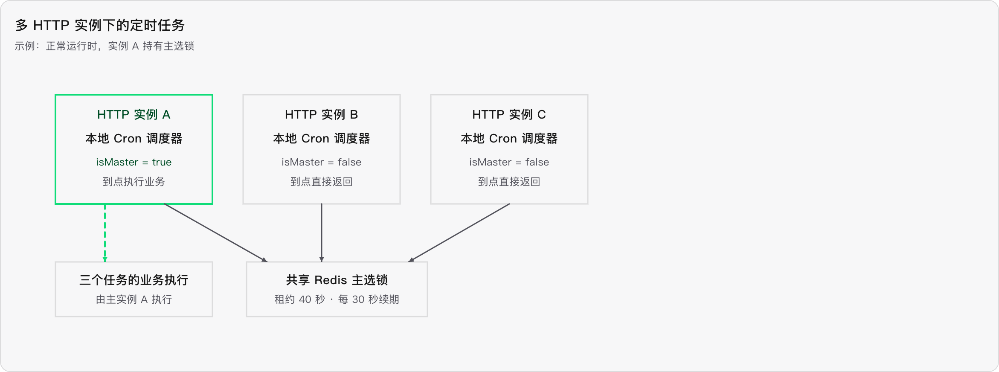

项目内的定时任务分为

1. 手动调用/平台调用 单次执行

2. HTTP 模式 : 进程内调度

# 点名执行的定时任务

- 通过 ==-mode=cron -task=<方法名> 启动程序。==

- 公共 Init() 完成后，MakeCronJobRun(task) 反射查找 cronjob.DefaultHandler 上的指定方法，将 flag.Args() 作为参数传入。

注册的任务如下 :

1. ContractSyncPeopleNewID：人员新 ID 补偿
2. ContractSyncBasicInfo：OA 基础信息同步
3. ContractFeishuSyncBasicInfo：飞书基础信息同步
4. ContractEffectedToExpiredCronJob：执行状态校正
5. DataCompare：按入参选择数据稽核任务

# HTTP 注册的定时任务

- main.Init() → NoneCronjobInit() → cronjob.Init() 在 r.Spin() 之前注册 Cron 并启动调度器，==不是“HTTP 服务启动时立即执行业务”。==

  仅 mode=http 且非 offline 时进入该初始化；cronjob.Init() 还受 PPE、CronConf.Disable 和配置完整性约束。

- 每个启用实例都有本地调度器，masterelection 通过 Redis SetNX、TTL 和续租维护主实例身份；任务到点先检查 IsMaster()，非主实例跳过业务执行。当

注册的任务如下 :

1. 每周一 08:00：contractAbnormalArchivedNotify，筛选归档异常合同并通知。
2. 每天 10:00：Contract30ExpiredAlert，实际分别提醒到期前 60、30、14、7 天的合同，而非仅提前 30 天；另有实时关闭到期提醒的配置开关。
3. 每小时：PullUnarchivedContractAlert，扫描未归档销售合同，通过 feishuservice.ContractInfoChange 同步飞书合同信息。注册处旧注释写“OA”，应以实际调用为准。

## 多实例问题

1. 每个进程调用`cron.New()` 、注册任务、`Start()` 。包级变量`cronJob` 只在当前进程内共享。

2. 每个实例争抢 Redis 主选锁，租约 40 秒 ，每 30 秒 续期。

3. 到点后，所有实例都会进入任务函数，但先检查本地`IsMaster()` ；非主实例直接返回。

