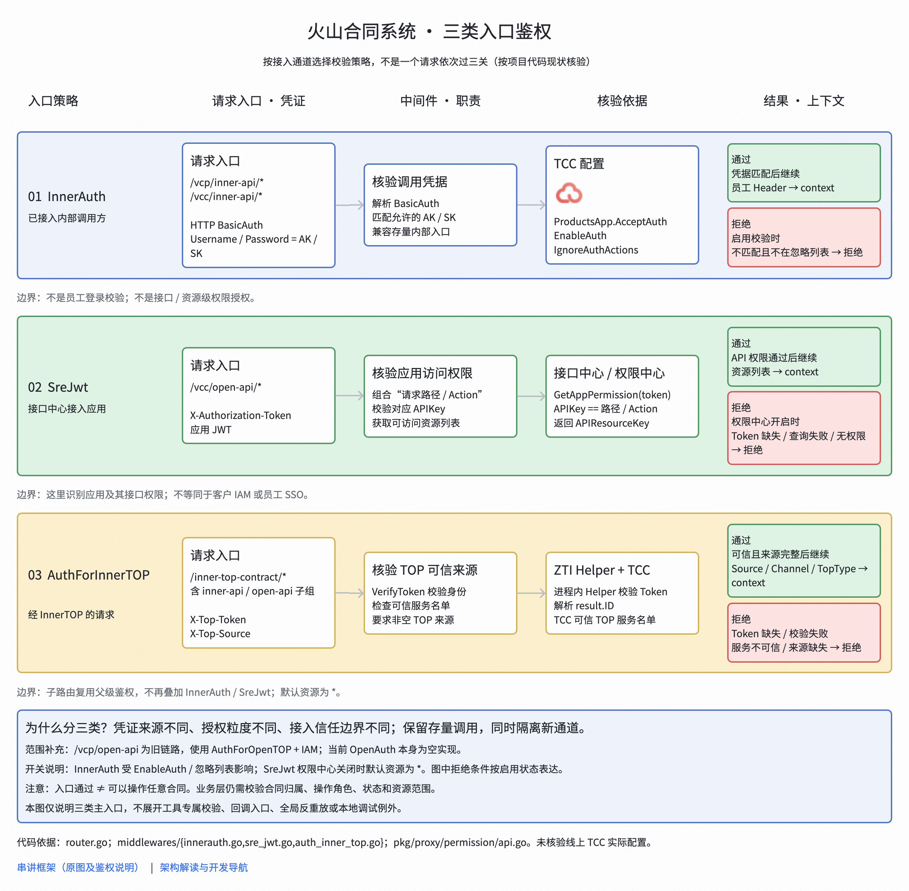

# 鉴权分类

接口鉴权主要分为

**InnerAuth** : BasicAuth ，根据 TCC 的配置判断传入进来的 Username 和 Password 是否配对的上

**SreJwt** : 根据传入的 X-Authorization-Token 进行校验

**AuthForInnerTOP**: 根据传入的 X-Top-Token 进行鉴权

## InnerAuth

**请求入口 :**

1. 接口 `/vcp/inner-api` 、`/vcc/inner-api/`

2. 通过传入 `Username / Password  = AK/SK` 进行鉴权

**鉴权方式 :**

1. 通过 ==将几个账号配置在 TCC 中, 鉴权的时候去获取 TCC 的账号, 并且判断==

**个人理解 :**

1. InnerAuth 的 鉴权方式相当于是 **固定了人员白名单**, 请求的时候通过对应的账号请求

2. 涉及到的接口 都是些内部接口，==看着不会提供给外部== , 作用可能仅是用来 调试 ？

## SreJwt

**请求入口 :**

1. 接口 `/vcc/openapi`

2. 通过传入 `X-Authorization-Token` 进行鉴权

**鉴权方式 :**

1. 通过获取 `GetAppPermission` 进行鉴权, 当 `Apikey == path/Action` 的时候表示可以访问

**个人理解 :**

1. 看着是基于 ==个人账户允许访问路径== 进行配置的

## AuthForInnerTOP

**请求入口 :**

1. 接口 `/inner-top-contract/`

2. 通过传入 `X-Top-Token` 进行鉴权

**鉴权方式 :**

1. 引入了第三方的 `ZTI TOken` 平台

2. 校验 `Token` 是否在可信名单里面

**个人理解 :**

1. 感觉相当于是 IP 白名单，不过是更高的用户白名单，由第三方平台进行管理
