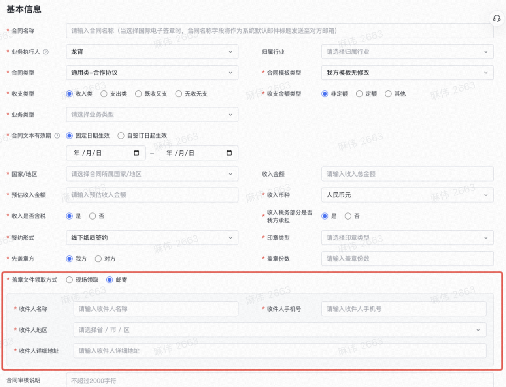
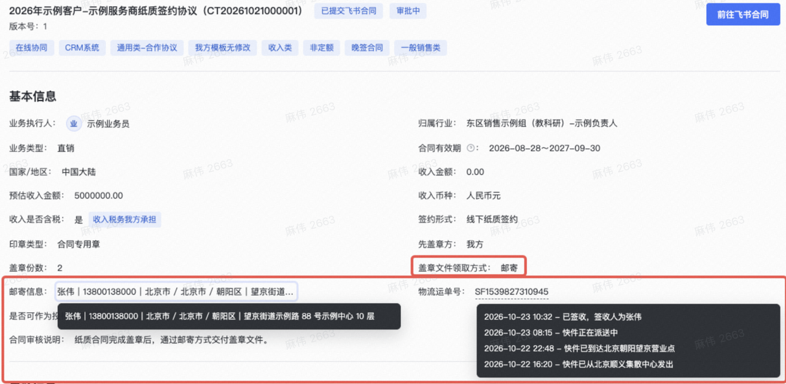

# 大体需求

1. 需要在 发起合同选择 ==纸质签约== 的时候, 新增对应的==盖章领取方式==

   - 盖章领取方式为, `现场领取` 和 `邮寄`

   - 当选择为 `邮寄` 的时候, 需要支持收件人信息的填写 和 校验

2. 当我们提交到飞书合同中后, 预计可以看到 ==对应的邮寄信息==

3. 飞书侧可能会有合同改动操作，因此数据同步时，需要更新飞书的合同数据

4. 对于历史存量数据，对于已经过节点的，不需要进行必填校验

   - 对于在途合同没有填写过节点的，进入对应节点后需要处理对应的校验

