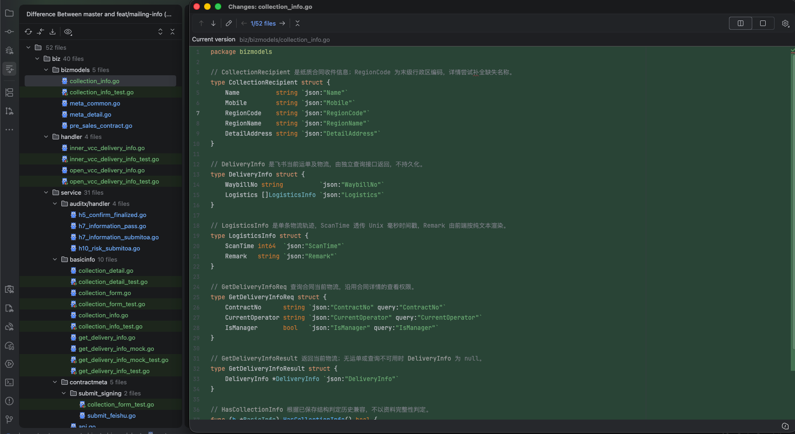

# 本次改动总览

总共改动 `52` 个文件, 涉及模块如下 :

@Ai_todo_Generate



## bizmodels

collection_info.go 增加了基本响应字段 CollectionRecipient、DeliveryInfo、LogisticsInfo、GetDeliveryInfoReq、GetDeliveryInfoResult

作用 : 看着是限制 前后端清空 的 Struct 不是 dal 层的字段

meta_common.go 更改了 在 BasicInfo 中增加了 CollectionMethod 和 Recipient

作用 : 看着是 service 层用到的 basic Info 增加对应的新字段

## handler

这应该是直接 对应接口的 package

1.  inner、openvcc 增加 GetDeliveryInfo20210101 看着是比较 常规的包装

包装 GetDeliveryInfo20210101 加入对应的鉴权 、响应请求

## Service/auditx/handler

1. 在线协同各个审批节点 涉及到 提交 & 修改的节点 增加本次的校验

@Ai_todo_Generate

## BasicInfo

### CollectionDetail.go

1. CRM 侧不想做 RegionName 的格式转换，因此这里需要额外增加了一个 Func 用于补充 `RegionName`

### CollectionFrom.go

1. 构建本次飞书提交的表单
2. 同步飞书改动的表单内容

** 构建本次飞书提交的表单: BuildCollectionForm**

基本思路 :

1. 判断是否是 历史合同 `HasCollectionInfo`
2. 进行主体校验 `CollectionEligible`
3. 判断是否有对应的 `FeiShuConst` 字段
4. 构建对应的表单的数据

   - 这里额外查了一次 `Region` 用于传递给飞书 `RegionCode` 的内容 。 已确认

**同步飞书改动的表单内容: SyncCollectionForm**

1. 获取飞书改动的表单内容 ，先判断对应的 `key` 确认对应的 method
2. 判断是否更改
3. 如果更改的话，判断对应字段的更改信息，这里又会额外去获取一层 RegionName
4. 校验整个表单内容

### CollectionInfo.go

**判断主体地区是否符合要求 : CollectionEligible**

1. 根据主体地区判断是否符合要求，只有符合地区的内容才支持放行

**保存请求: PrepareCollectionInfo**

1. 保存请求
2. 校验对应的结构

**校验已经保存的内容: ValidateStoredCollectionInfo**

### GetDeliveryInfo.go

1. mockGetDeliveryInfo 获取模拟数据
2. 判断合同是否可以获取对应的数据
3. 请求飞书的接口获取对应的合同信息
4. 解析对应的物流信息

### GetDeliverInfoMock.go

1. Mock 对应的模拟数据

### Contractmeta/SubmitFeishu.go

1. 提交飞书的时候 如果是邮件领取 那么清空对应的 领取地点内容

2. 追加领取方式 和 收件资料

### Contractmeta/api.go

1. MetaDetail 接口下补充 DB 中的内容

2. 并且补充 RegionName

### FeishuService/common.go

1. 根据飞书那边改动 进行校验
2. 如果是 MAIL 方式 则判断每个字段是否正确，如果改动了 RegionCode 需要更改对应的 RegionName

### MasterData/Region.go

1. 新增 查询 Region 的内容

### SalesContract/api.go

1. pre_contract , 在线协同的 CreateOrUpdate 的 时候校验一下对应的 CollectInfo

### SalesContract/create_or_update.go

2. salescontract 销售合同的 CreateOrUpdate 校验对应的 CollectInfo

### SalesContract/get_delivery_info.go

1. 请求飞书物流信息，重新查一次DB 获取 basicInfo 的内容
2. 如果是在线协同 还需要额外确认一下是否有权限

### SalesContract/get_pre_contract.go

1. 把权限校验的 Func 单独拆出来

### SalesContract/list_contract.go

1. 合同列表接口不需要返回对应的收件人信息

### cronjob

1. 定时同步飞书合同的内容 加上本次收件人信息的同步

### Pkg

1. Config 增加对应的 FeiShuConfig_apikey

### FeishuClient

增加请求逻辑内容

### mdCli

1. 增加请求主数据的接口

---

# 本次追加走读：纸质签约邮寄信息

本节依据服务端 `feat/mailing-info` 分支的 `f47bfe17e`，对比基线 `master` 的 `4b04c165c`。该基线也是本次读取时的 `origin/master`；追加内容描述当前实现，上文笔记和待补充标记保持原样。

需求范围为[「合同PRD」火山&飞书融合-合同第 6.3 节](https://bytedance.larkoffice.com/wiki/CfyYwFnY3iXcD3ko7NMcAKSPn0d#JIUvdkjghoV0Ylx5731cDuf3nBf)，本次读取版本为 `76848`。同时核对了[小邮局对接手册](https://bytedance.larkoffice.com/docx/AEzBd67ixoZDIcxayeccdDjbnsb)版本 `330`，以及本地 `/Users/yuean/vcp_clients` 的同名分支 `db2d788` 和其工作区改动。

**主链路已经接入：火山保存收件资料 → 提交飞书表单 → 飞书变更回写 → 火山详情回显；运单和轨迹由独立接口实时查询。**本次是源码与现有测试代码走读，未重新执行单测、页面验收或真实飞书写入，因此不能据此签署完整产品验收通过。

## 1. 改动总览补充

### 1.1 当前分支的文件统计与模块职责

按 `git diff master...HEAD`，服务端当前是 **49 个文件，包含 30 个实现文件和 19 个测试文件**。这一统计不包含工作区 `.gitignore` 和未跟踪的验收文档；上文的“52 个文件”属于此前记录口径。

此表补充上文“本次改动总览”中的 `@Ai_todo_Generate`。

| 模块                                        | 本次职责                                                                 | 主要落点                                                                                   |
| ------------------------------------------- | ------------------------------------------------------------------------ | ------------------------------------------------------------------------------------------ |
| `biz/bizmodels`                             | 定义领取方式、收件资料、独立物流请求与响应；表达未传和清空语义           | `collection_info.go`、`meta_common.go`                                                     |
| `biz/handler`                               | 新增 `GetDeliveryInfo` Action，承接 inner/open 请求并调用 service        | `inner_vcc_delivery_info.go`、`open_vcc_delivery_info.go`                                  |
| `biz/service/basicinfo`                     | 统一处理适用条件、保存校验、飞书表单往返、详情回显和物流解析             | `collection_info.go`、`collection_form.go`、`collection_detail.go`、`get_delivery_info.go` |
| `biz/service/salescontract`                 | 后台与在线协同保存入口接入；提交时兜底校验；独立物流查询复用在线详情权限 | `api.go`、`create_or_update.go`、`get_delivery_info.go`、`get_pre_contract.go`             |
| `biz/service/auditx/handler`                | 在四个原业务动作的校验末尾追加收件资料完整性校验                         | h5 定稿、h7 完善通过/提交、h10 风险提交                                                    |
| `biz/service/contractmeta`                  | 内部和开放详情补回收件资料；列表移除收件对象；提交飞书时追加表单         | `api.go`、`submit_signing/submit_feishu.go`                                                |
| `biz/service/feishuservice`                 | 在既有飞书基本信息同步中合并新增表单字段                                 | `common.go` 的 `FetchBasicInfo`                                                            |
| `cronjob`                                   | 补偿扫描时同步领取方式和收件资料                                         | `contract_feishu_sync_basic.go`                                                            |
| `biz/service/masterdata`、`pkg/proxy/mdcli` | 查询大陆区县，转换行政区编码与主数据编码，补全省市区名称                 | `masterdata/region.go`、`mdcli/api.go`、`mdcli/model.go`、`mdcli/init.go`                  |
| `pkg/proxy/feishucli`                       | 承接飞书查询结果的物流数组，让 HTTP 请求遵守调用方 context               | `model.go`、`api.go`                                                                       |
| `pkg/conf`、`pkg/const`                     | 配置各环境飞书字段和选项映射；定义本地领取方式枚举                       | `configs.go`、`paper_collection.go`                                                        |

当前最终差异没有修改 DAO 或数据库表结构；没有新增独立收件表，也没有新增收件信息加密存储逻辑。

### 1.2 两组信息的职责不同

| 信息                         | 保存位置或获取方式              | 使用场景                                        |
| ---------------------------- | ------------------------------- | ----------------------------------------------- |
| `BasicInfo.CollectionMethod` | 随已有 `basic_info` JSON 持久化 | 创建、编辑、审批校验、飞书同步、详情回显        |
| `BasicInfo.Recipient`        | 随已有 `basic_info` JSON 持久化 | 保存收件人名称、手机号、地区编码/名称和详细地址 |
| `DeliveryInfo`               | 调用飞书查询接口获取，不持久化  | 详情页通过独立 `GetDeliveryInfo` 加载运单和轨迹 |

因此，`CollectionRecipient` 虽然定义在 `bizmodels`，既是接口模型，也是 `BasicInfo` JSON 的嵌套结构。它最终会进入数据库的 `basic_info` 字段；不能仅理解为前后端传输结构。

`DeliveryInfo` 是查询结果，当前不放在合同详情模型中，也不作为创建、编辑合同的入参。

## 2. 模型、空值与历史兼容

入口：[bizmodels/collection_info.go](file:///Users/yuean/volc_contract_process/biz/bizmodels/collection_info.go)、[bizmodels/meta_common.go](file:///Users/yuean/volc_contract_process/biz/bizmodels/meta_common.go)。

`CollectionMethod` 是 `*string`，本地枚举为 `SELF_PICKUP` 和 `MAIL`。`Recipient` 是 `*CollectionRecipient`，包含 `Name`、`Mobile`、`RegionCode`、`RegionName`、`DetailAddress`。两个指针字段均使用 `omitempty`。

| 结构或输入                      | 当前含义                                                       |
| ------------------------------- | -------------------------------------------------------------- |
| 保存数据中两个新增字段均为 nil  | `HasCollectionInfo()` 为 false，按历史未接入结构处理           |
| `CollectionMethod` 指向空字符串 | 已有新结构，但领取方式未选择或已清空；不属于历史缺字段         |
| `Recipient` 为非 nil 的空对象   | 已有新结构，但收件资料为空；不属于历史缺字段                   |
| 编辑请求未传领取方式或收件对象  | 分别继承数据库旧值，避免旧客户端修改其他字段时丢失资料         |
| 编辑请求传 `Recipient:null`     | 解码后同样为 nil，仍按未传继承旧值；不是清空整个对象的独立指令 |
| 领取方式改为自取或合同不再适用  | `PrepareCollectionInfo` 清理 `Recipient`                       |

`HasCollectionInfo` 判断的是结构是否出现，**不判断资料是否完整，也不判断合同实际经过了哪个历史节点**。当前未依赖额外的 `CollectionInfoRequired` 字段或 `Enabled` 开关。

后台新建时，缺失的领取方式会被转为非 nil 的空字符串，适用场景随后执行必填校验；旧合同且新旧数据都没有新增字段时，直接兼容返回。历史未过填写节点的合同可以通过现有入口写入新字段，但页面是否展示和要求填写，仍要核对对应页面、动作与实际请求。

## 3. 保存、适用条件和审批节点

### 3.1 `CollectionEligible`：控制填写场景

入口：[basicinfo/collection_info.go](file:///Users/yuean/volc_contract_process/biz/service/basicinfo/collection_info.go)。

同时满足下列条件才适用新增填写规则：

1. `BizScene` 为销售合同。
2. `BizSource` 为后台发起 `BizSourceFee` 或在线协同 `BizSourceCooperation`。
3. `SignatureType` 为项目中的纸质签约常量 `SignatureOfflineElectronicSignature`。
4. 我方主体存在，且全部主体的注册地区属于大陆、香港、澳门或台湾。

主体地区来自主体主数据，不使用客户端传入的国家名称作为判断依据。优先使用 `SubjectNo`；既有请求只传 `LegalPartyNumber` 时，通过预加载主体映射还原 `SubjectCode`，避免错误判断为不适用后清空收件资料。

这里检查全部我方主体，没有按是否需要签约进行过滤，与 PRD 可见评论“不忽略无需签约的我方主体”一致。主体无法解析或缺地区资料时可能返回不适用；下游查询失败则返回查询错误。这一区别关系到资料清理，联调时应确认请求中的主体能正常映射。

### 3.2 `PrepareCollectionInfo`：先合并旧值，再清理和校验

处理顺序为：解析旧 `BasicInfo` → 未传字段继承旧值 → 判断历史结构 → 查询适用条件 → 清理失效收件资料 → 按保存阶段决定校验强度。

| 保存场景                     | 当前行为                                     |
| ---------------------------- | -------------------------------------------- |
| 后台新建适用纸质合同         | 要求领取方式；选择邮寄时要求完整收件资料     |
| 已有后台草稿编辑             | 暂存，直接跳过后续邮寄格式与完整性校验       |
| 在线协同未创建或草稿         | 暂存，直接跳过后续邮寄格式与完整性校验       |
| 其他保存阶段，且新结构已出现 | 调用 `ValidateCollectionInfo(b, true)`       |
| 不适用新增填写条件           | 清理收件对象，将领取方式保留为空字符串后返回 |
| 旧合同及本次请求均没有新结构 | 保留历史豁免                                 |

这里需要明确区分“草稿允许缺项”与“草稿允许非法格式”：当前两个草稿分支直接 `return nil`，连已填写值的格式也跳过了。已有测试把未知枚举、非数字手机号、超长手机号、501 字姓名/地址的草稿保存视为成功；这是当前行为证据，不代表这些输入符合 PRD 格式要求。

### 3.3 两类保存入口的实际位置

上文两个 `salescontract` 文件的职责，在当前代码中对应如下：

| 入口                                                                                                                                                              | 合同场景     | 新增调用位置                                                                       |
| ----------------------------------------------------------------------------------------------------------------------------------------------------------------- | ------------ | ---------------------------------------------------------------------------------- |
| [salescontract/api.go](file:///Users/yuean/volc_contract_process/biz/service/salescontract/api.go) 的 `salesContractServiceImpl.CreateOrUpdate`                   | 后台销售合同 | 原状态、请求及业务模式条款校验之后调用 `PrepareCollectionInfo`                     |
| [salescontract/create_or_update.go](file:///Users/yuean/volc_contract_process/biz/service/salescontract/create_or_update.go) 的 `CreateOrUpdateReq.GenProcessCtx` | 在线协同     | 原 `preFill`、`validate` 之后，`fillUpdateEntity` 之前调用 `PrepareCollectionInfo` |

在线协同的 `isNew` 在查询/构建过程前取得，用于保持首次创建与编辑的区别。校验处理后的字段继续沿原保存流程序列化到 `basic_info`，没有新增 DAO 保存路径。

### 3.4 审批节点补充

此表补充上文 `Service/auditx/handler` 中的 `@Ai_todo_Generate`。本次追加的是校验，不是新增审批节点或状态流转。

| 原业务动作                                                                                                                                              | 新增校验位置                  | 与原逻辑的关系                                             |
| ------------------------------------------------------------------------------------------------------------------------------------------------------- | ----------------------------- | ---------------------------------------------------------- |
| [h5_confirm_finalized.go](file:///Users/yuean/volc_contract_process/biz/service/auditx/handler/h5_confirm_finalized.go) 的定稿 `Validate`               | 原校验全部通过后              | 返回 `ValidateStoredCollectionInfo(ctx, pc.PreContractVO)` |
| [h7_information_pass.go](file:///Users/yuean/volc_contract_process/biz/service/auditx/handler/h7_information_pass.go) 的完善信息通过 `Validate`         | 原 `IsReverseContract` 成功后 | 原倒签错误仍优先返回，再检查收件资料                       |
| [h7_information_submitoa.go](file:///Users/yuean/volc_contract_process/biz/service/auditx/handler/h7_information_submitoa.go) 的完善信息提交 `Validate` | 原 `IsReverseContract` 成功后 | 原错误分支保留，再检查收件资料                             |
| [h10_risk_submitoa.go](file:///Users/yuean/volc_contract_process/biz/service/auditx/handler/h10_risk_submitoa.go) 的风险提交 `Validate`                 | 原校验及数据处理之后          | 返回已保存收件资料校验结果                                 |
| `salescontract/api.go` 的 `submitValidate`                                                                                                              | 原后台提交校验之后            | 增加后台提交前兜底                                         |

`ValidateStoredCollectionInfo` 从数据库模型解析 `BasicInfo` 和交易方：先判断历史结构，再判断适用条件，最后使用 `required=true`。历史完全缺字段时不会新增阻断；已经出现新结构的适用合同则要求完整。

`ValidateCollectionInfo` 的具体约束是：领取方式只允许两个枚举；邮寄姓名与详细地址按 Unicode 字符计数最多 500 字；手机号仅允许 ASCII 数字、最长 11 位，**没有额外要求恰好 11 位**；完整性校验时姓名、地区和地址不能仅含空白，手机号不能为空。此函数本身不查询地区是否合法，地区映射在飞书表单构建时处理。

## 4. 火山与飞书的双向同步

### 4.1 `BuildCollectionForm`：把本地资料转换成飞书字段

入口：[basicinfo/collection_form.go](file:///Users/yuean/volc_contract_process/biz/service/basicinfo/collection_form.go)。

流程是：历史结构检查 → 查询主体适用条件 → 计算实际领取方式 → 决定省略或清空 → 检查映射配置 → 构建表单。

| 本地信息                  | 飞书 `attribute_value`                                  | 配置项                                             |
| ------------------------- | ------------------------------------------------------- | -------------------------------------------------- |
| `SELF_PICKUP` / `MAIL`    | 含选项 `key` 的对象                                     | `CollectionMethodCode`、`SelfPickupKey`、`MailKey` |
| `Recipient.Name`          | 字符串                                                  | `RecipientNameCode`                                |
| `Recipient.Mobile`        | 字符串                                                  | `RecipientMobileCode`                              |
| `Recipient.RegionCode`    | 查询主数据后，发送单元素数组 `[]string{region.MdmCode}` | `RecipientRegionCode`                              |
| `Recipient.DetailAddress` | 字符串                                                  | `RecipientAddressCode`                             |

本地存行政区编码，飞书接收完整 `MDCA` 主数据编码。当前小邮局手册版本 `330` 的创建/更新示例已经使用带 `MDCA` 前缀的值，并明确数组只能有一个元素；提交接口还会验证该编码能否在主数据查到。当前实现保留前缀，与该版本协议一致。

`RegionName` 用于本地展示，不作为单独字段发送给飞书。表单构建使用 `ValidateCollectionInfo(..., false)` 校验已有值格式，完整性由保存和原必填节点负责。

### 4.2 不同场景的省略与清空

| 场景                                   | 本次表单行为                                     |
| -------------------------------------- | ------------------------------------------------ |
| 历史数据完全没有新增结构               | 不追加本期字段                                   |
| 不适用或方式为空，且 `ContractId` 为空 | 首次提交省略本期字段                             |
| 不适用或方式为空，但已有 `ContractId`  | 发送空领取方式、空文本、空地区数组，表达远端清理 |
| 自取                                   | 发送自取选项，同时发送四项空收件字段             |
| 邮寄                                   | 发送邮寄选项和对应收件字段；地区转换失败返回错误 |

“未发送字段”与“发送空值”有不同目的：前者兼容历史和首次不适用场景，后者用于清理已有飞书合同的失效资料。远端更新是否按这些空值清理，应通过邮寄转自取、纸质转非纸质的真实请求验证。

### 4.3 `submit_feishu.go`：接入统一表单

入口：[contractmeta/submit_signing/submit_feishu.go](file:///Users/yuean/volc_contract_process/biz/service/contractmeta/submit_signing/submit_feishu.go)。

`BuildSubmitParam` 通过 `buildFeishuApplyForm` 组装原有表单和本期表单，最后整体序列化到 `params["form"]`。`SubmitSigning` 沿原逻辑创建或更新飞书合同，再提交或重提。仅把收件人保存在火山数据库中，并不会自动传给飞书。

构建原领取地点时记录其下标；仅当实际发送的领取方式为邮寄，才从本次表单移除旧领取地点。自取、历史缺字段及不适用场景继续沿用原领取地点。

这一步只影响本次请求，没有清空数据库的 `ManageInfo.ReceivingPlace`，也没有发送旧领取地点的显式清空值。既有飞书合同更新时，省略字段是否保留旧值、邮寄提交是否允许没有领取地点，仍需核对远端约束。

### 4.4 `SyncCollectionForm`：部分更新和失败保护

飞书查询的 `form` 是一个 JSON 字符串，内部为 `attribute_code`、`attribute_value` 数组。函数先建立字段索引，复制 `BasicInfo`，需要修改收件资料时再复制 `Recipient`，全部解析成功后才一次性写回。

`changed`、`recipientChanged` 表示回包是否出现相应字段，不是比较新旧值是否相等。

| 飞书返回形态                             | 当前处理                         |
| ---------------------------------------- | -------------------------------- |
| 没有本期字段                             | 原值保持                         |
| 已有邮寄方式，回包只修改部分收件项       | 只修改出现的字段，其余保留       |
| 文本为 `""` 或 `null`                    | 清空对应字符串                   |
| 本次方式为自取或空值                     | 清理整个收件对象                 |
| 地区为一个完整主数据编码                 | 反查行政区编码及省市区名称       |
| 地区为 `[]` 或 `null`                    | 清空地区编码和名称，不查询主数据 |
| 地区数组超过一个元素、类型错误或未知选项 | 返回解析错误，不写回副本         |
| 地区反查失败                             | 返回错误，保留旧领取与收件资料   |

地区先还原成行政区编码再与旧值比较：同地区且旧名称存在时保留名称；换地区、缺名称或清空地区时更新名称。这样避免同一地区的编码往返误清空已有展示值。

### 4.5 真正落库的调用方

`SyncCollectionForm` 只合并内存对象，不直接写数据库。两条调用链负责持久化：

1. [feishuservice/common.go](file:///Users/yuean/volc_contract_process/biz/service/feishuservice/common.go) 的 `FetchBasicInfo` 接入合并，既有合同变更、同步和归档等调用方继续把 `BasicInfo` 序列化并保存。
2. [cronjob/contract_feishu_sync_basic.go](file:///Users/yuean/volc_contract_process/cronjob/contract_feishu_sync_basic.go) 的 `handleFeishuSyncBasicInfo` 在构建原基本信息后接入合并，通过 `UpdateByMap` 更新 `basic_info`。

因此正向提交和反向落库都已有接入点。**失败恢复仍有缺口：两个新增调用点都只记录 `SyncCollectionForm` 错误，后续仍可能保存其他字段并返回成功；新增收件资料不会因该错误自动触发消息重试。**

项目已有每小时未归档合同补偿拉取，但筛选了合同状态、归档状态、协同状态和业务场景；另一个扫描入口的实际调度也需核对。不能把“存在补偿任务”直接等同于所有收件同步失败都会恢复。

## 5. 地区转换和名称补全

入口：[masterdata/region.go](file:///Users/yuean/volc_contract_process/biz/service/masterdata/region.go)、[mdcli/api.go](file:///Users/yuean/volc_contract_process/pkg/proxy/mdcli/api.go)、[mdcli/model.go](file:///Users/yuean/volc_contract_process/pkg/proxy/mdcli/model.go)。

`masterdata.GetRegion` 为整次地区查询设置 3 秒预算，覆盖缓存未命中后的首次分页请求。`QueryRegionByCode` 接受行政区编码和主数据编码，两种编码缓存同一份 `RegionData`。

| 项目       | 当前实现                                                       |
| ---------- | -------------------------------------------------------------- |
| 查询接口   | `/md/api/ca/select`，查询大陆区县                              |
| 查询条件   | `countryCode=CN`、`queryStatus=1`、`queryType=2`               |
| 分页       | 每页 1000，最多 100 页；逐页检查 context                       |
| 地区提取   | 遍历国家/省/市/区树，只提取 `MDCA` 区县节点                    |
| 行政区字段 | 当前区县模型读取响应的 `subregionCode`                         |
| 主数据字段 | 读取 `mdmCode`，保留完整前缀                                   |
| 名称格式   | 不包含国家；省、市、区以 `/` 连接；直辖市重复层级保留          |
| 缓存       | LRU 容量 5000，24 小时过期，以两种编码分别索引                 |
| 分页去重   | 按唯一主数据编码判断；更名前后共用行政区编码不直接视作分页错误 |

缺行政区编码的资料不缓存，不猜测映射；缓存写入失败记录日志，查询结果仍可返回。`queryStatus=1` 根据[主数据协议](https://bytedance.larkoffice.com/wiki/wikcnk6f9tbSUjoHXyhSYcugVdg)表示仅查询有效数据，旧地址使用的停用编码能否反查需联调确认。原协议示例没有完整展示区县 `subregionCode`，应同时以实际响应核验当前模型。

名称补全发生在两个位置：飞书地区回写，以及详情中已有编码但缺名称时。保存入口本身没有额外补名称查询；详情补全只改变响应对象，不把补全结果写回数据库。

## 6. 详情、列表与独立物流查询

### 6.1 `FillCollectionDetail`：回显已有收件资料

入口：[basicinfo/collection_detail.go](file:///Users/yuean/volc_contract_process/biz/service/basicinfo/collection_detail.go)。

调用方包括 `contractmeta.MetaDetail`、`contractmeta.Detail` 和在线协同 `GetPreContractReq.Execute`，涵盖已有内部、开放及在线详情路径。

该函数先清理响应中的收件对象，再对后台/在线协同销售合同的纸质签约解析已保存 `Recipient`；缺地区名称时尝试主数据补全，失败仅记录日志，保留其他已取得资料。非纸质签约不回显本期收件对象，并隐藏领取方式。

详情展示只按纸质签约及业务场景判断，**没有复用填写场景的我方主体地区条件**，与 PRD 对详情的条件一致。

`contractmeta` 的简略/列表组装和在线协同列表均设置响应 `Recipient=nil`。这是移除列表返回内容，不是清空数据库；详情再从保存的 JSON 恢复收件资料。四项收件信息以 `|` 聚合展示属于页面职责。

### 6.2 `GetDeliveryInfo`：先权限，再实时查询

调用链为：

```text
inner/open GetDeliveryInfo20210101
  → salescontract.GetDeliveryInfo
  → 查询最新合同和 BasicInfo，检查在线协同查看权限
  → basicinfo.GetDeliveryInfo
  → feishucli.QueryContract
  → 解析运单、复制物流轨迹并稳定倒序
```

入口：[salescontract/get_delivery_info.go](file:///Users/yuean/volc_contract_process/biz/service/salescontract/get_delivery_info.go)、[basicinfo/get_delivery_info.go](file:///Users/yuean/volc_contract_process/biz/service/basicinfo/get_delivery_info.go)。

service 要求 `ContractNo` 和 `CurrentOperator`，先查本地合同并解析基本信息。在线协同且不是管理员时，复用原详情的管理员、审核人、审核角色及操作人访问规则；不满足权限时不会查询物流。

真实飞书查询要求：后台/在线销售合同、纸质签约、`IsFeishu=true`、本地已有 `ContractId`，且配置了 `WaybillCode`。不额外要求本地领取方式为邮寄或已保存收件资料，兼容没有新字段的历史纸质合同。

| 返回情况                                 | 结果                                   |
| ---------------------------------------- | -------------------------------------- |
| 没有运单、不适用、缺查询配置或下游不可用 | `Result.DeliveryInfo` 为 null          |
| 有运单、没有轨迹                         | 保留 `WaybillNo`，`Logistics` 为空数组 |
| 有运单和轨迹                             | 按 `ScanTime` 从大到小稳定排序         |
| 飞书查询超时或父请求取消                 | 结束下游请求，物流降级为空             |

飞书查询最多等待 2 秒。运单从 `form` 的配置字段读取，轨迹从查询结果顶层 `logistics` 读取；不写数据库，不用详情缓存代替实时值。普通详情不会发起飞书物流查询，但缺地区名称时仍可能等待主数据补全。

`ScanTime` 是 `int64`，透传 Unix 毫秒时间戳，页面负责格式化；`Remark` 应按纯文本展示。手册的空字符串示例没有明确时间戳类型，当前毫秒模型还应以实际远端响应确认。

### 6.3 Handler、路由与权限来源

新增的是既有 meta Handler 上的 `GetDeliveryInfo20210101`，沿已有 Action 分发注册，因此本次不需要修改 `router.go`。

| 路径                                 | 处理器                  | 说明                                                          |
| ------------------------------------ | ----------------------- | ------------------------------------------------------------- |
| `/vcc/inner-api/meta`                | `innerVCMetaHandler`    | 沿用 inner 路由鉴权，按已有逻辑解析操作人                     |
| `/vcc/open-api/meta`                 | `openVCCMetaBizHandler` | 沿用 open 路由鉴权，并与原 open 详情一样设置 `IsManager=true` |
| `/inner-top-contract/inner-api/meta` | 同 inner Handler        | 继承 `AuthForInnerTOP`                                        |
| `/inner-top-contract/open-api/meta`  | 同 open Handler         | 继承 TOP 分组鉴权                                             |

共同使用 `Action=GetDeliveryInfo`、`Version=2021-01-01`。新接口不在 `/salesContract` 或 `/pre_contract` 上分发。

inner 请求的 `IsManager` 会继续进入 service 判断；其可信赋值应核对实际调用链。open 入口的管理员语义是沿用原开放详情规则，不能将它理解为新增了普通用户管理员认证。

### 6.4 BOE 物流样例

入口：[basicinfo/get_delivery_info_mock.go](file:///Users/yuean/volc_contract_process/biz/service/basicinfo/get_delivery_info_mock.go)。

两个指定 BOE 泳道存在样例分支。service 层的本地参数与访问检查仍先执行；进入 `basicinfo.GetDeliveryInfo` 后，命中样例会跳过常规物流适用条件、运单配置和真实飞书查询，对该泳道中的合同返回固定样例。

代码结合请求泳道、服务泳道及 BOE 判定控制命中，非 BOE 服务不能仅凭指定请求头启用样例。该分支可验证页面接口接入和模型解析；真实物流验收必须在不命中样例的环境完成。

## 7. FeiShuCli 与对外 SDK 的对应改动

这里需要区分两个客户端层次：

- 项目内 `pkg/proxy/feishucli`：火山调用飞书合同的适配层。
- 仓库 `vcp_clients`：其他服务调用火山合同接口的 SDK。

### 7.1 项目内 `feishucli`

入口：[feishucli/model.go](file:///Users/yuean/volc_contract_process/pkg/proxy/feishucli/model.go)、[feishucli/api.go](file:///Users/yuean/volc_contract_process/pkg/proxy/feishucli/api.go)。

`QueryFeishuContract` 新增 `Logistics []LogisticsInfo`，绑定飞书 `logistics`、`scanTime`、`remark`。原 `Form` 和 `FormData` 已能承接新增字段，地区和选项转换由 `basicinfo` 处理，适配层透传请求。

`doRequest` 新增 `req.WithContext(ctx)`。同样的透传也接入 `mdcli`，使物流的 2 秒预算和地区的 3 秒预算能传入 HTTP 请求。由于修改的是共享请求函数，原有调用方的取消与超时也会开始影响下游调用，回归应关注这一行为变化。

当前 `pkg/conf/configs.go` 的新增配置是 `FeishuConst.PaperCollection` 的字段和选项映射，**没有新增独立的邮寄 API key 配置**。提交检查领取及收件映射；独立物流查询使用 `WaybillCode`。

### 7.2 `vcp_clients` 三套客户端

入口：[contractmetaclient/get_delivery_info.go](file:///Users/yuean/vcp_clients/contractmetaclient/get_delivery_info.go)、[contractmetahttpclient/get_delivery_info.go](file:///Users/yuean/vcp_clients/contractmetahttpclient/get_delivery_info.go)、[precontractclient/get_delivery_info.go](file:///Users/yuean/vcp_clients/precontractclient/get_delivery_info.go)。

| SDK 包                   | 新增承接                                                                                 | 独立物流路由          |
| ------------------------ | ---------------------------------------------------------------------------------------- | --------------------- |
| `contractmetaclient`     | `BasicInfo` 的两个指针字段，领取枚举、收件及物流模型，`OpenContractMeta.GetDeliveryInfo` | `/vcc/open-api/meta`  |
| `contractmetahttpclient` | 相同字段与模型，`OpenContractMeta.GetDeliveryInfo`                                       | `/vcc/open-api/meta`  |
| `precontractclient`      | 相同字段与模型，`ContractClient.GetDeliveryInfo`                                         | `/vcc/inner-api/meta` |

三套客户端的领取枚举、JSON 字段、指针与 `omitempty` 语义，和服务端一致；物流响应均为 `Result.DeliveryInfo`，含 `WaybillNo`、`Logistics`、`ScanTime:int64`、`Remark:string`。

`precontractclient` 的版本常量名字为 `ServiceVersion20200101`，但实际值是 `2021-01-01`，与本次 Handler 版本一致。各包装负责传入查询参数、解析响应以及返回服务端错误；SDK 工作区已移除旧详情内废弃的物流字段，物流仅通过独立接口获取。

`vclient` 将原来的 `context.WithTimeout(context.TODO(), timeout)` 改为基于调用方 context。调用方取消会传播到火山 HTTP 请求，应同时注意共享客户端的原有请求行为。

本地协议核对能够确认两边字段和路由对应，但不能证明消费者已升级 SDK，或飞书服务已部署对应字段、选项和通知。页面继续只调用原详情接口时，不会获得物流。

## 8. PRD 场景覆盖与原逻辑影响

### 8.1 按 PRD 场景检查

| PRD 场景或规则                           | 当前源码覆盖                                           | 仍需验证                               |
| ---------------------------------------- | ------------------------------------------------------ | -------------------------------------- |
| 后台新建                                 | 保存入口执行适用条件及完整性校验                       | 真实请求、页面字段显隐                 |
| 后台编辑                                 | 未传字段继承，按草稿/非草稿区分校验                    | 草稿已有值的格式限制                   |
| 后台复制                                 | 新建语义会重新校验，已有准备函数测试覆盖不继承历史豁免 | 复制页面是否使用新建入口并正确传字段   |
| 后台重提                                 | 保存、提交和飞书更新/重提链路已接入                    | 真实退回重提全过程                     |
| 在线协同编辑                             | 保存入口承接；未创建/草稿允许暂存                      | 对应页面与实际动作                     |
| 在线协同审核、完善信息                   | h5、h7、h10 四个动作追加已保存资料校验                 | PRD 页面与具体动作逐项对应             |
| 全部我方主体属于大陆/港澳台              | 按主体主数据判断，兼容法人主体编码                     | 缺主体映射和混合地区请求               |
| 姓名/地址 500 字、手机号数字且最长 11 位 | 完整校验和已有值格式校验函数具备规则                   | 草稿分支跳过格式的问题                 |
| 收件地区仅支持大陆，传主数据编码         | 大陆区县查询、行政区与完整 MDCA 编码互转               | 真实地区控件往返、停用编码             |
| 飞书修改后同步                           | 通知共用逻辑与补偿扫描均接入合并及保存                 | 仅改收件项是否通知，失败重试和补偿范围 |
| 历史已过节点无需补填                     | 完全缺新结构时豁免                                     | 历史查询中的缺字段、null 等实际形态    |
| 历史未过节点支持新规则填写               | 现有入口承接新结构，已接入动作校验                     | 页面展示及未传新字段时的实际节点行为   |
| 纸质详情展示领取方式、收件资料           | 内部、开放、在线详情返回本地资料                       | `\|` 聚合、无值隐藏                    |
| 运单和轨迹实时获取                       | 独立接口查询、不落库，轨迹稳定倒序                     | 真实飞书运单变化、非样例环境           |
| 虚线、hover、时间展示                    | 服务端提供单号、轨迹和毫秒时间                         | 页面交互，前端不在本仓库               |

### 8.2 当前能确认的兼容设计

原审批校验、倒签错误分支和后台提交校验仍保留，新增校验追加在相应位置；本次没有改这些动作的 `Process` 或状态转换。在线详情权限逻辑抽取后继续用于原详情，同时被物流查询复用。

旧客户端编辑时，两个新增字段未传会继承；完全缺新结构的历史数据保留豁免。列表隐藏收件对象只处理响应，详情再恢复；普通详情不等待飞书物流。持久化继续使用原 `basic_info` 字段，没有新增数据库结构或改变其加密方式。

这些是静态兼容证据。新增主体查询、字段清理、共享 context 透传，以及返回模型变化仍有行为影响，不能仅凭代码位置断言原有逻辑完全没有回归。

### 8.3 当前边界与验收关注点

| 关注点                     | 当前触发与后果                                                                          | 后续处理或验证方向                                       |
| -------------------------- | --------------------------------------------------------------------------------------- | -------------------------------------------------------- |
| 草稿跳过格式校验           | 已有后台草稿、在线草稿直接返回，已填非法枚举或格式可以暂存                              | 区分缺项暂存和已有值格式校验；后续完整节点会拒绝非法资料 |
| 飞书收件同步失败仅记日志   | 地区查询或解析失败保留旧收件信息，但其他同步继续成功                                    | 建立可发现、可重试的收件同步恢复机制，核对补偿范围       |
| 已有自取方式的部分回包误判 | 已有 `SELF_PICKUP`，仅返回收件项且没有方式字段时，当前返回“飞书领取方式缺失”            | 区分真正没有方式与已有合法自取；核对真实回包             |
| 历史 null 变成新结构       | 原两个字段均 nil，收到方式 `null` 后保存非 nil 空字符串；以后再经适用必填节点可能被拒绝 | 核对历史真实响应及后续动作，保留历史与主动清空的区别     |
| 远端字段省略/清空语义      | 自取、失效场景发空收件字段；邮寄省略领取地点                                            | 验证飞书是否接受并清理旧值                               |
| 地区资料与有效状态         | 缺 `subregionCode` 或旧编码停用，会影响映射及回写                                       | 获取实际主数据响应核验                                   |
| 权限与共享 context         | inner 的管理员标记来源需核对；原 HTTP 调用开始遵守父请求取消                            | 检查调用方授权赋值及相关原流程回归                       |
| 固定 BOE 样例              | 命中后跳过真实物流查询                                                                  | 验收结果明确区分页面样例展示和真实联调                   |

本轮没有用旧验收报告的测试通过结果替代当前分支验证。最终上线判断还需要实际 SDK 升级、真实飞书往返、页面全场景和 CI 回归证据。

## 9. 现有测试与建议走读顺序

### 9.1 已有测试代码覆盖

| 测试位置                                                   | 检查内容                                                                 |
| ---------------------------------------------------------- | ------------------------------------------------------------------------ |
| `basicinfo/collection_info_test.go`                        | 适用条件、法人主体兼容、保存合并、草稿行为、格式边界、历史结构和必填校验 |
| `basicinfo/collection_form_test.go`                        | 表单选项与清空、部分回写、失败不污染原值、完整 MDCA 编码往返、物流排序   |
| `basicinfo/collection_detail_test.go`                      | 纸质详情范围、地区名称补全、详情不查询飞书物流、补全不改数据库 JSON      |
| `basicinfo/get_delivery_info*_test.go`                     | 历史纸质物流查询、毫秒解析、跳过条件、超时和请求取消、BOE 样例范围       |
| `salescontract/collection_info_test.go`                    | 两类保存入口、未修改资料继承、列表响应移除收件对象                       |
| `salescontract/get_delivery_info_test.go`                  | 参数和本地查询错误、在线协同权限后再查询                                 |
| `masterdata/region_test.go`、`mdcli/region_test.go`        | 查询预算、编码映射、树解析、双编码缓存、分页去重与取消                   |
| `feishucli/request_context_test.go`                        | 实际 HTTP 请求遵守调用方取消                                             |
| SDK 的 `collection_*_test.go`、`get_delivery_info_test.go` | 字段序列化、详情兼容、接口参数、响应与请求取消                           |

测试中对外部依赖的 Mock 只能证明本地处理逻辑，不能证明真实飞书接受字段或发出变更通知。本次没有新增或修改业务测试，也未重新运行上述测试。

### 9.2 推荐阅读路径

1. 从 `bizmodels/collection_info.go` 和 `meta_common.go` 看清两类数据及指针语义。
2. 读 `basicinfo/collection_info.go`，对照后台、在线保存入口和四个审批动作，理解何时校验。
3. 读 `collection_form.go`、`submit_feishu.go`，再看 `FetchBasicInfo` 与补偿扫描，串起双向同步。
4. 读 `mdcli` 和 `masterdata/region.go`，理解行政区编码、MDCA 编码和名称来源。
5. 读 `collection_detail.go`、`salescontract/get_delivery_info.go` 和两个 Handler，区分本地详情与实时物流。
6. 对照 `vcp_clients` 三套客户端和既有测试，最后按第 8 节补齐实际验收证据。
