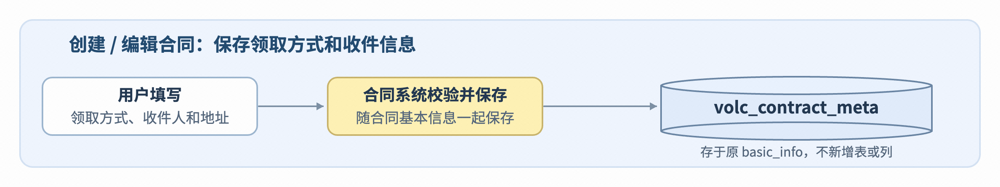
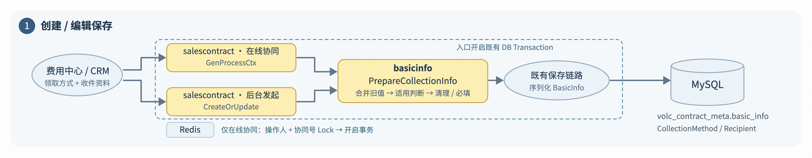
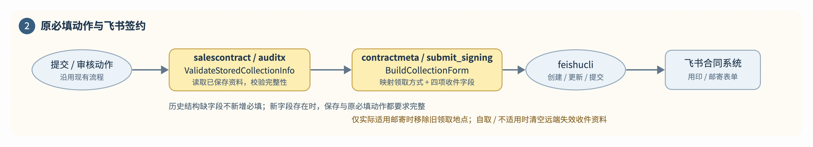
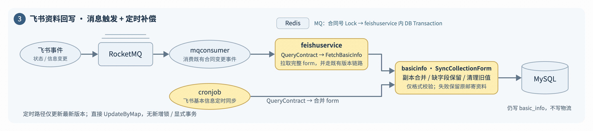
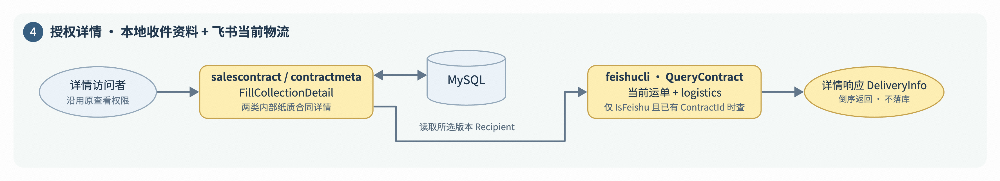

# 概要设计

## 影响范围 和 改动清单

| 改动分组           | 文件 / 模块                                                                                                                          | 调整内容（业务说明）                                                                                                                                                                     |
| ------------------ | ------------------------------------------------------------------------------------------------------------------------------------ | ---------------------------------------------------------------------------------------------------------------------------------------------------------------------------------------- |
| **资料模型**       | `biz/bizmodels/meta_common.go`<br>新增就近 `collection_info.go`                                                                      | **`BasicInfo` 新增领取方式 `CollectionMethod`、收件资料 `Recipient`。**<br>详情响应顶层新增 **`DeliveryInfo`**，用于实时返回运单及物流，不持久化。                                       |
| **填写与保存**     | `salescontract/create_or_update.go`<br>`salescontract/api.go`                                                                        | 适用于后台发起 / 在线协同销售合同、纸质签约，且全部我方主体属于中国大陆或港澳台。<br>**历史合同原本没有新增字段、本次也未传入时，保持兼容，不强制补填。** 详情展示不再限制主体地区。     |
| **在线协同校验**   | `auditx/handler/`<br>`h5_confirm_finalized.go`<br>`h7_information_pass.go`<br>`h7_information_submitoa.go`<br>`h10_risk_submitoa.go` | 销售确认 / 定稿、完善信息 / 审核、完善信息后直接提交签约、风险条款审核后提交签约的原 `Validate`，**统一接入邮寄必填判定**。未改动的一般审核动作保持原行为。                              |
| **后台提交校验**   | `salescontract/api.go`<br>`submitValidate` / `submitValidateBasicInfo`                                                               | `Submit` / `SubmitSalesContract` **使用已保存资料强校验**：适用场景下必须填写领取方式；选择邮寄后，姓名、手机号、地区编码、详细地址必须完整并符合格式要求。                              |
| **提交到飞书**     | `contractmeta/submit_signing/`<br>`submit_feishu.go`<br>`buildFeishuApplyForm`                                                       | 将已填写资料转换为飞书合同表单字段。<br>**邮寄：发送领取方式与四项收件资料，移除本次表单中的领取地点。**<br>**现场领取：保留原领取地点，四项收件字段发送空值，清除可能残留的邮寄资料。** |
| **详情展示**       | `salescontract/get_pre_contract.go`<br>`contractmeta/api.go`                                                                         | **按原内部查看权限返回已保存的收件资料。**<br>已关联飞书合同的纸质合同，**再实时查询运单及物流轨迹**，**补充到详情响应。**                                                               |
| **物流查询能力**   | `feishucli/api.go` / `model.go`                                                                                                      | **补充物流响应字段。** 详情查询复用飞书客户端 30 秒超时；查询失败时物流返回空。HTTP 请求绑定外层 `ctx`，外层取消后终止请求。                                                             |
| **飞书资料回流**   | `feishuservice/common.go`<br>`cronjob/contract_feishu_sync_basic.go`                                                                 | **飞书侧修改后的领取方式、收件资料，同步回火山合同系统。**                                                                                                                               |
| **字段与选项映射** | `pkg/conf/configs.go`<br>`pkg/const`                                                                                                 | **新增飞书字段 / 选项映射及内部枚举；**<br>保存和原提交、审批必填动作直接校验，不新增一套错误码。                                                                                        |

# 详细设计

## 数据库设计

仅扩展既有 `basic_info` 的 JSON 内容，不做 DDL。

在 `volc_contract_meta.basic_info` 中 ==新增 `CollectionMethod`、`Recipient`==

BasicInfo 经 json.Marshal 转为字符串，仍由原合同 DAO 整列保存，沿用原表、列、索引及合同版本机制。

==DeliveryInfo 是详情读取时组合的飞书当前运单及物流，不写入 basic_info，也不进入任何合同版本。==



### 字段存储边界

| 字段路径                                                                                                                                          | 类型 / JSON 行为                                           | 保存与使用口径                                                                                                                                                                                        |
| ------------------------------------------------------------------------------------------------------------------------------------------------- | ---------------------------------------------------------- | ----------------------------------------------------------------------------------------------------------------------------------------------------------------------------------------------------- |
| **`basic_info.CollectionMethod`**                                                                                                                 | **`*string`**<br>`json:"CollectionMethod,omitempty"`       | `SELF_PICKUP` = 自取；`MAIL` = 邮寄。`nil` 时省略字段；非 `nil` 的空字符串保存为 `"CollectionMethod":""`，表示未选、已清空或不适用，仍属于“结构已存在”。                                              |
| **`basic_info.Recipient`**                                                                                                                        | **`*CollectionRecipient`**<br>`json:"Recipient,omitempty"` | 普通 JSON 对象，包含 `Name`、`Mobile`、`RegionCode`、`RegionName`、`DetailAddress` 五个 `string` 字段。`nil` 时省略整个对象；非 `nil` 时五个子字段均参与序列化，空对象请求不会从旧对象补齐子字段。    |
| **`Recipient.RegionCode`**<br>**`Recipient.RegionName`**<br>**`Recipient.Mobile`**<br>**`Recipient.DetailAddress`**<br>**`Recipient.RegionCode`** | `string` / `string`                                        | 前端同时提交编码与名称；飞书地区控件仅映射 `RegionCode`。回写同码时保留原名称，改码或清空时清空 `RegionName`，避免错配；`RegionName` 不参与邮寄必填校验。                                             |
| **详情响应 `DeliveryInfo`**                                                                                                                       | `*DeliveryInfo`<br>不属于 `BasicInfo`                      | `WaybillNo` 来自飞书当前 form；<br>`Logistics` 含 `ScanTime`、`Remark`，按 `ScanTime` 倒序返回。无运单时为 `nil`；有运单但无轨迹时 `Logistics` 为空数组。只用于详情响应，不参与保存、复制或资料回写。 |

## 历史处理

历史兼容只看结构存在性：根据是否存在 新增字段 `盖章领取方式` 和 `收件人信息` 来进行判断

==`HasCollectionInfo() = CollectionMethod != nil 或 Recipient != nil`==

| 状态 / 请求                            | 处理及落库结果                                                                                                                                                                                                                                                                                                                                                |
| -------------------------------------- | ------------------------------------------------------------------------------------------------------------------------------------------------------------------------------------------------------------------------------------------------------------------------------------------------------------------------------------------------------------- |
| 历史两个字段均缺失 / `null`            | 均解析为 `nil`。编辑请求也未带新增结构时保持兼容，**不新增邮寄必填要求，不批量回填**。<br>**新建（含复制后新建）不会继承此豁免**：未传方式时初始化为空字符串指针，适用合同仍须选择领取方式。                                                                                                                                                                  |
| 适用 + 空字符串 / 空对象 / 选择 `MAIL` | **空字符串或空对象说明结构存在，不能恢复历史豁免**。适用条件为销售合同 + 后台发起 / 在线协同 + 纸质签约 + 全部我方主体注册地区为 `CN` / `HK` / `MO` / `TW`。<br>保存及原必填动作要求选择领取方式；`MAIL` 还要求 `Name`、`Mobile`、`RegionCode`、`DetailAddress` 完整。`Name` / `DetailAddress` 最多 500 字；`Mobile` 为纯数字、最长 11 位，不要求固定 11 位。 |
| `SELF_PICKUP` / 不再适用               | **自取保留 `SELF_PICKUP`、`Recipient` 置 `nil`；** 不再适用则 `CollectionMethod` 保存为空字符串、`Recipient` 置 `nil`。再次适用时因结构仍存在，按现行必填规则校验。                                                                                                                                                                                           |

## 系统架构图



** ① 创建 / 编辑保存**

1. ==CRM发起== 在线协同在 `salescontract.GenProcessCtx`、后台发起在 `salescontract.CreateOrUpdate` 中接入 `PrepareCollectionInfo`。

2. 适用条件为销售合同、后台发起或在线协同、纸质签约，且全部我方主体注册地区符合当前代码口径（CN / HK / MO / TW）。

   - 编辑请求未传新增字段时沿用旧值；

   - 新建或已带新增字段的合同校验领取方式，选择邮寄时要求姓名、手机号、地区编码及详细地址完整。

   - ==改为自取时清理 `Recipient`（收件人信息）==；不适用时清空领取方式并清理收件资料。历史结构完全缺少新增字段的合同保留兼容行为。

3. 校验通过后，领取方式 `CollectionMethod` 和收件资料 `Recipient` 随 `BasicInfo JSON` 写入 `volc_contract_meta.basic_info`，沿用合同记录 / 版本存储，不另建邮寄表。

---



**② 原必填动作与签约**

1. 后台提交的 `submitValidate`，以及 `auditx` 的 ==确认定稿、资料审核通过 / 提交 OA、风控提交 OA 等原节点== 接入 ==`ValidateStoredCollectionInfo`==，对已保存且适用的新增资料再次进行完整性校验，不向历史缺字段合同新增必填。

2. `contractmeta/submit_signing` 在既有飞书 `form` 构建中调用 `BuildCollectionForm`，按配置映射领取方式、姓名、手机号、地区编码和详细地址；

   - ==仅实际适用邮寄时移除原“合同领取地点”==，自取或不适用仍沿用原领取逻辑。

   - 首次提交的空值不发送；已关联飞书合同则发送空值表单，==清除远端失效资料。==

---



**③ 飞书资料回写**

1. 飞书状态 / 信息变更事件 `contactInfoChange` 经现有 `RocketMQ` 进入 `mqconsumer`，再交由 `feishuservice` 在既有事务 / 版本链路中查询飞书完整合同。`FetchBasicInfo` 接入 `SyncCollectionForm`，==将 `form` 中邮寄资料合并回 `BasicInfo`==

2. 现有飞书基本信息定时任务也接入同一合并方法，仅处理最新版本，并沿用直接 UpdateByMap 的写入方式，不新增锁或显式事务。

---



**④ 详情查询**

1. `salescontract.GetPreContractReq.Execute` 与 `contractmeta.Detail` 沿用原详情访问权限，调用 `FillCollectionDetail`：两类纸质合同回显所选合同版本中的 `Recipient`

2. 仅 `IsFeishu` 且已存在 `ContractId` 时，按合同号实时 `QueryContract`，读取当前运单及 `logistics`，按 `ScanTime` 倒序组装 `DeliveryInfo`。

3. ==历史版本也展示当前运单==；无运单、映射未配置或飞书查询失败时不返回物流，但不阻断本地详情。列表、简版与非目标查询入口不返回收件资料。

## 组件设计

### TCC

由于飞书提交表单接口的设计，传递的内容是 `attribute_code` 因此需要存储一下对应的映射关系

关系存储在 `feishu_const` 中

```json
"form": "[
    {
        \"attribute_code\": \"custom_13_6bb7391ace7b4cf39f84130170b29fad\", //盖章文件领取方式
        \"attribute_value\": {
            \"key\": \"cmoikiwh6000d3b7e1q8aldy9\"
        }
    },
    {
        \"attribute_code\": \"custom_1_d9934dd8c11a48a1b031ccd7f7bb73a8\", //姓名
        \"attribute_value\": \"韩善玺\"
    },
    {
        \"attribute_code\": \"custom_1_99cf5279bebb4cf4ab7460a376cf3f65\", // 手机号
        \"attribute_value\": \"18303996108\"
    },
    {
        \"attribute_code\": \"custom_1042_5263be4208e64a31a91fb671cf2433f4\", // 收件人地区，从主数据获得，传入的格式虽然是数组，但是只支持一个元素
        \"attribute_value\": [\"00002746\"]
    },
    {
        \"attribute_code\": \"custom_1_cb2faf9069ab4adbbad7e470e1de4674\", // 收件人详细地址
        \"attribute_value\": \"北京市朝阳区融中心A\"
    }
]",
```

| 映射配置名（拟新增）   | 手册线上值                                     | 职责                         |
| ---------------------- | ---------------------------------------------- | ---------------------------- |
| `CollectionMethodCode` | `custom_13_6bb7391ace7b4cf39f84130170b29fad`   | 领取方式radio                |
| `SelfPickupKey`        | `cmoikiu9a000c3b7ejs6kdloh`                    | 现场领取选项                 |
| `MailKey`              | `cmoikiwh6000d3b7e1q8aldy9`                    | 邮寄选项                     |
| `RecipientNameCode`    | `custom_1_d9934dd8c11a48a1b031ccd7f7bb73a8`    | 收件人姓名                   |
| `RecipientMobileCode`  | `custom_1_99cf5279bebb4cf4ab7460a376cf3f65`    | 手机号                       |
| `RecipientRegionCode`  | `custom_1042_5263be4208e64a31a91fb671cf2433f4` | 收件行政区，单元素数组       |
| `RecipientAddressCode` | `custom_1_cb2faf9069ab4adbbad7e470e1de4674`    | 详细地址                     |
| `WaybillCode`          | `custom_1_3e5c232d2bbb428d8ef99dd79d3e0c32`    | 只读运单解析，不作为保存字段 |

来源：[飞书技术方案映射表](https://bytedance.larkoffice.com/wiki/OgSiwV0vxi3wV7kCiDGcIfsFnzc#share-N3RqdSQzFoKc8bxGRfocLnpfn5J)。

## 接口设计

### 接口改动与调用方式 @唐明

**本次只扩展原接口，不新增邮寄接口。**

保存时填写领取方式和收件资料；提交、审批读取已保存数据；详情返回只读运单和物流。CRM 页面、SDK 和跨端联调结果尚未验证，不代表已上线或联调通过。

| inner-top 路径 / Action                                                                 | 请求变化                                            | 响应变化 / 注意                                                                  |
| --------------------------------------------------------------------------------------- | --------------------------------------------------- | -------------------------------------------------------------------------------- |
| /inner-api/pre_contract <br/>CreateOrUpdatePreContract / CreateOrUpdatePreContractInner | 新增BasicInfo.CollectionMethod、BasicInfo.Recipient | 原保存响应不变；保存时校验新增字段。                                             |
| /inner-api/salesContract <br/>CreateOrUpdate                                            | 新增basicInfo.CollectionMethod、BasicInfo.Recipient | 原保存响应不变。                                                                 |
| /open-api/pre_contract <br/>CreateOrUpdatePreContract                                   | 新增BasicInfo.CollectionMethod、BasicInfo.Recipient | CRM 对接复用开放创建 Handler；核对 DTO / SDK 是否完整透传。                      |
| /inner-api/pre_contract <br/>OperatePreContract                                         | 无新增收件参数或豁免参数。                          | 原动作响应不变；读取已保存资料，有改值时先成功保存。                             |
| /inner-api/salesContract <br/>Submit / SubmitSalesContract                              | 无新增收件参数。                                    | 原响应和错误包装不变；读取 DB 数据校验。                                         |
| /inner-api/pre_contract <br/>GetPreContract                                             | 无新增参数。                                        | Result.PreSalesContract.BasicInfo 新字段；Result.PreSalesContract.DeliveryInfo。 |
| /inner-top-contract/inner-api/meta <br/>Detail / MetaDetail                             | 无新增参数；ContractVersion 沿用。                  | Result.BasicInfo 新字段；Result.DeliveryInfo。                                   |

**在线协同保存（内部）**

```plaintext
POST /inner-api/pre_contract?Action=CreateOrUpdatePreContract&Version=2021-01-01
POST /inner-api/pre_contract?Action=CreateOrUpdatePreContractInner&Version=2021-01-01
// 上述两个既有 Action 为同一保存逻辑的别名，择一沿用，不是连续调用。

// Request Body 增量；不是完整请求
{
  "BasicInfo": {
    "CollectionMethod": "MAIL",
    "Recipient": {
        "Name": "示例收件人",
        "Mobile": "00000000000",
        "RegionCode": "地区选择器返回的真实末级编码",
        "RegionName": "上海市/上海市/浦东新区",
        "DetailAddress": "示例详细地址"
    }
  }
}
```

后端这边返回的也是 末级编码，因此在回显的时候需要额外注意一下 @唐明

**后台发起保存**

```plaintext
POST /inner-api/salesContract?Action=CreateOrUpdate&Version=2021-01-01

// Request Body 增量；不是完整请求
{
  "BasicInfo": {
    "CollectionMethod": "MAIL",
    "Recipient": {
        "Name": "示例收件人",
        "Mobile": "00000000000",
        "RegionCode": "地区选择器返回的真实末级编码",
        "RegionName": "上海市/上海市/浦东新区",
        "DetailAddress": "示例详细地址"
    }
  }
}
```

**CRM 创建 / 编辑（开放）**

```plaintext
POST /open-api/pre_contract?Action=CreateOrUpdatePreContract&Version=2021-01-01

// Request Body 增量；不是完整请求
{
  "BasicInfo": {
    "CollectionMethod": "MAIL",
    "Recipient": {
        "Name": "示例收件人",
        "Mobile": "00000000000",
        "RegionCode": "地区选择器返回的真实末级编码",
        "RegionName": "上海市/上海市/浦东新区",
        "DetailAddress": "示例详细地址"
    }
  }
}
```

**提交 / 审批动作**（请求结构不变，不重复传收件资料）。

```plaintext
POST /inner-top-contract/inner-api/pre_contract?Action=OperatePreContract&Version=2021-01-01
POST /inner-top-contract/inner-api/salesContract?Action=Submit&Version=2021-01-01
POST /inner-top-contract/inner-api/salesContract?Action=SubmitSalesContract&Version=2021-01-01

// 上述为各自独立的既有调用，按原业务动作择一使用。
// Request Body：沿用各 Action 原参数；不新增 BasicInfo / Recipient / DeliveryInfo。
```

**合同详情响应增量**（Result 直接承载合同信息）。

```plaintext
POST /inner-api/meta?Action=Detail&Version=2021-01-01
POST /inner-api/meta?Action=MetaDetail&Version=2021-01-01
// 两个既有 Action 为别名，择一调用；请求参数不变。

// Response 增量；ResponseMetadata 为原响应元信息，不是新增请求参数。
{
  "ResponseMetadata": {
    "Action": "Detail",
    "Version": "2021-01-01"
  },
  "Result": {
    "BasicInfo": {
      "CollectionMethod": "MAIL",
      "Recipient": {
          "Name": "示例收件人",
          "Mobile": "00000000000",
          "RegionCode": "地区选择器返回的真实末级编码",
          "RegionName": "上海市/上海市/浦东新区",
          "DetailAddress": "示例详细地址"
      }
    },
    "DeliveryInfo": {
        "WaybillNo": "示例运单号",
        "Logistics": [
            {
                "ScanTime": "2026-02-09 20:19:41",
                "Remark": "示例物流信息"
            }
        ]
    }
  }
}
```

调用 MetaDetail 时，ResponseMetadata.Action 对应为 MetaDetail；数据仍位于 Result 下。

**在线协同详情响应增量**（合同信息位于 Result.PreSalesContract）。

```plaintext
POST /inner-api/pre_contract?Action=GetPreContract&Version=2021-01-01
// 请求参数不变；下方为响应增量，不是完整响应。

{
  "ResponseMetadata": {
    "Action": "GetPreContract",
    "Version": "2021-01-01"
  },
  "Result": {
    "PreSalesContract": {
      "BasicInfo": {
        "CollectionMethod": "MAIL",
        "Recipient": {
            "Name": "示例收件人",
            "Mobile": "00000000000",
            "RegionCode": "地区选择器返回的真实末级编码",
            "RegionName": "上海市/上海市/浦东新区",
            "DetailAddress": "示例详细地址"
        }
      },
      "DeliveryInfo": {
          "WaybillNo": "示例运单号",
          "Logistics": [
              {
                  "ScanTime": "2026-02-09 20:19:41",
                  "Remark": "示例物流信息"
              }
          ]
      }
    }
  }
}
```

无可用物流时 DeliveryInfo=null；有运单无轨迹时 Logistics=[]。

### 保存规则：何时必填，如何兼容旧请求

**填写适用条件**：销售合同，来源为后台发起或在线协同，SignatureType="1"（纸质签约），且全部我方主体注册地区属于中国大陆 / 香港 / 澳门 / 台湾。不是根据收件地址判断我方主体地区。

| 字段 / 场景             | 当前后端规则及调用方要求                                                                                                                                                                  |
| ----------------------- | ----------------------------------------------------------------------------------------------------------------------------------------------------------------------------------------- |
| CollectionMethod        | SELF_PICKUP＝现场领取；MAIL＝邮寄。 <br/>适用的新建、编辑保存要求选择；原提交及必填审批节点再次校验。适用场景下空字符串不能用于清空后继续保存。                                           |
| Recipient               | MAIL 要求姓名、手机号、地区编码、详细地址完整。姓名和地址不能全为空白，各最多 500 字；手机号为非空 ASCII 数字、最长 11 位，**不要求恰好 11 位**。                                         |
| RegionCode / RegionName | 选择器只提供中国大陆末级地区，编码与完整省市区名称一并提交。 <br/>后端直接保存、回显，不增加地区反查或编码前缀校验。RegionName 是展示字段，无独立必填校验；DetailAddress 与地区分开填写。 |
| 编辑时省略 / null       | CollectionMethod、Recipient 使用普通指针反序列化； <br/>未传和 null 均按未传处理，编辑时继承对应旧值。                                                                                    |
| 编辑 Recipient          | 传入对象按整组替换，不逐个子字段合并。 <br/>MAIL 修改任一收件字段时应提交完整 Recipient；传 {} 或只传 Mobile 不会由旧对象补齐，将因资料不完整被拒绝。                                     |

审批复用 h5 定稿确认、h7 完善信息通过 / 提交签约、h10 风险审核后提交签约的原 Validate 入口；未改动的一般审核动作保持原行为。以保存 / 动作接口返回的现有错误提示为准，不新增一套错误码。

### 跨端联调验收矩阵

| 验收动作                                                       | 必须验证的结果                                                                               |
| -------------------------------------------------------------- | -------------------------------------------------------------------------------------------- |
| 已有合同原保存数据没有新增联系人结构→退回→重提                 | 按结构缺失的历史兼容允许为空，不因退回或重提时间变化强制补填。                               |
| 原保存数据已有联系人结构，但邮寄资料不完整→提交                | 到原结构化必填动作按新规则检查；不得以空姓名、空电话等判成历史结构缺失。                     |
| 复制历史已提交合同                                             | 新合同重新判定；原合同豁免和物流不得跟过来。                                                 |
| 不适用场景打开、保存、提交                                     | 前端不传；回显空；飞书form无新增字段；不存在默认SELF_PICKUP。                                |
| 旧客户端保存仍适用合同                                         | 旧请求未带新增字段时保留现有收件资料；自取或不适用时按业务条件清理。                         |
| MAIL改自取后update→search                                      | 本地旧资料清理；update传四项对应空值后，search确认旧值已清空，领取方式为新值。               |
| 飞书修改地址→原通知 / 原补偿                                   | 火山回写最新地址；不新增物流存储或额外消息类型。                                             |
| DKMS 不可用时保存和查询                                        | 邮寄资料沿原 DAO 正常保存和查询，JSON 中直接保留 Recipient；本期 DKMS 加解密调用次数均为 0。 |
| 前端选择对应的收件人信息保存后 -> 查看/编辑 对应的地区选择组件 | 能够正常回显地区层级                                                                         |

来源：[飞书技术方案第 3.4 节](https://bytedance.larkoffice.com/wiki/OgSiwV0vxi3wV7kCiDGcIfsFnzc#doxcnf3s0iXxoilaZYRclcqY9Lh)。
