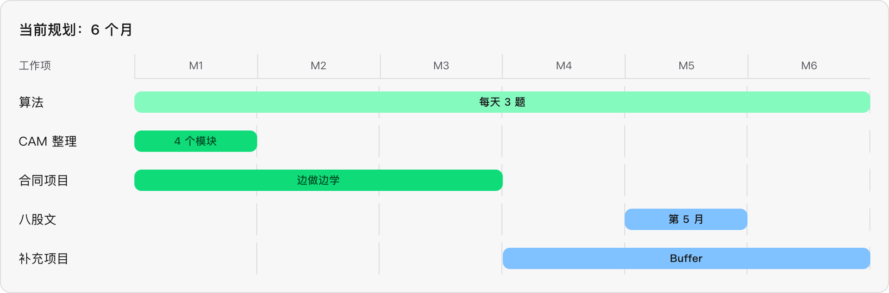
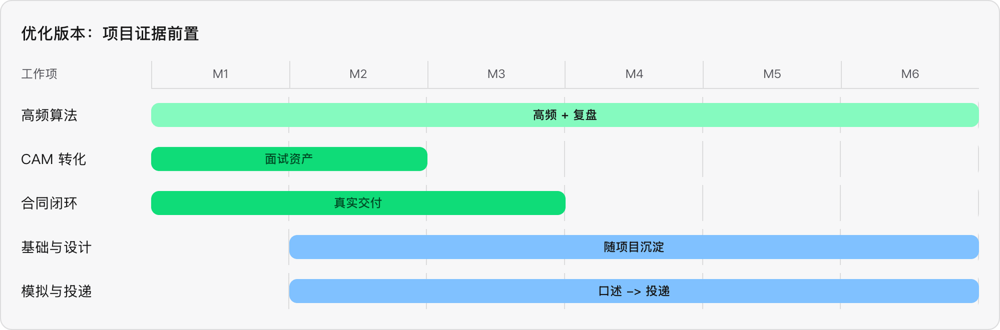

# 现在

命运已经作出了他的选择 

我曾后悔过, 

1. ==为什么我不保研 ? 不读研究生 ? 不在大三的时候考研==
2. ==为什么实习的时候没有去大公司 ?==
3. ==为什么正式工作的时候没有去其他公司 ?== 

从上帝视角来看, 我选择研究生的考虑就是 ==AI 时代发展,导致学历贬值==

为什么实习的时候没有去大公司，我只能说并没有机会，或者说自己能力不行，各种各种

# 该怎么办

往前看

==君子藏器于身，待时而动==

本质上是 ==试用期如何跳槽的问题==

# 时间总线

我 9月 20 号左右入职的，到现在已经过去啦 ==7天== 的时间

我预计只有 6 ～ 9 个月时间，大概到 ==明年4月份== 我女朋友出考研成绩后 以及 ==明年6月份毕业==，我需要尝试去南方

所以我只有 ==6个月时间 ~ 9个月时间== 

##  如何规划这 6 个月时间

### 算法

Acwinwg 基础课 (106) + LeetCode 灵茶山艾府 (349) + LeetCode Hot100 (100)

总共 555 道题

假设一天 3 道题， 那么需要 ==185天== 也就是 ==6个月时间== 

所以现在每天需要保持 `3`个题的匀速前进

优先 LeetCode 灵茶山艾府 >= LeetCode Hot100 >= Acwing 基础课

### 项目

#### CAM 项目整理

预计 1个月 ，3周时间整理出

1. 交易所 或 产品的 接入 到高可用
2. 异步和同步历史抓取补齐
3. 账单标准化与队长
4. Websocket流程处理

#### 合同项目处理

1. 这个只能说变做边学，预计在 3个月内处理完

#### 是否要包装一个项目

TBD

预计还有 `3个月` 的 BufferTime

#### 其他八股文的整理

1. 感觉给一个月差不多了 可以在倒数第二个月

#### Summary

所以整个时间线应该是

1. 1 - 6个月内 每天3个算法题
2. 第一个月 整理 CAM 的内容 整理出 4 个大模块 （交易所、历史记录、对账、Websocket)
3. 1 - 3个月内 边工作边整理 新公司的合同项目
4. 第 5 个月开始背八股文
5. 第 4 ～ 6 个月 可以尝试 补充其他项目 以及 补充中间价的使用

# 我有不得不离开的理由

我的女朋友

# 遗留问题

进了外包就没有未来了吗
