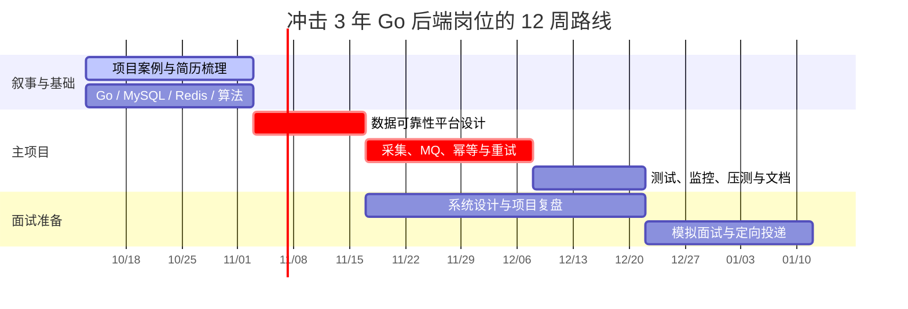

# 说在前沿

需要改变，需要整理，为了下一次战争 ！


# 我现在拥有什么

## CAM

一个经历了我3年 （1年实习+2年正式）的项目

我主要负责下面这几个模块
tradeacc/
tradeaccbiz/
cefiacc/
historytrade/
exg/
historytrade_business/
globalsnapshot_fix/
exg

日常工作的内容无非就是

1. 对接交易所 资产 和 数据
2. 配置交易所抓取和对接配置
3. 修复资产和

整个项目可以认为是 面向B端，客户私有化部署，我感觉甚至可以认为是一个单体应用 


## volc_contract_process

这是我的第二份工作的项目，我现在才进来 9 天。 目前不知道大体架构 ，但是看过一遍 看着也是面向 B 端的

而且这还是一个外包项目

看了几个链路也是比较简单的，都是 Rest->handler->Service->DB

甚至有一些 DB 都没有增加 Redis 缓存

对应我的空缺，无非就是 MQ 那边能补一点知识


## Webook

第三个项目 Webook 这个项目是我在被裁员之后 看了一个月的视频做的

补充了 RPC 微服务 关注 点赞 热榜 Feed 等热评模块

但是我社招的时候发现他们并不爱问这个项目，总以 “自己做的项目得不到数据的验证" ... 为由 


[webook](https://github.com/DDLGitGzzhM/webook)

## Acwing

我在 Acwing 买了两个课程但是都没跟进下去

### Acwing-Kob

这个是一个 Java 技术栈的内容，但是我是一个  Golang 开发 

我记得3年前我做到一半没做下去，感觉里面只有一个亮眼点，就是有一个匹配池的机制

### Acwing-AiFriends

这是去年买的一直没学，看着是一个 Python + Ai 的应用

不过我感觉只是单纯的 Ai 应用 封装接口，更别提什么 Agent、Skills、MCP、Multi-Agent 什么内容了

# AI Generate

## 我的定位

我应该冲击的不是泛后端，也不是为了追热点转向 Python 或单纯的 AI 应用封装。

更合适的定位是：

> **3 年 Go 后端工程师，方向为金融数据接入与治理、B 端流程系统、分布式可靠性。**

我的核心经历其实已经在 CAM：

- 多交易所异构 API 的资产、行情和历史数据接入；
- 面向私有化客户的配置治理、问题排障和数据修复；
- 交易、资产、对账等金融数据场景。

`Webook`、`Acwing-Kob` 和 `AiFriends` 可以保留为学习素材，但不再作为主线项目。它们无法证明我处理真实业务复杂度的能力。

相比之下，CAM 目录中已有大量接口测试、行情偏差与完整性巡检脚本；我后来补的 CEFi MCP 也已经有多环境配置、异步任务轮询、错误规则诊断等雏形。接下来要做的不是再堆一个项目，而是把这些经验串成一条“数据可靠性”的证据链。

## 12 周路线



### 第 1 - 3 周：把经历变成可面试的叙事

先不急着学新框架，先写出 CAM 的 3 个 STAR 案例：

1. 一次交易所接入：交易所之间有哪些接口、鉴权、字段或账户类型差异，我如何拆解和验证；
2. 一次数据质量问题：异常如何发现、如何定位到数据源或配置、如何修复并避免再次发生；
3. 一次私有化部署或配置治理：多客户环境下的配置、权限、发布和排障如何处理。

每个案例都要能回答：**背景、规模、异常场景、我的决策、验证手段、结果**。没有可公开的生产指标时，不能编数字；可以如实描述通过接口测试、巡检、告警、日志或工单闭环来验证。

同时补齐面试高频基础：

- Go：`context`、goroutine 泄漏、并发控制、channel、内存逃逸、GC；
- MySQL：索引、执行计划、事务隔离级别、锁和慢查询；
- Redis：缓存穿透/击穿/雪崩、缓存一致性、分布式锁；
- 算法：每周 12 - 15 道高频题，累计 80 - 100 道即可，不把刷题变成主战场。

### 第 3 - 8 周：完成一个 Go 主项目

项目暂定为 `market-data-reliability-platform`：一个**行情/资产数据接入、校验、告警与人工复核平台**。

它不是 CAM 的开源复刻，也不使用任何公司代码、数据和配置。数据源使用交易所公开行情接口或本地模拟数据，抽象出统一的 `Source Adapter`。

项目需要形成完整闭环：

```text
定时采集 -> 消息投递 -> 规则校验 -> 异常记录 -> 告警/人工复核 -> 重放任务
```

必须具备的工程能力：

- Go 服务拆分与统一数据模型；
- MQ 异步校验；
- 幂等消费、指数退避重试、死信队列和失败重放；
- MySQL 状态机与 Redis 热点缓存；
- Prometheus 指标、日志和链路排障信息；
- Docker Compose 一键启动；
- 单元测试、消费者集成测试、故障注入测试；
- README 中的架构图、消息语义、关键权衡和压测结果。

这个项目直接承接我已有的金融数据经验，也能覆盖 3 年 Go 后端岗位常问的可靠性、异步化、缓存与可观测性问题。

### 第 6 - 10 周：系统设计与真实工作增量

围绕自己的经历准备四道系统设计题：

1. 多交易所数据采集系统；
2. 对账与异常数据修复系统；
3. 消息可靠投递、重复消费和失败重放；
4. 合同审批或状态流转系统。

在 `volc_contract_process` 中，优先争取一段能闭环的真实工作，而不只是继续写普通 CRUD。优先级可以是：

- MQ 消费幂等和失败补偿；
- 合同状态的异步同步；
- 定时任务的重复执行控制；
- 缓存治理或接口性能优化；
- 一条复杂流程的测试补齐与可观测性改造。

完成其中任意一项，都要留下设计文档、关键决策、测试结果和复盘。这将成为第二个真实项目案例。

### 第 9 - 12 周：模拟面试与投递

每周至少两次模拟：

- 一次项目深挖：讲清楚 CAM、主项目或合同系统中的一个闭环；
- 一次基础与算法：Go、数据库、缓存、MQ、系统设计。

每次面试后记录“不会题 -> 原因 -> 下次回答模板”，而不是只记答案。

投递目标聚焦在：

- Go 服务端；
- 金融科技、支付、清结算、交易平台；
- 数据平台；
- 企业 SaaS 后端。

## 简历应该怎样写

CAM 不应该只写“负责模块和修复问题”，可以表达为：

> 负责数字资产管理系统的交易所资产与行情数据接入、配置治理与数据质量排障；面向私有化客户处理多交易所接口差异、异步任务和异常数据校验，建设接口测试与行情巡检能力，提升问题发现和定位效率。

主项目完成后，可以增加：

> 设计并实现 Go 数据可靠性平台：通过消息队列解耦采集与校验链路，使用幂等消费、指数退避、死信重放和可观测指标处理外部 API 的重复、超时与限流问题。

## 最终优先级

1. **CAM 经验重构 + Go 数据可靠性主项目**；
2. **在合同项目中拿下一段 MQ/事件驱动/可靠性闭环**；
3. **算法与系统设计保持稳定输入**；
4. Webook、Kob、AiFriends 仅作为补充，不再占用主力时间。

我缺少的不是项目数量，而是把已有经历组织成“我可以独立解决复杂后端问题”的证据链。下一次面试，要让面试官看到的是一个处理过真实数据接入和复杂业务问题的 Go 工程师，而不是做过几个教程项目的人。
