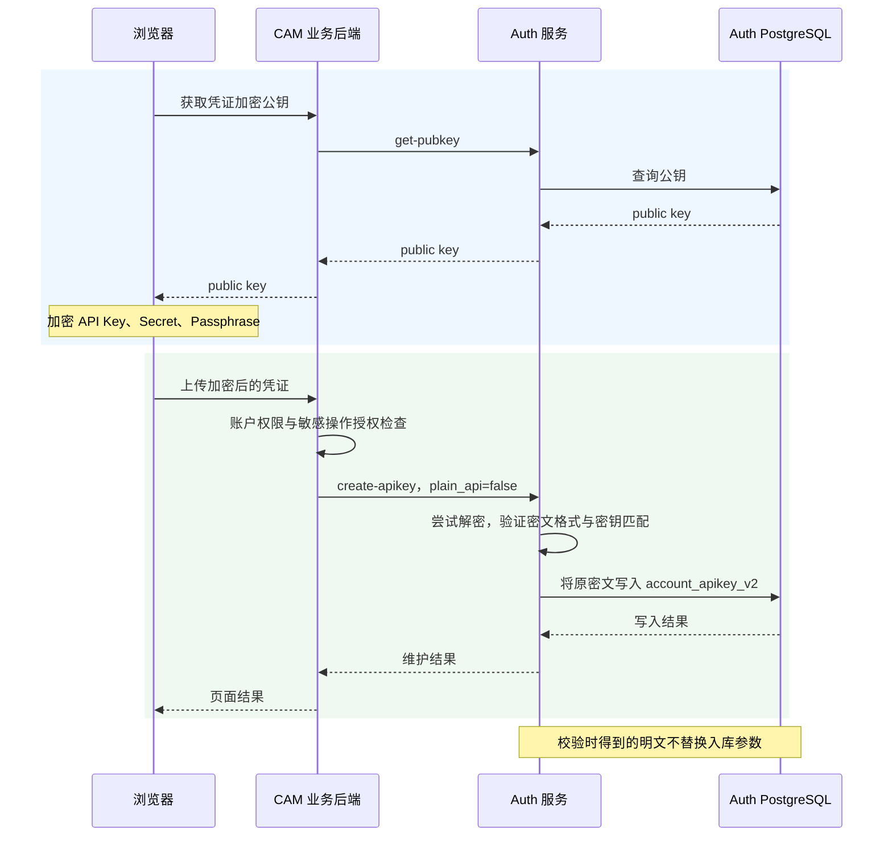
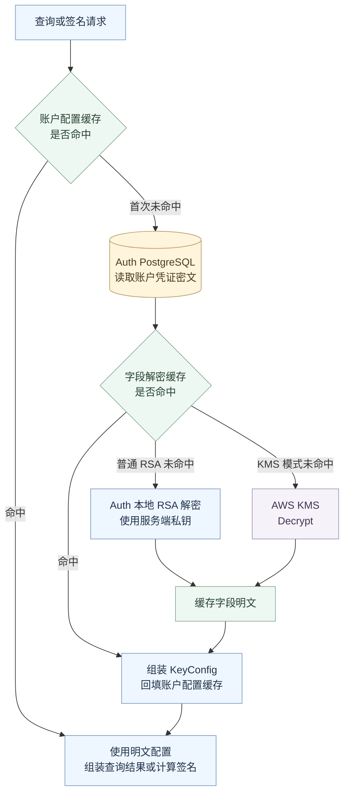
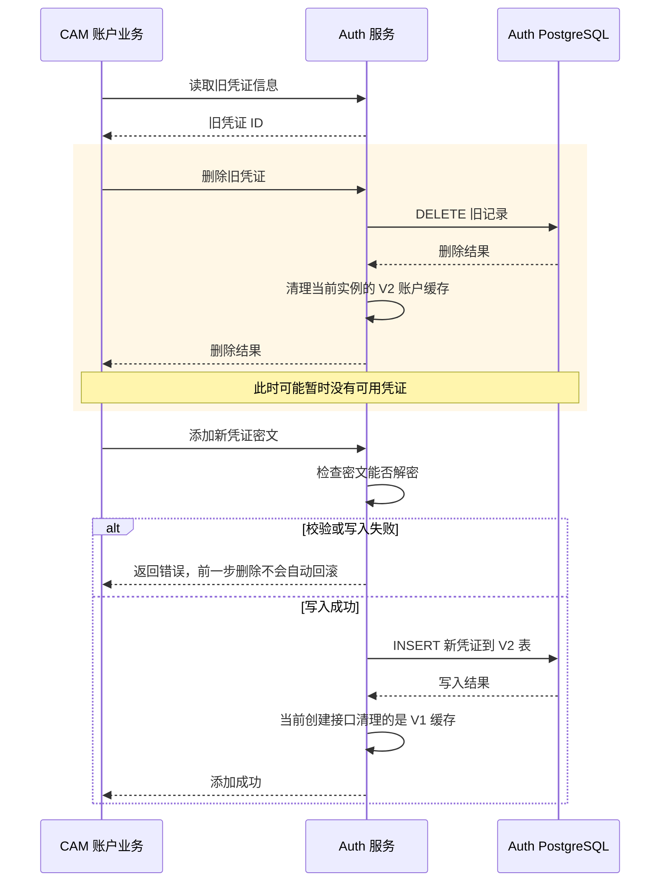

# CAM API Key 维护：加密上传、Auth 签名与缓存一致性

CAM 的普通交易所凭证链路是：**浏览器使用 Auth 公钥加密，业务后端转发密文，Auth 校验后保存原密文，需要查询或签名时在 Auth 内部解密，并缓存解密结果。**

这与用户登录是两件事。登录和敏感操作验证决定谁能维护哪个账户；加密和签名服务决定凭证如何保存、在哪里使用。登录机制见 [CAM 登录实现](/post/cam-login-session-0x01)。

本文依据 2026-11-15 核对的本地 CAM 源码，主线限定为网页端 `api-encrypt` 模式及 V2 凭证表。AWS Secrets Manager、特殊交易所适配和 V1 兼容路径单独说明。静态发现与改进建议不代表已复现的线上故障，也不作为个人已完成工作的证明。

## 一、面试时先讲凭证生命周期

这个模块解决的不只是“把 Secret 加密一下”，还包括账户归属、凭证传输、持久化、按需签名、更换凭证和缓存失效。

可以先这样介绍：

> CAM 把交易所凭证维护拆成业务侧和 Auth 服务两部分。网页端拿到 Auth 公钥后，对 API Key、Secret 和 Passphrase 加密；业务后端检查账户权限和敏感操作授权，再把密文交给 Auth。Auth 验证密文可解密后写入专用数据库，常规调用由 Auth 解密并完成签名。为减少重复查库和解密，Auth 缓存账户明文配置及字段解密结果。这个方案降低了普通业务链路接触 Secret 的范围，但也引入了明文内存管理、密钥更新一致性和多实例缓存失效的问题。

讲完这段，再选“公私钥边界”“缓存刷新语义”或“换 Key 的失败窗口”展开。没有压测数据时，只描述减少了哪些操作，不编造延迟或吞吐提升比例。

## 二、区分系统里的几种凭证

| 名称 | 用途 | 与其他凭证的关系 |
| --- | --- | --- |
| 用户 Session ID | 识别 CAM 网页登录会话 | 不用来加密交易所 Secret |
| 交易所 API Key | 标识交易所账户的 API 凭证 | 通常需要随交易所请求发送 |
| 交易所 API Secret | 按交易所协议计算签名，部分平台使用其他认证形式 | 需要可用的原始值，不能仅保存不可逆密码哈希 |
| Passphrase | 某些交易所要求的额外认证字段 | 也可能属于敏感凭证 |
| Auth RSA 公钥与私钥 | 保护上传与持久化的凭证内容 | 公钥供加密，私钥用于解密；不是用户密码 |
| Auth 服务 Token | 业务后端调用 Auth 时使用的服务认证凭证 | 不等同于网页登录 Cookie |

公钥可以下发到浏览器，拿到公钥不意味着拥有维护账户的权限。请求能否进入维护接口，仍由登录、组织权限、资源权限和二次认证共同控制。

## 三、上传与落库：业务后端接收的是什么

### 3.1 浏览器先获取 Auth 公钥

账户编辑页初始化时调用 `getPublicKey()`，经 `/tradeacc/public-key` 转到 `auth_client.GetPublicKey()`，最后访问 Auth 的 `/auth/get-pubkey`。

普通 RSA 模式从 Auth 的公钥存储中读取；KMS 模式获取 KMS 公钥。公钥来源属于 Auth 的部署配置，不是每个用户登录时派生一把新的加密密钥。

图 1 展示普通 RSA 模式的成功主线。账户维护前的网页登录过程已省略，权限与敏感操作授权仍由业务后端执行。



### 3.2 前端加密与参数处理

`EditAccount.vue` 的 `formatApiParam()` 组装加密后的凭证。`encryptKey()` 将较长的输入按每 100 个字符分段加密，用 `*****` 拼接各段密文；Passphrase 走对应的加密函数。

普通配置名为 `rsa_1024`，使用 JSEncrypt；后端普通解密实现是 RSA PKCS#1 v1.5。**配置名不能替代实际公钥位数的检查。** `rsa_oaep` 分支使用 RSA-OAEP，哈希与 MGF1 均为 SHA-256，与 KMS 解密算法对应。

RSA 对单次输入长度有限制。这里的分段是现有兼容方案，按字符切片也不能等同于按加密输入字节数精确控制上限。若未来承接更复杂的凭证格式，可以评估混合加密，并单独设计算法版本、密钥版本和密文格式；不能声称当前代码已经使用 AES-GCM 信封加密。

组装请求后，前端会删除顶层的原始 `api_key`、`api_secret` 等表单字段，使用嵌套的 `api` 参数传递凭证。特殊交易所对字段含义有适配，不能把这里的结论扩展成“所有交易所、所有字段都走同一加密逻辑”。

### 3.3 `tradeacc` 主要做转发和账户关联

`tradeacc.Api.AddApi()` 提取账户标识，将凭证字段交给：

```go
auth_client.AddAPIKey(key, false)
```

这里的 `false` 是 `plainApi` 参数，表示传入的已经是密文。客户端再向 Auth 发送 `plain_api=false`，并带上配置得到的 Auth 服务认证头。

代码也保留了明文输入兼容分支：`tradeaccbiz/model.go` 在 `PlainApi=true` 时调用 `EncryptApi()`，用 Auth 公钥在业务后端补做加密。因此应说“普通网页上传前已经加密”，不能说业务后端在所有调用方式下都不可能接触明文。

### 3.4 Auth 验证后保存原密文

`httpCreateApikey()` 对普通密文调用 `checkCipherApi()`，逐个尝试解密 API Key、Secret 和可选 Passphrase。这个检查验证“密文是否能被当前配置解开”，不等于交易所认可这组凭证，也不等于读写权限、IP 白名单和有效期全部正确；交易所 API Checker 承担另一层校验。

检查通过后，`sign.AddAPIKey()` 直接将原字段插入 `account_apikey_v2`。`checkCipherApi()` 没有用解密结果覆盖入库结构体，所以普通密文分支保存的仍然是密文。

Auth 接口自身还存在 `plain_api=true` 的跳过校验能力，而当前插入函数没有统一的二次加密步骤。本文的“落库为密文”结论限定在已核对的正常加密链路，不能仅凭数据库字段名推断所有历史记录或内部调用都满足这一条件。

## 四、私钥在哪里，KMS 和 Secrets Manager 有何不同

| 模式 | 数据库主要保存什么 | 解密或读取在哪里完成 |
| --- | --- | --- |
| 普通 RSA 的 `api-encrypt` | API Key、Secret、Passphrase 密文 | Auth 使用其可访问的 RSA 私钥解密 |
| KMS 的 `api-encrypt` | KMS 公钥加密后的凭证密文 | Auth 调用 KMS `Decrypt`，使用 RSA-OAEP SHA-256 |
| `AWSSecretManager` | 账户关联信息和 Secret ID 等 | Auth 按 Secret ID 从 Secrets Manager 获取凭证 |

普通 RSA 的 `GetRsaKey()` 有环境分支：非生产路径可使用数据库中的私钥字段；生产路径会从运行用户的 `.cam/id_rsa` 文件读取，特定部署还有 GPG 分支。只读取公钥的接口不会返回私钥。

KMS 管理加解密密钥，Secrets Manager 管理凭证内容，两者不是同一种接入模式。KMS 模式下返回的解密结果仍会进入 Auth 进程内存，不能据此认为 Auth 从未接触明文。

加密保护依赖解密能力与密文存储的隔离。如果运行身份、私钥文件或 KMS 权限同时被攻破，只有“数据库里看起来是密文”不足以维持这一隔离边界。部署权限、内存转储、日志和备份策略仍需要单独管理。

## 五、读取和签名：为什么多数请求不用重新解密

### 5.1 两层缓存的作用不同

V2 路径是 `GetKeyConfigV2 → GetAPIKeyInfoV2 → tryDecodeRsa → Decrypt`。解密成功后，账户配置中的 API Key、Secret 和 Passphrase 都是可使用的明文。

| 缓存 | Key 的主要组成 | 缓存值 | 成功刷新间隔 | 首次失败缓存间隔 |
| --- | --- | --- | --- | --- |
| 账户配置缓存 | V1/V2 前缀 + 账户 | 解密成功后的 `KeyConfig` | 10 年 | 10 秒 |
| 字段解密缓存 | 账户 + 字段密文 | 明文字符串 | 1 分钟 | 1 分钟 |
| KMS 解密缓存，KMS 分支额外使用 | 密文字节 | KMS 返回的明文字节 | 1 年 | 10 分钟 |

这些是源码中的参数，不是线上实测指标。底层使用 Auth 进程内的 `sync.Map`，不是 Redis。`EnableKeyCache` 默认开启，非生产初始化时关闭账户配置缓存；这个开关没有同时关闭底层字段解密缓存。

图 2 展示首次加载和缓存命中路径，省略了刷新失败等分支。外部数据库与 KMS 单独画出，避免误认为它们属于本地缓存。



账户缓存命中时，查库和 `Decrypt()` 都会跳过。账户缓存未命中但字段缓存命中时，也不需要再次进行 RSA 运算。只有需要重新取得解密结果时，才执行实际解密；KMS 分支还可能命中自己的缓存。

上传校验也调用 `Decrypt()`，所以它可能已经预热了字段缓存。即使某个账户第一次读取配置，也不一定是第一次执行解密。

### 5.2 “1 分钟到期”不是删除明文

`CacheWithLastSuccessNeverExpire()` 的行为需要按状态区分：

| 状态 | 调用方得到什么 | 缓存内部发生什么 |
| --- | --- | --- |
| 从未成功过 | 等待本次同步调用的结果 | 成功则存结果，失败则短期缓存错误 |
| 已有成功值，未到刷新时间 | 直接返回成功值 | 不重新执行加载函数 |
| 已有成功值，已到刷新时间 | 先返回旧成功值 | 本次访问触发 goroutine 异步刷新 |
| 异步刷新失败 | 后续仍可取得旧成功值 | 记录错误，保留最后成功结果 |

因此，“1 分钟”是访问触发的刷新阈值，不是后台定时任务，也不是明文最多驻留一分钟。上层账户缓存命中时，底层解密函数可能长时间不会再次被调用。

缓存主要提升重复访问效率；对业务侧的封装则来自 Auth API。首次同步加载仍有查库、解密或 KMS 请求开销，缓存无法让这部分成本消失。

### 5.3 缓存的是凭证，不是所有请求的签名

`sign.Sign()` 先取得账户 `KeyConfig`，再根据本次 `signString` 调用具体交易所的签名函数。例如 HMAC-SHA256 分支使用明文 Secret 对当前输入计算 HMAC。

同一账户可以复用凭证配置，但不同请求的时间戳、路径或正文可能不同，仍需计算相应签名。不能将“避免重复解密”写成“后续请求不需要签名”。

### 5.4 查询返回与 Secret 外发的准确边界

| 调用路径 | API Key | Secret / Passphrase |
| --- | --- | --- |
| Auth 普通 V2 查询 | API Key 部分掩码 | Secret、Passphrase 为空 |
| Auth 完整 API Key 查询 | 完整 API Key | Secret 为空，但包含 Passphrase |
| `tradeacc.GetApi()` 面向业务展示的结果 | 取决于查询是否要求完整 Key | Secret、Passphrase 统一替换为 `***` |
| 常规签名接口 | 可返回完整 API Key 和签名 | 返回结构包含 Passphrase |
| `sign/retsecret` | 属于特殊签名动作 | `AllowReturnSecret` 允许时返回 Base64 编码的 Secret |

`auth_client.AddAPIKey()` 默认设置 `allow_return_secret=false`，再按交易所允许列表决定是否开启。**准确说法是常规路径减少 Secret 外发，同时保留特定适配的受控出口。** Base64 是编码，不提供加密保护；不能声称 Secret 在所有场景下绝不离开 Auth。

## 六、更换、删除与迁移：缓存一致性是维护重点

### 6.1 更换 API Key 的当前顺序

`updateApiBundle()` 取得旧凭证后，先调用 `oldApi.DelApi()`，再调用 `newApi.AddApi()`。两个步骤通过独立请求完成，不能描述成 Auth 数据库内的一次原子替换。

图 3 将正常顺序与失败窗口放在一起。这里画的是当前实现，不是改进后的理想方案。



直接影响有两点：删除成功而新增失败时，旧凭证已经丢失；两个请求之间，并发读取可能看到无凭证状态。代码没有证明这是一套“无缝切换”机制。

如果业务需要平滑更换，可设计 Auth 内的替换接口：校验新密文，通过版本化记录保存新凭证，在本地 DB 事务内切换有效版本，并在提交后可靠传播失效事件。交易所在线验证属于外部调用，应安排在事务之外，明确验证成功到切换之间的状态变化边界。

### 6.2 10 年缓存依赖正确失效

账户缓存时间很长，常规维护必须依赖显式删除或其他版本机制。当前代码有以下可核对的事实：

| 当前行为 | 推导出的边界 |
| --- | --- |
| V1/V2 使用不同缓存前缀 | 清 V1 不等于清 V2 |
| 创建接口向 V2 表插入，随后调用 `DeleteAPIKeyCache()` | 清理目标仍是 V1，需要核对 V2 的失效路径 |
| 删除接口调用 `DeleteAPIKeyCacheV2()` | 常规更换前的删除会清 V2，不能断言所有更换都会保留旧缓存 |
| 缓存使用本进程 `sync.Map` | 清当前实例不等于其他 Auth 实例同时失效 |
| 首次未成功的账户查询错误会缓存 10 秒 | 删除与新增之间的读取可能缓存“无凭证”，新增后应清理对应负缓存 |

这些结论来自静态链路，不代表已经观测到线上旧 Key 被使用。多实例是否部署、请求如何路由、是否存在外围通知，都需要额外证据。

改进时应统一 V1/V2 和相关派生缓存的失效入口，给凭证增加版本，使用可靠事件通知或读取时版本校验处理跨实例收敛，并明确最长陈旧时间。仅在更新请求所在实例执行一次 `Delete()` 不足以构成全局失效方案。

### 6.3 异步刷新可能与删除交错

底层缓存刷新 goroutine 在完成后直接 `ResultCache.Store()`。如果旧刷新已启动，维护请求删除缓存，而旧刷新随后完成，就存在把旧结果写回的交错窗口。

现有按 Key 的 Mutex 主要保护入口检查和删除，不能自动阻止已释放入口锁的旧 goroutine 回填。可以用 generation/version 校验限制回填，或取消过时刷新；需要通过确定性的并发实验验证，而不是只跑顺序读写。

### 6.4 V1 到 V2 的迁移属于另一条维护路径

历史凭证可能挂在不同交易所子账户类型上，当前方向是向 Prop 层归拢。Auth 保留 V1/V2 读取与 Copy 接口；客户端根据配置选择路径，并在特定失败分支尝试 Copy 后重读。

`copyApiKey()` 在 Auth 内开启本地数据库事务，通过 `INSERT ... SELECT` 复制原密文字段，不需要先解密再重新加密。**这个 Copy 事务不能覆盖业务侧“删除旧 Key、添加新 Key”的两个 HTTP 请求。**

Copy 的目标存在性检查、数据库唯一约束和并发行为需要独立验证，尤其不能仅凭 SQL 中出现 `FOR UPDATE` 就声称目标不存在时已被正确锁定。这里也未看到 Copy handler 主动清理目标账户缓存，需要结合负缓存和版本机制考虑。

## 七、静态核对发现与改进优先级

以下是代码检查结果和建议处理方式，尚未进行生产复现或改动。

| 优先级 | 静态发现 | 建议 |
| --- | --- | --- |
| 先保证正确性 | `GetAPIKeyInfoV2()` 的 `tryDecodeRsa()` 报错后只记日志，仍返回 `keys, nil` | 传播解密错误，避免未解密或部分解密的配置被上层当成功值缓存 |
| 先保证正确性 | 更换凭证先删后加，缺少原子替换与失败恢复 | 提供版本化替换接口，保留旧版本直到新版本切换成功 |
| 先保证一致性 | 新增入 V2 却清 V1，本地缓存缺少跨实例收敛保证 | 统一失效入口，覆盖成功缓存、负缓存与所有实例 |
| 先保证一致性 | 异步刷新可能在删除之后回填旧结果 | 增加版本检查，验证删除与回填的并发时序 |
| 收紧信任边界 | Auth Token 未设置时中间件直接放行；stage 对空请求 Token 有例外 | 明确部署前置条件，生产缺失服务认证时拒绝启动或拒绝请求 |
| 收紧密文入口 | Auth 接口有 `plain_api=true` 路径；单纯跳过校验不保证密文落库 | 约束调用方和模式，在 Auth 边界校验存储契约 |
| 控制缓存驻留 | 缓存没有容量上限和按到期时间清理条目的逻辑 | 增加容量、淘汰及敏感字段生命周期策略，监控内存和条目数 |

生产环境普通 RSA 私钥如何保护、KMS 权限是否最小化、服务间是否使用加密传输，需要结合实际部署核对。上述代码不能单独证明网络隔离、硬件保护或零泄露。

## 八、面试追问与建议回答

### 为什么不能像登录密码一样只存哈希

服务需要使用交易所 Secret 对具体请求签名，某些交易所还要求使用原始凭证做其他认证。单向密码哈希无法恢复原始 Secret，所以需要可控的解密或托管签名能力；同时要尽量限制可以接触明文的进程和接口。

### 每次取 API Key 都要解密吗

不需要。生产环境先查账户明文配置缓存，命中直接使用；未命中才查库，再查字段解密缓存。首次没有可复用结果时才同步解密，后续到期可能触发异步刷新。缓存不会消除冷加载开销。

### 数据库是密文，为什么内存还会有明文

常规签名函数需要使用可用的 Secret，因此 Auth 必须取得明文。当前实现缓存这些明文来减少开销。存储加密解决持久化层的保护问题，内存安全则依赖进程隔离、访问权限、转储策略和驻留控制。

### 缓存设为 10 年合理吗

代码表达的是“长期复用、依赖主动失效”的策略。对于变化少的凭证可以减少重复工作，但前提是变更通知、跨实例失效和并发回填控制可靠。当前已经存在需要补强的失效路径，不能只把超长缓存当作性能亮点。

### 前端拿到公钥后，是否就可以维护任意账户

公钥只用于加密，不能证明用户是谁，也不能授权账户操作。业务后端还要校验 Session、部门和具体资源权限，并按策略检查敏感操作授权；调用 Auth 时还应有独立的服务身份认证。

### 校验能解密，是否说明交易所凭证有效

只能说明密文和当前解密配置匹配。凭证是否被交易所撤销、是否有读取或交易权限、IP 是否被允许，需要实际调用交易所验证，并对后续运行中的失效持续观测。

### 更换交易所 Secret 与轮换 RSA 私钥有何区别

前者改变交易所认证凭证，需要切换有效业务版本并清理缓存。后者改变保护密文的加密密钥，需要考虑旧密文如何解开、公钥切换时在途上传如何处理、旧私钥保留多久以及如何迁移密文。当前普通读取链路未展示完整的密文密钥版本协议，不能声称已经支持无损自动轮换。

### 新 Key 写入失败时如何处理

当前先删后加的实现可能让账户失去可用凭证，应如实描述。改进方向是先验证并保存新版本，再原子切换有效版本，失败时保持旧版本可用，并让更新事件及缓存状态可追踪。这是建议方案，不是当前代码已有保证。

## 九、补强验证与源码索引

下面的实验用于验证设计边界，本文未执行这些实验，也没有填入假定的性能数据。

| 验证场景 | 重点观测 |
| --- | --- |
| 冷启动后首次查询与连续查询 | PG 查询次数、实际解密次数、缓存命中和延迟 |
| 保留成功结果，触发刷新并制造解密失败 | 是否继续返回旧值，错误是否可观测 |
| 删除成功、新增失败 | 是否进入无凭证状态，是否有恢复途径 |
| 新增前先查询不存在的 V2 账户 | 新增后是否仍命中负缓存 |
| 两个 Auth 实例同时服务 | 一个实例维护后，另一个实例何时停止使用旧配置 |
| 暂停异步刷新，在删除后恢复 | 旧结果是否会重新写回缓存 |
| 输入错误 RSA/KMS 密文 | 解密错误是否被传播，是否污染成功缓存 |
| 普通查询、完整查询与 `retsecret` | 实际返回字段与允许列表是否符合预期 |

源码路径均相对于 CAM 仓库根目录；函数名是主要定位依据，行号仅对应本次核对。

| 主题 | 源码位置 |
| --- | --- |
| 前端算法选择、分段与参数组装 | `front/src/views/account/exchange/account/components/EditAccount.vue:1812–1826,2129–2195,2198–2288,2515–2524` |
| JSEncrypt 与 OAEP 实现 | `front/src/utils/encrypt.ts:1–21` |
| 业务侧公钥接口 | `back/tradeaccbiz/gin_impl.go:228–234`，`GetPublicKey` |
| 凭证转发与后端加密工具 | `back/tradeacc/api.go:171–196,212–267` |
| 明文输入兼容分支 | `back/tradeaccbiz/model.go:164–175` |
| Auth 请求与 Secret 外发开关 | `back/auth_client/client.go:139–174,273–303,576–583` |
| 密文校验与创建 | `back/auth_server/httpserver/httpserver.go:95–171` |
| V2 读取、密文插入 | `back/auth_server/sign/db.go:324–387` |
| 普通解密与字段缓存 | `back/auth_server/sign/db.go:146–226` |
| 私钥来源与公钥读取 | `back/auth_server/sign/db.go:503–557` |
| KMS 解密及缓存 | `back/auth_server/sign/aws_kms.go:164–207` |
| 账户配置缓存与失效 | `back/auth_server/sign/key.go:14–124` |
| 缓存刷新状态机 | `back/auth_server/authcam/cache.go:32–115` |
| 签名分发与返回结构 | `back/auth_server/sign/server.go:19–92` |
| HMAC 与 Secret 外发 | `back/auth_server/sign/sign.go:36–77` |
| 查询返回字段 | `back/auth_server/httpserver/httpserver.go:652–716`；`back/tradeacc/api.go:105–155` |
| 更新凭证的先删后加 | `back/tradeaccbiz/tradeacc.go:2810–2844` |
| Auth 服务认证边界 | `back/auth_server/httpserver/httpserver.go:577–597` |
| Copy 事务与接口 | `back/auth_server/sign/db.go:429–496`；`back/auth_server/httpserver/httpserver.go:600–648` |
