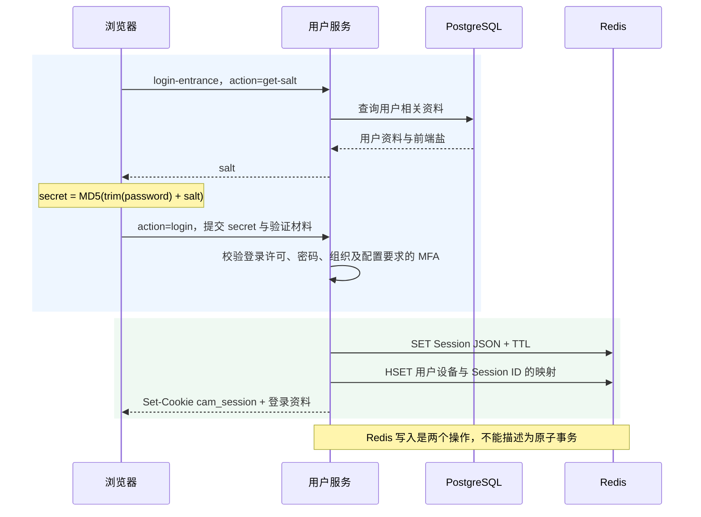
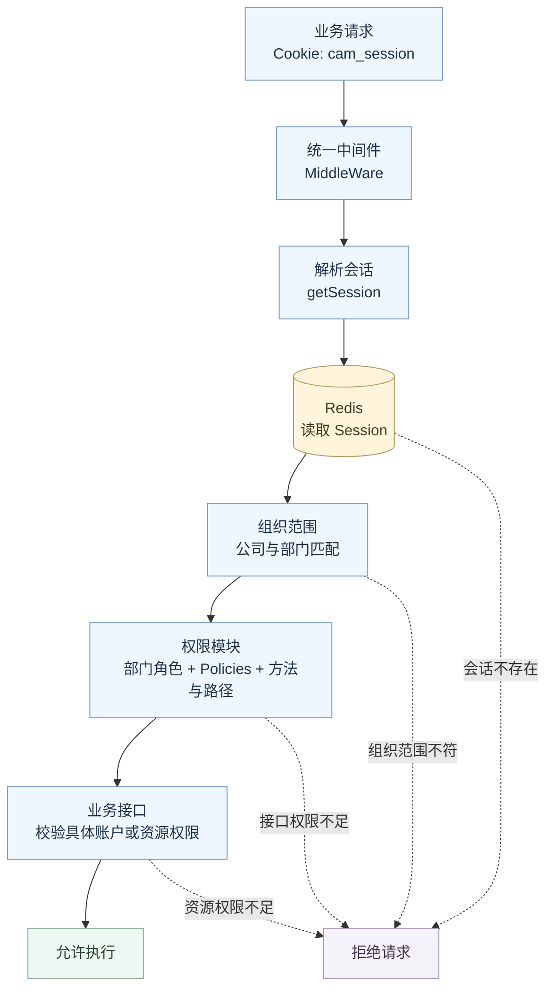
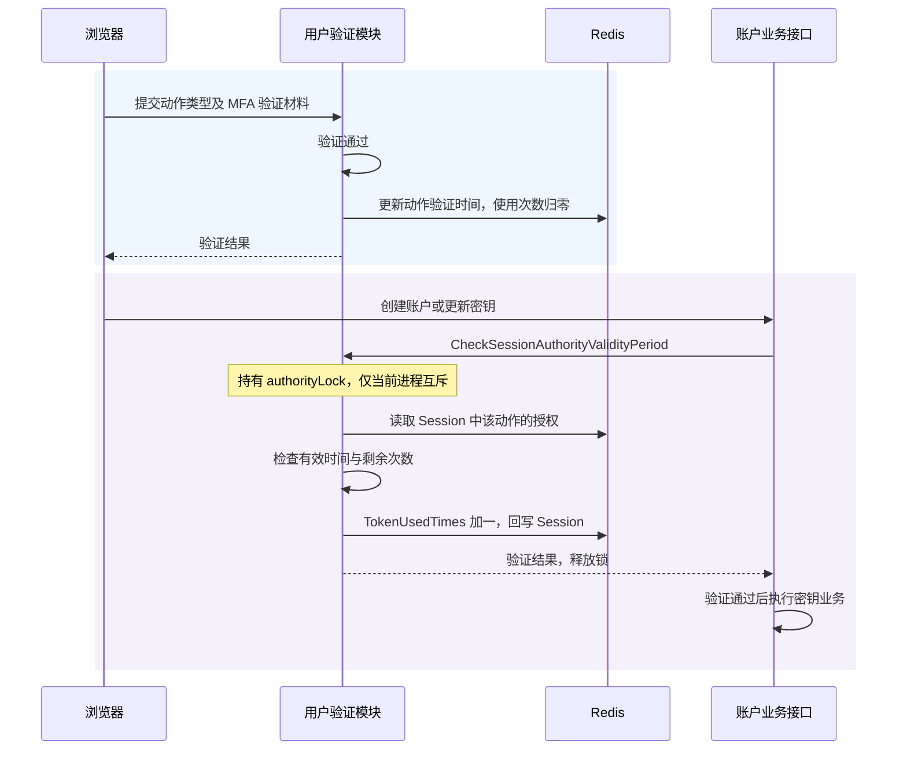

# CAM 登录实现：Session、组织权限与敏感操作验证

CAM 网页端采用 **Cookie 携带 Session ID、Redis 保存会话、后端按组织和接口检查权限**的方案。交易所账户模块 `tradeacc` 使用这套用户身份和权限上下文；交易所 API Key 的加密、存储和签名由另一条链路完成，见 [API Key 维护](/post/cam-apikey-maintenance-0x01)。

本文以 2026-11-15 核对的本地 CAM 源码为依据，主要讨论普通网页登录。代码还支持 OAuth、API Token、API 签名和 ToC 会话，不把这些分支与网页 Cookie 会话混为一谈。文中的“当前实现”来自静态代码；“改进建议”不代表已经上线，也不据此认定个人贡献或性能收益。

## 一、面试时先讲清楚解决了什么问题

这套系统需要同时回答三个问题：**请求来自谁、这个用户能操作哪个组织的数据、当前操作是否需要再次证明身份。**

例如，用户登录后切换部门查看交易所账户，后端不能只看“已经登录”；还需要确认部门属于当前公司、用户在该部门有什么角色，以及是否有权修改目标账户。修改 API Key 又属于敏感操作，可以按配置要求 Google Authenticator 或 YubiKey 验证。

可以先用下面这段话介绍系统：

> CAM 网页登录使用服务端 Session。密码和配置要求的二次验证通过后，后端生成 Session ID，把用户、公司、策略和有效期存到 Redis，再通过 HttpOnly Cookie 返回会话标识。后续请求由统一中间件读取 Session，检查公司、部门、角色和接口权限。涉及账户密钥变更时，还会检查该会话的敏感操作授权是否在有效时间和次数内。这样可以集中管理会话失效和权限边界，但也需要处理 Redis 故障、会话并发更新以及多实例下的授权计数一致性。

这段话描述系统行为。面试中若使用“负责”“设计”“重构”等个人表述，需要另有实际提交或任务记录支撑。

## 二、职责划分与一次完整登录

| 模块 | 职责 | 关键入口 |
| --- | --- | --- |
| 前端登录页 | 获取前端盐、处理密码输入、提交验证材料 | `front/src/views/login/index.vue` |
| 登录前接口 | 分发获取盐、校验、登录等动作，记录登录结果 | `back/userprelogin` |
| 用户服务 | 密码校验、二次认证、设备记录、创建和删除会话 | `back/user/user_helper` |
| 鉴权与权限模块 | 解析身份、检查组织范围和接口权限 | `back/user/auth`、`back/permission` |
| Redis | 保存 Session、用户设备到会话的索引等运行状态 | `SetSession`、`GetUserSessionById` |
| PostgreSQL | 保存用户、组织、设备和登录记录等持久数据 | `back/user/db` |

图 1 展示普通账号密码登录的成功主线。为了突出职责，配置读取、错误记录和初次登录绑定流程没有逐项画出。



### 2.1 登录入口与密码校验

前端请求 `/api/v1/user-pre-login/login-entrance`，后端根据 `action` 分发 `get-salt`、`check-secret`、`login` 等动作，入口同时接入人机验证包装和进程内限流。这里不能将限流器描述成覆盖所有服务实例的全局限流器。

普通密码路径可以概括为：

```text
前端提交：secret = MD5(trim(password) + saltFront)
后端比较：MD5(secret + saltBackend) == passwordHash
```

前端调用位于登录页的 `login()`；后端比较位于 `LoginCheckSecret()`。请求字段 `secret` 是登录密码的处理结果，与交易所的 `api_secret` 是两个不同概念。

**这是已有的加盐 MD5 实现，不应在面试里包装成推荐的现代密码存储方案。** 盐有助于区分相同密码的存储结果，但 MD5 计算成本低；前端这个固定摘要也不是一次性的挑战响应，不能靠“没有上传原始密码”推导出防重放能力。传输仍依赖 HTTPS，后端密码存储的改进方向是带版本标记的 Argon2id、bcrypt 等专用密码哈希方案。

### 2.2 密码通过后还有哪些检查

`userprelogin.Login()` 先处理用户名或邮箱映射、是否允许密码登录以及登录许可，再调用 `user_helper.Login()`。后者继续检查：

- 用户是否仅允许 API 访问。
- 密码是否正确；失败时按公司配置累计错误次数，达到阈值后禁止登录。
- 公司是否归档，用户是否存在可用部门。
- 当前登录动作是否要求 Google Authenticator 或 YubiKey。
- 设备资料更新、单会话策略和用户策略加载。

MFA 是 Multi-Factor Authentication，即多因素认证。代码存在特定开发权限分支，因此准确说法是“按用户和环境策略执行验证”，不能说所有入口无条件执行相同的 MFA。

登录成功与失败还会记录来源、设备、IP、状态和原因。日志和审计记录应关注身份与操作结果，不能包含密码、登录摘要或完整 Session ID 等凭证。

### 2.3 Session 的创建与返回

`SetSession()` 用 `RandSeq(64)` 生成 64 个字符的会话标识，构造 `SessionInfo`，其中包括用户、公司、策略、设备、过期时间和敏感操作授权记录。

随后执行两个 Redis 写入：

1. `SET`：保存 Session JSON，并设置 TTL。
2. `HSET`：建立用户下 `deviceId → sessionId` 的映射，供设备维度和用户维度的退出操作使用。

`SetSessionCookie()` 将 Session ID 写入 `cam_session` Cookie。代码设置 `HttpOnly=true`、路径 `/`，并在非 stage 环境设置 `Secure=true`；Cookie 有效期取自 Session 剩余时间。

浏览器持有的是会话标识，后端持有会话内容。页面 JavaScript 不能通过常规 Cookie API 读取 HttpOnly Cookie，但浏览器发送请求时仍会自动携带它。

## 三、后续请求如何完成身份和权限检查

图 2 展示需要登录的普通业务请求。身份、组织范围、接口权限和具体资源权限是不同层次，任一层失败都应阻止后续操作。



### 3.1 身份认证：这个请求是谁发起的

统一中间件先判断不需要登录的权限规则；其他请求进入 `VerifyLoginAuth()`。普通网页分支从 Cookie 提取 `cam_session`，调用 `GetUserSessionById()` 读取 Redis。Redis 返回不存在时，会话被认定为过期；Redis 自身异常则作为读取错误处理。

这里使用服务端会话校验，没有通过解析一个自包含 JWT 来获得网页用户身份。多个业务实例只要连接同一套 Redis 会话存储，就可以识别同一个浏览器会话。

代码也支持 `Api-Signature`、`Api-Token`、OAuth Device Flow Bearer Token；ToC 分支使用另一套 Cookie 和 Vault 会话。面试讲述时先限定入口，再解释对应机制。

### 3.2 组织与接口授权：这个身份能做什么

普通业务请求通常携带 `department`。后端检查部门格式及其公司前缀是否与 Session 中的公司一致，然后根据用户和部门取得角色。

`permission.UserReqIsPass()` 结合用户名、角色、Policies、HTTP 方法和 URL 路径判断是否放行。普通用户的部门角色会在请求链路中重新取得，Policies 则来自会话等相关路径，不能笼统说所有权限字段每次都从数据库重新加载。

业务接口还需要检查目标资源。例如 `tradeaccbiz.PostDeleteAccount()` 先检查部门，再检查账户操作权限。统一中间件允许访问一个接口，不等于允许操作任意账户 ID。

### 3.3 设备记录的边界

`checkDevice()` 主要更新设备和访问资料，部分异常只记录日志。请求鉴权文件中的 `verifySessionDevice` 校验逻辑处于注释状态。

因此，可以描述“记录设备、建立设备与会话索引”，不能描述成“每次请求都通过设备指纹强绑定 Session”。设备 Cookie 也不应被当作不可伪造的硬件身份。

## 四、会话的有效期、续期和退出

| 动作 | 当前行为 | 面试中需要说明的边界 |
| --- | --- | --- |
| 创建 | Session 写入 Redis，并附带 TTL | 不是只依赖浏览器 Cookie 到期 |
| 初始有效期 | 读取公司配置，解析失败时回退为 7 天 | `session_expire_days` 虽然包含 days，函数实际按小时乘以 3600 |
| 续期 | 显式刷新接口在剩余不足 30 分钟时延长至“当前时间 + 30 分钟” | 没有看到每次业务请求都自动重置为初始有效期 |
| 单会话策略 | 开启 `UserSSO` 时，新登录会尝试删除该用户已有会话 | 此处指新登录踢旧会话，不等同于 OAuth 联邦登录 |
| 普通退出 | `Logout()` 正常分支删除 Redis Session，并清理 Cookie | 缺少设备 Cookie 的分支只清理浏览器 Cookie |
| 批量退出 | 通过用户设备索引枚举 Session 并删除 | 删除和索引维护存在多次 Redis 操作 |

正常情况下，Redis Session 被删除后，即使客户端仍保留原 Cookie，后续普通鉴权也无法读取有效会话。Cookie 负责携带身份索引，Redis 负责决定身份索引是否仍有效。

需要区分“设计意图”和“异常语义”：`SetSession()` 的 Redis 写入错误仅记录日志；`UpdateSession()` 也会记录写入失败后返回 `nil`。`Logout()` 忽略删除错误并返回成功。因此，现有实现不能保证每次返回登录、续期或退出成功时，所有 Redis 状态都已正确更新。

改进时应优先让关键写入和撤销错误可见，再设计重试、补偿或原子更新。单纯缩短 TTL 不能替代可靠的退出语义。

## 五、敏感操作为什么还需要二次认证

登录证明用户取得了会话，接口权限证明用户被允许执行某类操作。修改交易所 API Key 时，还可以要求用户近期完成一次额外验证。

`VerifySessionAuthority()` 验证材料通过后，会在 Session 的 `AuthActionVerifyInfo[action]` 中记录验证时间、已使用次数和临时授权次数。业务入口调用 `CheckSessionAuthorityValidityPeriod()` 判断这份授权能否使用。

图 3 展示普通网页登录下、需要二次认证的敏感操作。图中的锁来自 Go `sync.Mutex`，不是 Redis 分布式锁。



主要规则包括：

- 一般授权的时间窗口为 10 分钟，stage 初始化分支设为 3 分钟。
- 临时授权使用 30 秒窗口，并单独检查允许使用次数。
- 普通次数限制来自 `authorization-action-times` 配置；配置获取失败时设置回退值 3。
- 未配置 GA/YubiKey 的动作可以直接通过，不是所有敏感操作必然弹窗。
- API 签名和 API Token 会话在这个函数中存在跳过分支，不能直接套用网页二次认证结论。

这相当于把“是否登录”“是否有权”“近期是否再次验证”拆成三道检查。二次认证只增加操作条件，不会改变上传 API Key 所用的公钥，也不会用登录密码派生交易所密钥。

## 六、设计取舍与需要诚实说明的不足

### 6.1 Session 与 JWT 的取舍

CAM 当前使用共享 Redis 保存网页会话，优点是可以集中查询、续期和撤销，且业务实例不必绑定某个浏览器。代价是请求链路依赖 Redis，权限字段也可能涉及缓存和更新延迟。

JWT 的自包含校验可以减少集中查询，但主动撤销、权限变更立即生效仍需要额外机制。不能仅凭“无状态”判断 JWT 一定更合适；应先看系统是否强调即时退出、组织切换和敏感操作授权。

### 6.2 多实例下的计数与会话更新

`authorityLock` 只串行化同一个进程中的敏感授权检查。两个实例仍可能同时读取相同的 `TokenUsedTimes`，各自加一后覆盖写回；Session 整体 JSON 的并发修改也可能互相覆盖。

这是静态分析得到的并发窗口，未做生产复现。改进方向是把“校验时间和次数、扣减次数”放入 Redis Lua 原子执行，或通过版本号实现 CAS；不应声称已有全局原子扣减。

同理，开启单会话策略时，“删除旧会话”和“创建新会话”是多个步骤。并发登录是否严格只保留一个会话，需要原子化或专门的并发验证。

### 6.3 密码与会话凭证

`RandSeq()` 当前使用 `math/rand/v2` 生成字符。64 个字符描述的是长度，不能据此声称使用了安全凭证专用随机源。改进时应显式使用 `crypto/rand`，并处理随机源失败。

密码存储可采用版本化迁移：识别旧哈希，通过原校验后，在能安全取得并验证密码的协议下更新为新哈希。因为当前前端提交的是旧摘要，不能只替换后端 MD5 函数就宣称完成原始密码的 bcrypt/Argon2id 迁移。

HttpOnly 限制脚本直接读取 Cookie；Secure 限制 Cookie 在安全传输中发送。二者都不能单独证明系统已经防住 CSRF 或所有 XSS。已读的 Cookie 设置函数没有显式设置 SameSite；实际策略还需结合浏览器行为、网关与其他中间件核对。

## 七、面试追问与建议回答

### 为什么 Redis 里已经有权限，还要按部门检查

用户身份相对稳定，组织上下文却可能随请求变化。同一个用户在不同部门可能有不同角色。后端需要校验请求部门属于 Session 中的公司，再取得部门角色，而不是直接相信前端传入的公司或角色。

### Redis 宕机时还能登录或访问吗

普通会话读取依赖 Redis，读取异常不会直接放行业务请求。登录写入、续期和退出的错误处理则没有同样严格，存在只记录日志的路径。回答时应把读失败和写失败分开，并说明优先改进错误传播与撤销确认。

### 用户退出后为什么不能只删除 Cookie

浏览器删除 Cookie 只影响该浏览器后续主动携带凭证。如果同一个 Session ID 已被复制，服务端记录仍在就可能继续被使用。因此正常退出还应撤销服务端 Session。当前缺少 `devid` 的退出分支只清 Cookie，是需要补强的具体边界。

### 用了 Mutex，二次验证次数为什么还可能超用

Mutex 只保护本进程，多实例共享的状态在 Redis。跨实例的“读、检查、加一、写回”仍不是一个原子操作。需要把原子边界放到共享状态所在的位置，并明确验证失败和扣次数的业务语义。

### 登录和交易所 API Key 加密有什么关系

登录控制谁可以进入上传接口，角色与二次认证控制谁可以改哪个账户。凭证内容则由 Auth 公钥加密、在 Auth 服务内解密使用；两条机制互相配合，但没有用 Session ID 或登录密码加密交易所 Secret。

### 这个模块的亮点应该怎么讲

优先讲清楚身份、组织权限、资源权限和敏感动作验证的分层，以及共享会话如何支持多实例和主动撤销。再说明异步失效、原子计数和故障处理的取舍。没有实测结果时，不写吞吐提升比例、零越权或零故障等结论。

## 八、补强验证与源码索引

下面是建议补充的验证，不表示这些实验已经执行：

| 场景 | 应观察的结果 |
| --- | --- |
| Redis Session 已过期，Cookie 尚存 | 受保护接口拒绝请求 |
| Session 公司与请求部门不一致 | 在业务操作前拒绝 |
| 相同 Session 并发执行敏感动作 | 验证授权次数是否跨实例超用 |
| Session 写入或续期时 Redis 故障 | 检查接口返回与实际存储是否一致 |
| 缺少设备 Cookie 时退出 | 检查原 Session 是否仍可被复用 |
| 两个实例同时登录同一用户 | 验证单会话策略的并发边界 |

源码路径均相对于 CAM 仓库根目录；函数名是主要定位依据，行号仅对应本次核对。

| 主题 | 源码位置 |
| --- | --- |
| 前端密码处理 | `front/src/views/login/index.vue:771–791`，`login` |
| 登录动作分发 | `back/userprelogin/startup.go:25–82`，`SetupGinEngine`、`LoginEntrance` |
| 登录入口与 Cookie 返回 | `back/userprelogin/restapi.go:139–197`，`Login` |
| 密码比较与登录校验 | `back/user/user_helper/user.go:681–690,878–967` |
| 密码错误次数限制 | `back/user/user_helper/user.go:994–1044` |
| 设备、会话创建与有效期 | `back/user/user_helper/user.go:1271–1374` |
| 随机标识生成 | `back/user/user_helper/user_util.go:19–24`，`RandSeq` |
| Cookie 属性 | `back/user/startup/restapi.go:46–51,73–74` |
| 统一中间件 | `back/startup/startup.go:463–491`，`MiddleWare` |
| 会话读取、组织与权限 | `back/user/auth/user_auth.go:44–61,256–323,361–462` |
| 敏感操作授权 | `back/user/auth/user_auth.go:524–558,593–675` |
| Session 更新、撤销与续期 | `back/user/user_helper/user.go:1377–1458,4020–4033` |
| 刷新接口与退出 | `back/userpublic/startup.go:40–54`；`back/usercenter/restapi.go:42–72` |
| 账户资源检查示例 | `back/tradeaccbiz/gin_impl.go:58–73`，`PostDeleteAccount` |
