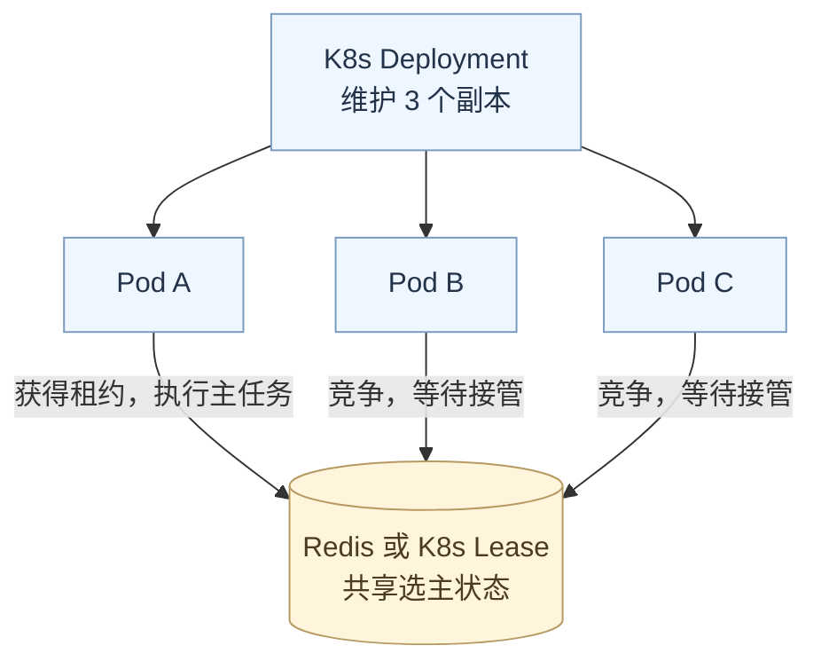

# K8s 和主实例

**用了 K8s，普通业务服务仍然需要明确决定哪些任务只由主实例执行。** K8s 可以维护副本数量，也提供 Lease 资源供程序选主；普通 Deployment 不会自动理解定时扫描、任务调度等业务职责。

## 先认识三个概念

- **Pod**：K8s 运行容器的基本单位。可以先把一个运行 Go 服务的 Pod 理解成一个服务实例。
- **Deployment**：描述希望运行几个 Pod，负责部署更新和维持目标副本数量。容器退出可由 kubelet 重启，Pod 丢失后控制器会尝试补建。
- **Lease**：记录持有者、续租时间和租期，供多个实例协调主身份。程序通过 Kubernetes API 竞争和续租。

## 单副本与多副本

如果把 Deployment 的 `replicas` 配成 `1`，目标就是运行一个副本，通常不需要在多个正常副本间选主。代价是这个副本不可用时，任务要等它恢复。

但 `replicas: 1` 不保证任何时刻绝对只有一个执行者。默认滚动更新可能先创建新 Pod，再终止旧 Pod；旧实例也可能仍在处理任务。对严格排他的工作，仍要考虑任务取消、幂等或选主协调。

如果一个服务部署三个副本，三个实例都可正常提供服务，而后台扫描只由其中一个执行，就需要业务选主。使用 Redis 时，可以通过 `SET NX + TTL + Lua` 竞争租约，再根据主身份决定是否执行任务。

## K8s 能替代哪部分

| 方案 | 谁管理实例 | 谁协调主身份 | 程序需要做什么 |
| --- | --- | --- | --- |
| 单副本 Deployment | K8s | 通常没有多副本竞争 | 正确处理任务执行与停机 |
| 多副本 + Redis 选主 | K8s | Redis 租约 | 抢占、续租、失主后停止任务 |
| 多副本 + K8s Lease 选主 | K8s | Kubernetes API / Lease | 接入选主库、配置访问权限、启动与停止主任务 |

Go 服务可以使用 `client-go/tools/leaderelection` 和 `LeaseLock`，在获得主身份时启动任务，失去主身份时停止任务。它可以替换 Redis 这个协调后端，但程序仍要接入选主流程，并正确处理回调和取消。K8s 控制面的 scheduler、controller-manager 也使用选主，它们的主身份属于控制面自身，不会自动分配给业务服务。

对于已有 Redis、且可能在 K8s 之外运行的服务，Redis 方案比较方便；如果组件只运行在 K8s 中，又希望复用集群 API，可以考虑 Lease。两种方案都不能单独保证任务恰好执行一次，关键操作仍需幂等或下游 fencing 校验。

## 参考

- [Kubernetes：Deployment 与滚动更新](https://kubernetes.io/docs/concepts/workloads/controllers/deployment/)
- [Kubernetes：Lease 与业务工作负载选主](https://kubernetes.io/docs/concepts/architecture/leases/)
- [client-go：leaderelection](https://pkg.go.dev/k8s.io/client-go/tools/leaderelection)
- [StreamletInfra：Redis 选主组件](https://github.com/Marvel-L/StreamletInfra)
