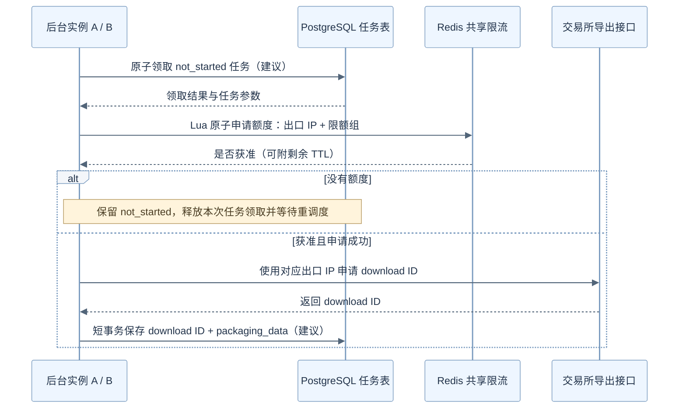

# 多实例单 IP 限流

**当交易所按照出口 IP 限制请求频率时，共用同一个出口 IP 的多个服务实例，需要共享同一份限流额度。**

在历史数据抓取系统中，可以先用 `not_started` 保存待启动任务，再由后台按额度申请交易所导出任务。Redis 负责跨实例协调申请频率，任务状态负责记录哪些任务仍在等待。

本文结合 CAM 异步抓取代码说明这一演进。当前代码已经包含 `not_started` 流程，但申请入口仍使用进程内限流；下文的 Redis 共享限流和配套调度处理是建议方案。

## 从手动发起到批量抓取

最初，系统支持客户或产品手动发起单账户抓取。入口 `CatchExgHistoryDataBegin` 先调用 `GetDownloadId`，向交易所申请 download ID；申请成功后，通过 `StoreDownloadId` 保存任务，进入 `packaging_data`。

```text
手动发起 → 申请 download ID → packaging_data → 后续轮询、下载和导入
```

当需要同时抓取多个账户时，直接申请容易碰到频率限制，调用方也需要自行安排等待与重试。为支持批量抓取，在 `packaging_data` 之前增加了 `not_started`：

```text
创建任务 → not_started → 后台申请 download ID → packaging_data → 原有处理流程
```

当前代码中，`CreateNotStartedTask` 将参数和 `not_started` 状态写入 PostgreSQL 任务表；`WatchAsyncNotStartedTask` 查询待启动任务，调用申请入口；成功后，`storeDownloadId` 保存 download ID 并更新状态。

这里拆开了两个时刻：创建任务表示系统已经接收抓取需求，进入 `packaging_data` 表示已经取得交易所导出任务的 download ID。

## 进程内限流为什么不够

`back/historytradev2/asyn/publisher/asyn_rest.go` 中的限流定义为：

```go
limiter = rate.NewLimiter(rate.Every(time.Minute), 1)
```

`GetDownloadId` 在入口处执行：

```go
if !limiter.Allow() {
    return "", DownloadIdOtherResp{},
        errors.Errorf("exceeded the rate limit for the retrieve. Only one call per minute is allowed.")
}
```

这是一个容量为 1、每分钟补充一个令牌的令牌桶。初始化时可以立即放行一次，额度不足时，`Allow()` 立即拒绝，不等待、不排队。

这个包级变量只在当前进程内共享。若实例 A、B 使用同一个出口 IP，它们仍各有一个令牌桶，可能同时放行请求。后台每处理一个任务后等待两分钟，也只控制当前实例的执行节奏，无法协调其他实例。

另外，当前限流发生在账户处理、月额度检查和交易所请求之前。后续检查或请求失败，也不会自动退回已经消耗的令牌。

## 用 Redis 共享申请额度

所有共用出口 IP 的实例应访问同一个 Redis，并根据实际限额范围生成相同的 Key，例如：

```text
htv2:async:limit:<exchange>:<quota_group>:<egress_ip>
```

其中，`egress_ip` 是交易所实际看到的出口 IP，可能来自 NAT 或代理；不能直接用 Pod IP 代替。`quota_group` 表示共享限额的一组接口，具体如何分组，需要依据交易所规则确定。

如果交易所限制的是 IP 级额度，而 Key 按账号或实例 ID 划分，就会再次产生多份额度，失去共享限流的作用。

### 固定每 60 秒放行一次

对于当前每次获准至少间隔 60 秒的需求，可以使用：

```redis
SET htv2:async:limit:<exchange>:<quota_group>:<egress_ip> 1 NX EX 60
```

- `NX`：只有 Key 不存在时才设置成功。
- `EX 60`：设置 60 秒过期时间。
- 设置成功：当前实例获得一次申请机会。
- 设置失败：额度正在被占用，当前任务继续等待。

这条命令本身就是原子操作，不需要先 `GET` 再 `SET`。必须包含 `NX`，单独使用 `SET EX` 会覆盖已有值，无法阻止多个实例同时获准。

这个 Key 表示申请频率额度。获准请求完成后，不应立即删除 Key，否则下一次申请就可能在 60 秒内再次获准。它也不保证同一时间只有一个导出任务处于运行状态。

### 每个窗口允许 N 次

如果需求变成一个窗口内允许 N 次，可以用 Lua 原子完成额度初始化、查询、判断和扣减：

```lua
-- KEYS[1]：共享限流 Key
-- ARGV[1]：窗口额度 N，调用方保证为正整数
-- ARGV[2]：窗口秒数，调用方保证为正整数
-- 返回 1 表示获准，返回 0 表示没有额度

local remaining = redis.call('GET', KEYS[1])

if not remaining then
    -- 当前请求已经占用一次额度，所以剩余 N - 1
    redis.call('SET', KEYS[1], tonumber(ARGV[1]) - 1,
               'EX', ARGV[2])
    return 1
end

if tonumber(remaining) <= 0 then
    return 0
end

redis.call('DECR', KEYS[1])
return 1
```

如果把查询和扣减拆成多条客户端命令，两个实例可能同时读到剩余额度为 1，随后都认为自己能够发起申请。Lua 执行期间不会插入其他客户端命令，能保证读取、判断和扣减作为一个整体执行。

这个示例的窗口从首次申请开始，后续扣减不刷新 TTL。额度耗尽后，Key 仍保留到窗口结束，过期后重新初始化。

N 为 1 时，它实现与 `SET NX EX` 类似的放行间隔；N 大于 1 时，允许窗口内突发，也可能在过期前后连续放行两批请求。因此，它不等价于“任意连续 60 秒内最多 N 次”，更严格的要求需要滑动窗口或分布式令牌桶。

## `if not remaining` 是什么意思

```lua
local remaining = redis.call('GET', KEYS[1])

if not remaining then
    -- 初始化额度
end
```

`not` 是 Lua 的逻辑取反运算符。只有 `nil` 和 `false` 被视为假，数字 `0`、字符串 `"0"`、空字符串都被视为真。

在 Redis Lua 中，`GET` 在 Key 不存在或已过期时返回 `false`；Key 存在时返回字符串。

| `remaining` 的值 | `not remaining` | 后续处理 |
| --- | --- | --- |
| `false` | `true` | 没有额度记录，初始化为 N - 1 并设置 TTL |
| `"5"` | `false` | 记录存在，判断后扣减一次 |
| `"0"` | `false` | 记录存在，转成数字后判断额度耗尽 |

所以，`if not remaining` 判断的是有没有读到额度记录。判断额度耗尽的是下一段：

```lua
if tonumber(remaining) <= 0 then
    return 0
end
```

## 接入任务流程时的配套处理

**没有额度属于暂时等待，不能直接把任务标记为失败。**

当前 `processAsyncTask` 在延迟执行的错误处理中，将错误统一写成 `packaging_failed`。替换成 Redis 限流后，需要识别限流结果：没有额度时保留 `not_started`，结束本次尝试，等待重调度；实际申请失败再根据错误性质处理。

Lua 示例只返回是否获准。为了安排下一次尝试，可以扩展脚本返回剩余 `PTTL`，据此设置重试时间，避免在额度恢复前反复竞争。

多实例调度还需要任务领取机制。当前 `GetPendingAsyncTask` 是普通查询，多个实例可能拿到相同任务列表。可以配合任务租约锁或数据库原子认领，并在领取后重新确认任务状态。即使申请频率受控，也不能保证同一任务不会被重复提交。

建议的调度关系如下。图中的原子认领和短事务保存属于配套改进；当前 `storeDownloadId` 对状态与 download ID 的更新仍是分开的调用。



手动入口和后台入口应经过同一套 Redis 限流逻辑，确保两种发起方式共同消耗 IP 额度。当前 Redis 月额度检查仍承担账户当月使用次数限制，它与分钟级 IP 限流的范围不同，需要分别保留。

## 源码定位

以下路径以 CAM 工程根目录为基准：

| 文件 | 相关内容 |
| --- | --- |
| `back/historytradev2/asyn/publisher/asyn_rest.go` | `CatchExgHistoryDataBegin`、`GetDownloadId`、进程内令牌桶、账户月额度检查 |
| `back/historytradev2/asyn/service/service.go` | `CreateAsyncTask` 拆分并创建异步任务 |
| `back/historytradev2/asyn/service/util.go` | `CreateNotStartedTask`、保存 download ID 和更新状态 |
| `back/historytradev2/asyn/service/task_watcher.go` | 待启动任务扫描、申请入口调用、`packaging_failed` 错误处理 |
| `back/historytradev2/select_service/async_task.go` | 查询 `not_started` 任务 |

关于后台任务由哪个实例调度，可以结合[《K8s 和主实例》](./k8s和主实例.md)阅读。选主负责协调调度职责，共享限流负责协调出口 IP 的申请额度，任务认领负责避免重复处理。
