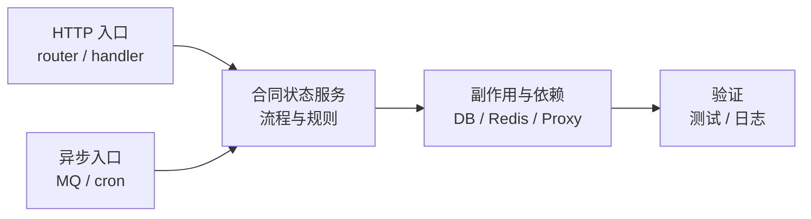

# 先定目标

刚接手一个大项目时，目标不是“看完项目”，而是尽快完成一次真实交付，并且能讲清楚一条完整业务链路。

对于 `volc_contract_process`，第一周的产出应该是一页自己的项目地图，并能回答：

```text
谁发起 -> 哪个入口接收 -> 业务状态如何变化
-> 写哪些表/缓存 -> 发什么消息 -> 下游如何处理
-> 失败怎么重试 -> 如何验证结果
```

不能从 `biz/service` 目录逐个看起。项目并不是简单的 `Rest -> Handler -> Service -> DB`，还存在 HTTP、RocketMQ、延迟消息、定时任务、事件总线、Redis、外部服务代理等链路。

# 推荐阅读主线

先以“合同状态变化”为主线阅读。它会经过 HTTP、MQ、延迟任务和事件总线，是理解项目复杂度最快的路径。



阅读原则：先吃透中间的“合同状态服务”，再向两边展开入口、依赖和验证。

# 第一周计划

## 第 1 天：只读启动与入口

先看：

- `main.go` 中的 `Init`、`InnerInit`、`OpenInit`；
- `router.go` 中的路由分组和中间件；
- 配置、DAL、Redis、MQ、定时任务分别在什么时候初始化。

此时不要进入具体业务逻辑，只记录：

| 模块 | 职责 | 入口 | 关键依赖 |
| --- | --- | --- | --- |
| HTTP | 接收内外部请求 | `router.go` | 鉴权、中间件、handler |
| MQ | 接收异步事件 | `mqconsumer` | RocketMQ、handler |
| 定时任务 | 时间触发的业务处理 | `cronjob` | service、eventbus |
| 业务服务 | 合同状态与业务规则 | `biz/service` | DAL、Proxy、缓存 |

## 第 2 天：从一个事件反向追踪

从 `biz/service/mqconsumer/init.go` 选一个消费者，例如：

- OA 状态变化；
- 飞书流程变化；
- 合同事件；
- 延迟消息。

顺着下面的方向继续：

```text
RegisterHandler
  -> handler_*.go
  -> service
  -> DAL / Proxy / EventBus
  -> *_test.go
```

这里必须重点关注 handler 最终返回 `nil` 还是 `error`：

- `nil`：当前消息被视为消费成功；
- `error`：当前消息可能进入 RocketMQ 的重试流程。

部分消费者已经设置了 `MaxReconsumeTime = 3`。因此，读 MQ 代码时不能只看“业务是否能跑通”，还要回答：重复消息怎么处理、失败会重试几次、重试后状态是否仍然正确。

## 第 3 天：整理状态机与副作用

找到这条链路涉及的 model、DAL 方法和状态字段，整理成状态表：

| 旧状态 | 新状态 | 触发条件 | 数据变更 | 副作用 |
| --- | --- | --- | --- | --- |
| 待补充 | 待补充 | 回调 / MQ / 人工操作 | 更新主表或明细表 | 通知、发消息、调用外部服务 |

重点阅读 `biz/service/eventbus/api.go`：

- `PublishEvent` 如何把领域事件包装为延迟消息；
- `ProcessEvent` 如何按 `EventType` 分发给处理器；
- 消息发送失败时当前代码如何记录和恢复。

## 第 4 天：以测试代替猜测

找到同一链路中的 `*_test.go`，优先读失败分支，而不是只看成功用例：

- 重复消息；
- 下游 RPC 或数据库失败；
- 消息发送失败；
- 状态不合法；
- 消费者启动失败；
- 重试后再次执行。

每发现一个没有测试的分支，就记录为候选任务；不要一上来重构整个 MQ 模块。

## 第 5 天：完成第一个小闭环

优先拿当前需求或最近线上问题所在链路中的小任务。第一个任务应该足够小，但必须闭环：

- 补一个遗漏分支的测试；
- 修一个明确的状态判断；
- 补关键日志或指标；
- 修复一次重复消费、异常重试或状态不同步问题。

交付时要能够说明：

```text
触发条件 -> 影响范围 -> 修复策略 -> 回归用例 -> 线上验证方式
```

# 每读一个函数，都问这 8 个问题

1. 输入来自 HTTP、MQ 还是 cron？
2. 需要什么鉴权和前置状态？
3. 修改了哪些数据？
4. 是否会重复执行，幂等键是什么？
5. 调用了哪些外部服务？
6. 失败后返回什么，是否会重试？
7. 有哪些日志、指标、告警可定位？
8. 测试覆盖成功、失败和重复场景了吗？

# 推荐文件顺序

1. `main.go`
2. `router.go`
3. `biz/service/mqconsumer/init.go`
4. `biz/service/eventbus/api.go`
5. `biz/service/mqconsumer/handler_oa_process_change.go`
6. `biz/service/mqconsumer/handler_feishu_process_change.go`
7. 对应的 `*_test.go`
8. 最后才进入 `salescontract`、`contractmeta`、DAL 和各类 Proxy。

# 结论

先向同事确认当前需求或最近线上问题对应的“合同状态变化链路”是哪一条，然后围绕这条链路建立地图。

读完一条链路并完成一次小交付，比泛读两周的 `service` 目录，更快获得对项目的掌控力。
