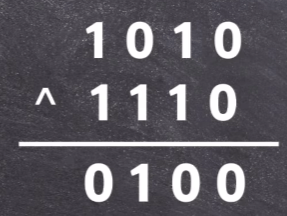
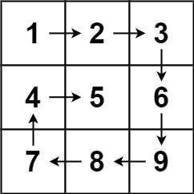

# 136. 只出现一次的数字

题目链接 : https://leetcode.cn/problems/single-number/description/?envType=study-plan-v2&envId=top-100-liked

题意 :
给你一个 非空 整数数组 nums ，除了某个元素只出现一次以外，其余每个元素均出现两次。找出那个只出现了一次的元素。

你必须设计并实现线性时间复杂度的算法来解决此问题，且该算法只使用常量额外空间。

Tag : `位运算`

## 难点

题目要求 ==线形时间复杂度==, ==常量额外空间==

1. 因此不能进行排序
2. 不能使用 Map

## 思路

1. 引入 ==异或== , 异或 对于 2 进制不同数字才会 变成 1 

2. 否则都是 0 

{.inline}

## Code

```go
func singleNumber(nums []int) int {
    ans := 0
    for _ , v := range nums {
        ans ^= v
    }
    return ans 
}
```

# 169. 多数元素

题目链接 :

题意 :

给定一个大小为 `n` 的数组 `nums` ，返回其中的多数元素。多数元素是指在数组中出现次数 大于 `⌊ n/2 ⌋` 的元素。

你可以假设数组是非空的，并且给定的数组总是存在多数元素。

Tag : `map`, `投票`

## 难点

1. 无，直接使用 `map`

## 思路

1. 直接使用 Map 进行统计，然后再对 map 进行一次遍历

## Code

```go
func majorityElement(nums []int) int {
    mp := make(map[int]int)
    for _ ,num := range nums {
        mp[num] ++ 
    }
    for k , v := range mp {
        if v > len(nums) / 2  {
            return k
        }
    }
    return -1
}
```

## 另外一种思路

`摩尔投票法` 对于超过半数投票的情况, 我们可以引入 `heap` 并且初始化 `1`

对于超过半数的投票，那么当前 `ans` 肯定会存活

## Code

```go
func majorityElement(nums []int) (ans int) {
    hp := 0
    for _, x := range nums {
        if hp == 0 { // x 是初始擂主，生命值为 1
            ans, hp = x, 1
        } else if x == ans { // 比武，同门加血，否则扣血
            hp++
        } else {
            hp--
        }
    }
    return
}

```

# 543. 二叉树的直径

给你一棵二叉树的根节点，返回该树的 直径 。

二叉树的 直径 是指树中任意两个节点之间最长路径的 长度 。这条路径可能经过也可能不经过根节点 root 。

两节点之间路径的 长度 由它们之间边数表示。

[详情可看](https://marvel-l.github.io/Blog/post/diameter-of-binary-tree-0x01/)

# 108. 将有序数组转换为二叉搜索树

给你一个整数数组 nums ，其中元素已经按 升序 排列，请你将其转换为一棵 平衡 二叉搜索树。


# 230. 二叉搜索树中第 K 小的元素

题目链接 : https://leetcode.cn/problems/kth-smallest-element-in-a-bst/description/?envType=study-plan-v2&envId=top-100-liked

给定一个二叉搜索树的根节点 `root` ，和一个整数 `k` ，请你设计一个算法查找其中第 `k` 小的元素（k 从 1 开始计数）。


# 二叉树的右视图

题目链接 : https://leetcode.cn/problems/binary-tree-right-side-view/description/?envType=study-plan-v2&envId=top-100-liked

给定一个二叉树的 根节点 root，想象自己站在它的右侧，按照从顶部到底部的顺序，返回从右侧所能看到的节点值。

# 56.合并区间

题目链接 : https://leetcode.cn/problems/merge-intervals/description/?envType=study-plan-v2&envId=top-100-liked

以数组 intervals 表示若干个区间的集合，其中单个区间为 intervals[i] = [starti, endi] 。请你合并所有重叠的区间，并返回 一个不重叠的区间数组，该数组需恰好覆盖输入中的所有区间 。

# 54. 螺旋矩阵

题目链接
https://leetcode.cn/problems/spiral-matrix/description/?envType=study-plan-v2&envId=top-100-liked

给你一个 m 行 n 列的矩阵 matrix ，请按照 顺时针螺旋顺序 ，返回矩阵中的所有元素。

 {.samll}

## 难点

1. 个人认为 ==st数组初始化有点复杂==
2. 以及如何保证能够走完

## 思路

1. 一开始以为要用 queue 进行，但是发现可以直接使用 `for` 进行

2. 每次走的时候 统计对应的步数

3. 其他的模拟即可

## Code 

```go
var (
    dx = []int{0,1,0,-1}
    dy = []int{1,0,-1,0}
)

func spiralOrder(matrix [][]int) []int {
    st := make([][]bool, len(matrix))
    for i := 0 ; i < len(matrix) ; i ++  {
        st[i] = make([]bool, len(matrix[i]))
    }

    n := len(matrix)
    m := len(matrix[0])
    alls := n * m 

    idx , dir, x , y := 0 , 0, 0, 0 
    res := make([]int,0)

    for idx < alls {
        idx ++ 
        st[x][y] = true 
        res = append(res, matrix[x][y])
        sx := dx[dir] + x
        sy := dy[dir] + y 
        if (sx >= n || sx < 0 ) || (sy >= m || sy < 0) || st[sx][sy] == true  {
            dir ++ 
            dir = dir % 4
        }
        x = dx[dir] + x
        y = dy[dir] + y 
    }
    return res 
}
```

# 48. 旋转图像

题目链接 : https://leetcode.cn/problems/rotate-image/description/?envType=study-plan-v2&envId=top-100-liked

数学归纳法 :

先进行对角线翻转，然后再做一次行反转

1. `(i,j)` -> `(j,i)` -> `(j,n-1-i)`


## Code 

```go
func rotate(matrix [][]int)  {
    n := len(matrix) 
    for i := range n {
        for j := range i {
            matrix[i][j] , matrix[j][i] = matrix[j][i], matrix[i][j]
        }
    }

    for i := range n {
        slices.Reverse(matrix[i])
    }
}
```

# 76. 最小覆盖子串

给定两个字符串 s 和 t，长度分别是 m 和 n，返回 s 中的 最短窗口 子串，使得该子串包含 t 中的每一个字符（包括重复字符）。如果没有这样的子串，返回空字符串 ""。

测试用例保证答案唯一。

题目连接 : https://leetcode.cn/problems/minimum-window-substring/description/?envType=study-plan-v2&envId=top-100-liked

