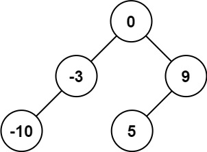

# 108. 将有序数组转换为二叉搜索树

题意 :

给你一个整数数组 nums ，其中元素已经按 升序 排列，请你将其转换为一棵 平衡 二叉搜索树。

输入：nums = `[-10,-3,0,5,9]`
输出：`[0,-3,9,-10,null,5]`
解释：`[0,-10,5,null,-3,null,9]` 也将被视为正确答案：

{.small}

## 难点

1. 平衡 和 搜索树的理解

   - 平衡 要求 ==每个节点的左右子树高度不能超过 1== 
   - 搜索 要求 ==左节点的值必须小于右节点== 

## 思路

1. 因为数组是 ==有序数组==, 我们知道 根肯定是 中间数值

2. 考虑当前节点的情况

    - 对于一个区间  `[a,b,c]` 那么肯定 `b` 是根节点 `a,c` 是左右节点
    - 因此考虑 ==递归 分治==, 递归到最底层进行这种状态处理 然后进行节点赋值

## Code

代码需要注意 ==左右区间== 的问题

```go
func dfs(nums []int) *TreeNode {
    if len(nums) == 0 {
        return nil 
    }
    mid := len(nums)/2
    return &TreeNode{
        Val: nums[mid],
        Left: dfs(nums[:mid]),
        Right: dfs(nums[mid+1:]),
    }
}
func sortedArrayToBST(nums []int) *TreeNode {
    return dfs(nums)
}
```