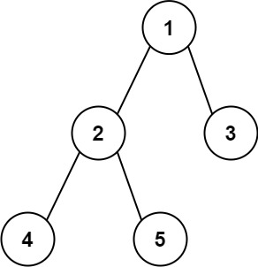

# 543. 二叉树的直径

题目链接 :

https://leetcode.cn/problems/diameter-of-binary-tree/description/?envType=study-plan-v2&envId=top-100-liked

题意 :

给你一棵二叉树的根节点，返回该树的 直径 。

二叉树的 直径 是指树中任意两个节点之间最长路径的 长度 。这条路径可能经过也可能不经过根节点 root 。

两节点之间路径的 长度 由它们之间边数表示。


{.small}

输入：root = `[1,2,3,4,5]`
输出：`3`
解释：`3` ，取路径 [4,2,1,3] 或 [5,2,1,3] 的长度。

## 难点

1. 需要找一个能够 ==记录答案的状态== 

2. 需要明确 点 和 边的状态记录

## 思路

1. ==2 个点才可以确认一条边==, 因此当我们递归到 底层的时候应该返回 `-1`

2. 通过外部变量 `ans` 记录每次节点的最大值

3. 递归返回每个节点最长的边 

4. 不过需要注意的是，==我们递归到当前节点 其实还需要考虑当前节点和左右节点的一条边== 即 `llen = llen + 1`


{.small}

## Code 

```go
var ans int 
func dfs(node *TreeNode) int {
    if node == nil {
        return -1
    }
    llen := dfs(node.Left) + 1
    rlen := dfs(node.Right) + 1
    ans = max(ans, llen + rlen)
    return max(llen , rlen) 
}
func diameterOfBinaryTree(root *TreeNode) int {
    ans = 0 
    dfs(root)
    return ans 
}
```