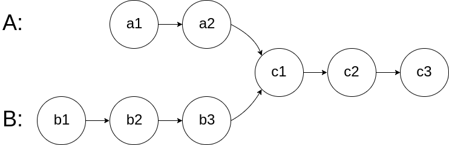
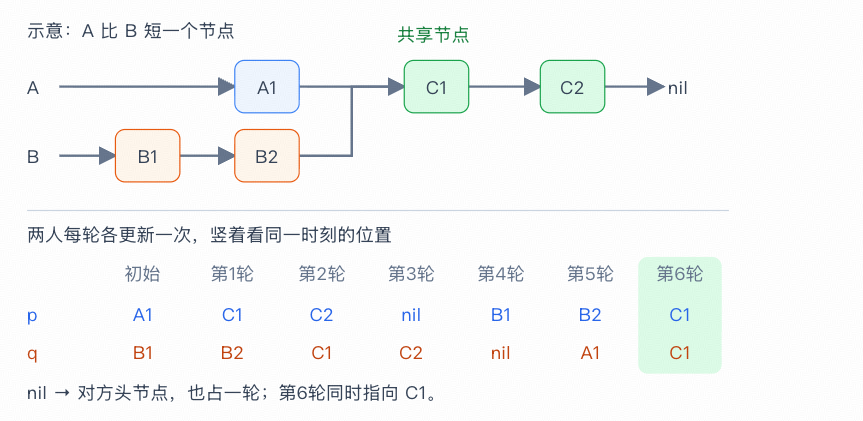

# 160. 相交链表

题目链接 : https://leetcode.cn/problems/intersection-of-two-linked-lists/description/?envType=study-plan-v2&envId=top-100-liked

给你两个单链表的头节点 headA 和 headB ，请你找出并返回两个单链表相交的起始节点。如果两个链表不存在相交节点，返回 null 。

图示两个链表在节点 c1 开始相交：




## 思路

一个常见的思路 就是==对齐长度之后，先跳跃指定长度==的距离 然后再进行移动判断

1. 不过需要注意的是 ，我们判断链表相等的时候，不能直接使用==value判断相等，我们可以直接判断节点是否相等==

## Code

```go
func getIntersectionNode(headA, headB *ListNode) *ListNode {
    dummy := headA 
    len1, len2 := 0, 0 
    for dummy != nil {
        dummy = dummy.Next
        len1 ++ 
    }
    dummy = headB
    for dummy != nil {
        dummy = dummy.Next
        len2 ++ 
    }
    if len1 > len2 {
        headA, headB = headB, headA 
        len1, len2 = len2, len1 
    }
    for range (len2 - len1) {
        headB = headB.Next
    }
    for headA != nil && headB != nil {
        if headA == headB {
            return headA
        }
        headA = headA.Next
        headB = headB.Next
    }
    return nil 
}
```

## 另外一种思路

如果两个链表存在 ==公共后缀==，那么他们遍历完成之后，==交换走一遍对方的路==

那么 ==A + B + commmonSuffix = B + A + commonsuffix== 

而相交的点 就是公共点



##  Code 

```go
func getIntersectionNode(headA, headB *ListNode) *ListNode {
    p, q := headA, headB
    for p != q {
        if p != nil {
            p = p.Next
        } else {
            p = headB
        }
        if q != nil {
            q = q.Next
        } else {
            q = headA
        }
    }
    return p
}
```