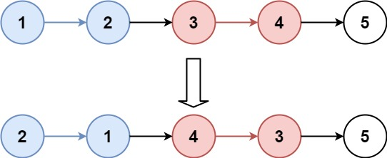

# 25. K个一组反转链表

题目链接 : https://leetcode.cn/problems/reverse-nodes-in-k-group/description/?envType=study-plan-v2&envId=top-100-liked

给你链表的头节点 `head` ，每 `k` 个节点一组进行翻转，请你返回修改后的链表。

`k` 是一个正整数，它的值小于或等于链表的长度。如果节点总数不是 `k` 的整数倍，那么请将最后剩余的节点保持原有顺序。

你不能只是单纯的改变节点内部的值，而是需要实际进行节点交换。

 {.small}

## 难点

1. K个一组 涉及到很多个指针的移动

## 思路

1. 我们知道 反转链表 ，反转完成的时候 会返回一个 ==pre和cur== 其中我们在移动完成的时候

    - pre 会指向 tail
    - cur 会指向 下一个的开头 

2. 我们需要保证 `res -> pre , 反转的头 -> cur`, 然后从 `cur`继续下一轮 `k` 反转

3. 因此我们就需要 ==记录一下反转的头== 即 `node`

这样子根据这个思路来进行即可

## Code

```go
/**
 * Definition for singly-linked list.
 * type ListNode struct {
 *     Val int
 *     Next *ListNode
 * }
 */

func preCheck(node *ListNode, k int ) int  {
    idx := 0
    for node != nil && idx < k{
        node = node.Next
        idx ++ 
    }
    return idx 
}

func reverse(node *ListNode, k int ) (*ListNode,*ListNode,*ListNode) {
    var pre, cur *ListNode = nil, node
    for idx := 0 ;  cur != nil  && idx < k ; idx ++  {
        nxt := cur.Next
        cur.Next = pre
        pre = cur  
        cur = nxt 
    }
    // 1->2->3
    //  nil<- 1 <- 2 , 3 
    return pre , cur , node 
}

func reverseKGroup(head *ListNode, k int) *ListNode {
    res := &ListNode{Next : head}
    dummy := res 
    //  head -> 2 -> 1
    // 还需要记录一个 1-> 也就是 tail
    // 2 其实就是 pre , cur指向了 下一个 ，1 的话是 first 也就是没反转的第一个
    for dummy.Next != nil {
        length := preCheck(dummy.Next,k)
        if length < k {
            break 
        }
        h, nxt, tail := reverse(dummy.Next,k) // 2  , 3 , 1  // 2->1 , 3
        tail.Next = nxt 
        dummy.Next = h 
        dummy = tail  
    }

    return res.Next
}
```
