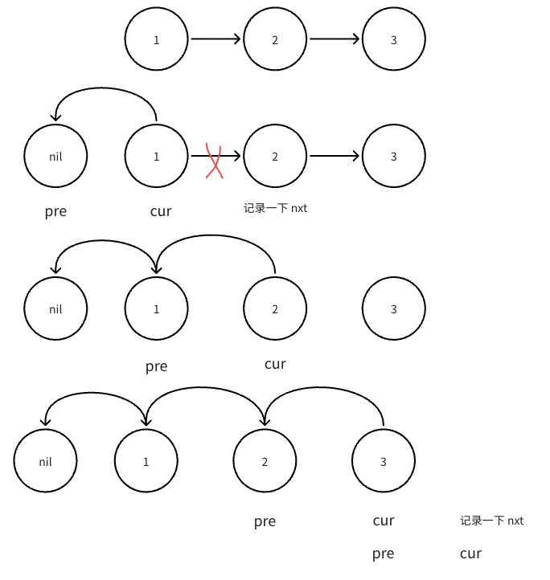

# 206. 反转链表

题目链接 : https://leetcode.cn/problems/reverse-linked-list/

给你单链表的头节点 head ，请你反转链表，并返回反转后的链表。

## 思路

1. 这个题 ==不需要 dummy!==, 如果引入了 dummy , 还需要考虑寻找尾节点

2. 我们直接使用 `pre` 进行处理，同时移动 `pre` 和 `cur` 把当前节点都链接到 `pre` 节点上

3. 最后直接返回 `pre` 头节点即可



## Code

```go
func reverse(head *ListNode) *ListNode {
   var pre, cur *ListNode = nil , head 

    for cur != nil {
        nxt := cur.Next
        cur.Next = pre 
        pre = cur 
        cur = nxt
    }

   return pre 
}
func reverseList(head *ListNode) *ListNode {
    return reverse(head)
}
```
